# ESXi 7.0 上安装 Alibaba Cloud Linux 4：云镜像导入 + 对齐 ECS 登录方式

> 基线：2026-11-23 至 11-24 实测。ESXi 7.0 Update 3（build 19482537）；镜像 `aliyun_4_x64_20G_nocloud_alibase_20261103.qcow2`（Alibaba Cloud Linux 4.0.7，内核 6.6.102，自带 cloud-init 23.2.2）；管理机 Ubuntu 26.04 + Docker 29.7。文中 `192.168.10.x` 是示例内网地址，照做时换成自己的。
>
> 这是一份照着实测过程整理的记录，包括中途踩到的坑和修复办法（第四节）。每一步的命令和输出都来自实际执行：终端截图是在真实终端里跑手册中的命令拍下来的，ESXi 截图取自操作时的界面。

## 一、开始之前

### 成品

| 项目 | 取值 | 说明 |
| --- | --- | --- |
| 虚拟机名 / 主机名 | `alinux4-infra-01` | 公司内部（开发 / 测试 / UAT）通用的基础组件机，不绑定具体组件 |
| IP | `192.168.10.50/24`，网关 `192.168.10.1` | 静态地址 |
| CPU | 8 vCPU（1 插槽 × 8 核） | |
| 内存 | 24 GB | 建机前先看主机空闲内存，见步骤 7 |
| 系统盘 | 60 GB，精简置备，接 NVMe 控制器节点 (0:0) | 由 20G 云镜像扩容而来，首次开机自动扩满；客户机里是 `/dev/nvme0n1` |
| 数据盘 | 400 GB，精简置备，接 NVMe 控制器节点 (0:1)，挂载到 `/data` | 客户机里是 `/dev/nvme0n2` |
| 固件 | EFI（安全引导关闭） | |
| 网卡 | VMXNET 3 | |
| 登录 | `ecs-user` + SSH 密钥，免密 `sudo` | 对齐阿里云 ECS 推荐方式，见步骤 4。root 的密码只在 ESXi 控制台可用，见《系统优化》第二节 |
| 随主机自动开机 | 已启用，启动顺序 11 | 新虚拟机默认不参与，要单独启用，见第五节 |
| 内存预留 | 19,664 MB，是配置内存的 80% | 宿主机超配且各虚拟机都没有预留，给这台留保障；界面里没有这项，要用脚本设，见第五节 |

### 为什么不是"挂 ISO 装系统"

[阿里云的 Alibaba Cloud Linux 镜像页](https://mirrors.aliyun.com/alinux/4/image/) 不提供 ISO 安装盘，只提供**云镜像**（qcow2 / vhd，20G 虚拟盘）和一个示例 `seed.img`。[官方文档](https://help.aliyun.com/zh/alinux/getting-started/use-alibaba-cloud-linux-3-images-in-an-on-premises-environment)写得很直接：

> Alibaba Cloud Linux 镜像本身不能直接启动虚拟机，需要配置引导镜像 seed.img，并配置网络、账号、YUM 源等信息。

所以"装系统"被拆成三件事：

```text
 ① 下载云镜像并校验 ─┐
                      ├─► ③ 在 ESXi 建虚拟机，挂上这两样 ─► ④ 开机
 ② 转成 VMDK ─────────┘         （硬件选型必须迁就镜像自带的驱动）      cloud-init 首次启动完成初始化
 ②' 制作 seed 配置盘 ─┘                                            （主机名、IP、账号、数据盘）
```

- **磁盘内容**来自镜像，不需要"安装"。
- **初始化**由 cloud-init 读取 seed 盘完成。
- **硬件选型**不能随手选：镜像的 initramfs 里只有部分存储驱动，选错控制器就开不了机。

### 四个会卡住的坑

这四点都是这次实测撞上的。网上"ESXi 装 Alibaba Cloud Linux 3"的文章基本都踩了前两个。

| 坑 | 现象 | 正确做法 |
| --- | --- | --- |
| 控制器选了 PVSCSI 或 LSI Logic | 开机卡在 `dracut-initqueue timeout`，找不到根分区 | 系统盘接 **NVMe** 或 **SATA** 控制器，依据见第七节 |
| 没挂 seed 盘 | 开机后没有任何可登录的账号：root 密码锁定、禁止密码登录、没有密钥 | 制作卷标为 `cidata` 的 ISO，挂成光驱 |
| 拿转换出来的磁盘直接开机 | 开机被拒：磁盘类型不受支持或无效，请确保磁盘已导入 | 先在 ESXi 上**导入**成原生磁盘，见步骤 18 |
| 默认路由写成了 `to: default` | 静态 IP 不生效，`cloud-init status` 报 `Address default is not a valid ip address` | 写成 `to: 0.0.0.0/0`，见第四节 |

### 选型速查

| 部件 | 选型 | 一句话依据 |
| --- | --- | --- |
| 客户机操作系统版本 | Red Hat Enterprise Linux 9 (64 位) | ESXi 的列表里没有 Alibaba Cloud Linux；AL4 属于 RHEL 9 兼容体系 |
| 磁盘控制器 | NVMe | 镜像 initramfs 里有 `nvme.ko`，没有 `vmw_pvscsi.ko`、`mptsas.ko`；SATA（`ahci.ko`）也可启动，两种都实测过 |
| 固件 | EFI，安全引导关闭 | 镜像带完整的 EFI 分区；云镜像的引导程序不一定被安全引导信任 |
| 网卡 | VMXNET 3 | 镜像带 `vmxnet3.ko`，开机后自动加载 |
| 数据盘置备 | 精简置备 | ESXi 默认是"厚置备，延迟置零"，400 GB 会立刻占满 |
| 光驱 | 数据存储 ISO 文件，并勾选"打开电源时连接" | 不勾的话首次开机读不到配置盘 |

## 二、在管理机上准备两个文件

工作目录结构：

```text
~/Downloads/alinux4-esxi/
├── dl/        下载的镜像和校验文件（只读，不要在这里执行任何脚本）
├── scripts/   本文用到的脚本（源码在文末附录）
├── seed/      cloud-init 的三个配置文件
└── out/       中间产物；out/upload/ 下是最终要传到 ESXi 的两个文件
```

### 步骤 1：启动工具容器

需要 `qemu-img`（转换）、`cloud-localds`（做配置盘）、`lsinitramfs`（看驱动）等工具。管理机上没有这些包，也不想去动系统环境，所以全部放进一个一次性容器，用完删掉。

先按附录把 `tools-up.sh`、`convert.sh`、`seed.sh`、`gpt_dump.py` 存到 `scripts/` 下，然后执行：

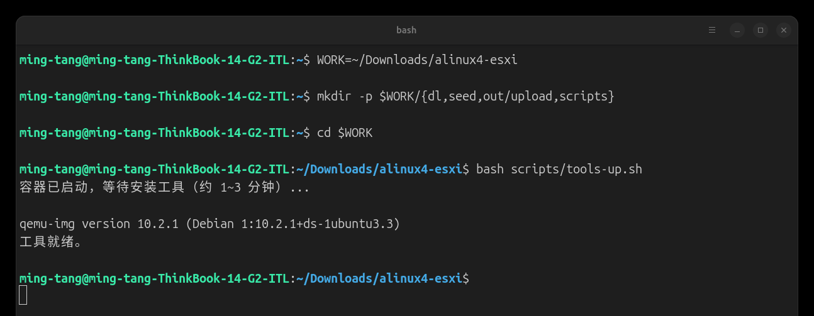

```bash
WORK=~/Downloads/alinux4-esxi
mkdir -p $WORK/{dl,seed,out/upload,scripts}
cd $WORK
bash scripts/tools-up.sh
```

看到最后一行"工具就绪"即可。容器内的 `apt` 走阿里云的 Ubuntu 镜像站，不依赖代理，约 1–3 分钟。

<details>
<summary>点开查看 <code>scripts/tools-up.sh</code></summary>

```bash
#!/usr/bin/env bash
# 启动一次性工具容器，之后用 docker exec alinux4-tools <命令> 调用。
#
#   qemu-utils            qemu-img             镜像格式转换、扩容、校验
#   cloud-image-utils     cloud-localds        制作 cloud-init seed ISO
#   genisoimage           isoinfo              查看 ISO 内容
#   e2fsprogs             debugfs              不挂载也能读 ext4 里的文件
#   initramfs-tools-core  lsinitramfs          列出 initramfs 里的驱动模块
#   mtools                mdir                 读 EFI 分区（FAT）
#   cloud-init            cloud-init schema    配置文件写完先校验
#
# 本机没有 sudo 也能用：工具全在容器里，用完删除：docker rm -f alinux4-tools
# 容器内的 apt 改走阿里云的 Ubuntu 镜像站，不依赖代理。
set -euo pipefail

WORK=$(cd "$(dirname "$0")/.." && pwd)
MIRROR=${UBUNTU_MIRROR:-mirrors.aliyun.com}

mkdir -p "$WORK/out"
docker rm -f alinux4-tools >/dev/null 2>&1 || true
rm -f "$WORK/out/.tools_ready"
docker run -d --name alinux4-tools \
    -v "$WORK":/work -w / ubuntu:26.04 sh -c '
      sed -i "s|http://archive.ubuntu.com/ubuntu/|http://'"$MIRROR"'/ubuntu/|;
              s|http://security.ubuntu.com/ubuntu/|http://'"$MIRROR"'/ubuntu/|" \
          /etc/apt/sources.list.d/ubuntu.sources &&
      apt-get update -qq &&
      DEBIAN_FRONTEND=noninteractive apt-get install -y -qq --no-install-recommends \
          qemu-utils cloud-image-utils genisoimage e2fsprogs \
          initramfs-tools-core mtools cloud-init >/dev/null 2>&1
      echo "apt_rc=$?" > /work/out/.tools_ready
      exec tail -f /dev/null' >/dev/null

echo "容器已启动，等待安装工具（约 1~3 分钟）..."
for _ in $(seq 1 180); do [ -f "$WORK/out/.tools_ready" ] && break; sleep 2; done
[ -f "$WORK/out/.tools_ready" ] || { echo "等待超时，请查看: docker logs alinux4-tools"; exit 1; }
grep -q 'apt_rc=0' "$WORK/out/.tools_ready" || { echo "工具安装失败，请查看: docker logs alinux4-tools"; exit 1; }
for t in qemu-img cloud-localds isoinfo lsinitramfs mdir debugfs cloud-init; do
    docker exec alinux4-tools sh -c "command -v $t >/dev/null" || { echo "缺少 $t"; exit 1; }
done
docker exec alinux4-tools qemu-img --version | head -1
echo "工具就绪。"
```

</details>

### 步骤 2：下载并校验镜像

镜像文件名里的 `20261103` 是构建日期，发新版就会变；**校验文件名要和它对应**，都在[镜像页](https://mirrors.aliyun.com/alinux/4/image/)上列着。

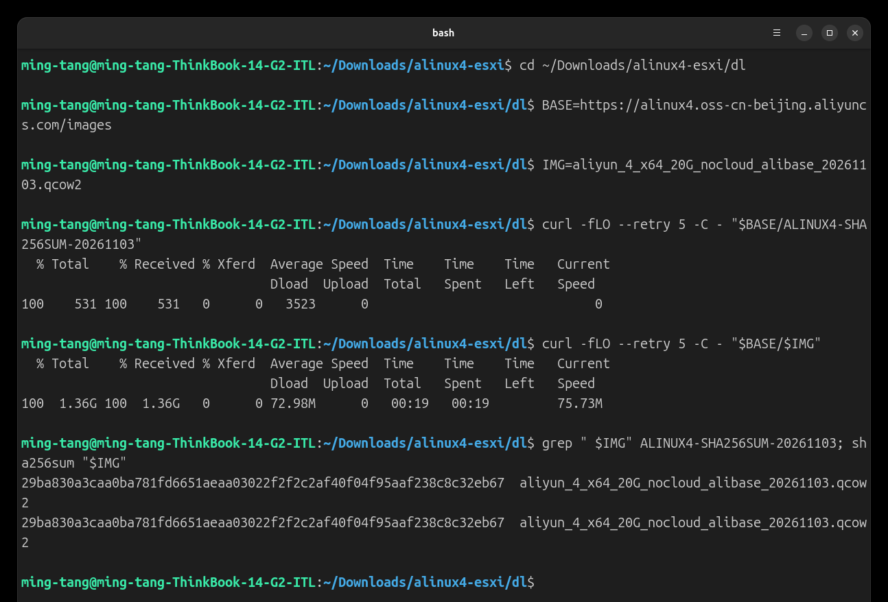

```bash
cd $WORK/dl
BASE=https://alinux4.oss-cn-beijing.aliyuncs.com/images
IMG=aliyun_4_x64_20G_nocloud_alibase_20261103.qcow2

curl -fLO --retry 5 -C - "$BASE/ALINUX4-SHA256SUM-20261103"
curl -fLO --retry 5 -C - "$BASE/$IMG"
grep " $IMG" ALINUX4-SHA256SUM-20261103
sha256sum "$IMG"
```

最后两行是官方公布的校验值和自己算的值，必须一致。

### 步骤 3：转换成 VMDK

云镜像是 qcow2，ESXi 只认 VMDK。另外镜像只有 20G，而系统盘规划的是 60G——根分区在镜像里排在最后，把虚拟盘扩容后，首次开机 cloud-init 会自动把根分区和文件系统扩满，不用进系统手工扩。

目标格式用 `streamOptimized`：单文件、带压缩，上传量小（1.33 GiB）。它**不支持扩容**，所以脚本里先转成 raw 扩容，再转成 VMDK。这种格式 ESXi 不能直接拿来开机，但能读、能导入（步骤 18）。

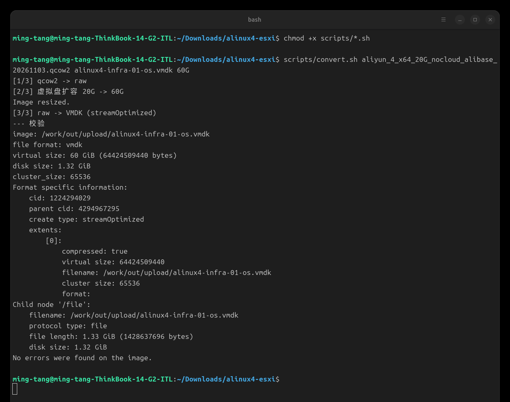

```bash
cd $WORK
chmod +x scripts/*.sh
scripts/convert.sh aliyun_4_x64_20G_nocloud_alibase_20261103.qcow2 alinux4-infra-01-os.vmdk 60G
```

约 3 分钟，耗时主要在压缩。输出里重点看两处：

- `virtual size: 60 GiB`，而 `file length: 1.33 GiB`——VMDK 是稀疏的，随客户机写入增长。
- `No errors were found on the image.`

<details>
<summary>点开查看 <code>scripts/convert.sh</code></summary>

```bash
#!/usr/bin/env bash
# 把 Alibaba Cloud Linux 4 的 qcow2 云镜像转换成 ESXi 可直接挂载的单文件 VMDK。
#
# 为什么分两步：目标格式 streamOptimized 不支持扩容，所以先转成 raw、把虚拟盘
# 扩到目标容量，再转成 VMDK。镜像的根分区排在最后，首次开机时 cloud-init 会
# 自动把根分区和文件系统扩满整块盘。
#
# 依赖只有 Docker：转换工具装在一次性容器里（见 tools-up.sh），不改动宿主机。
#
# 用法：convert.sh <输入.qcow2>（位于 dl/ 下） <输出.vmdk> <系统盘容量，如 60G>
set -euo pipefail

IN=${1:?用法: convert.sh <镜像.qcow2> <输出.vmdk> <容量>}
OUT=${2:?用法: convert.sh <镜像.qcow2> <输出.vmdk> <容量>}
SIZE=${3:?用法: convert.sh <镜像.qcow2> <输出.vmdk> <容量>}

WORK=$(cd "$(dirname "$0")/.." && pwd)   # 工作目录，容器内挂载为 /work
C=/work
TOOLS=${TOOLS:-alinux4-tools}

docker inspect "$TOOLS" >/dev/null 2>&1 || { echo "工具容器 $TOOLS 未启动，请先运行 tools-up.sh"; exit 1; }

q() { docker exec "$TOOLS" qemu-img "$@"; }

mkdir -p "$WORK/out/upload"
RAW="$C/out/${OUT%.vmdk}.raw"

echo "[1/3] qcow2 -> raw"
q convert -f qcow2 -O raw "$C/dl/$IN" "$RAW"

echo "[2/3] 虚拟盘扩容 20G -> $SIZE"
q resize -f raw "$RAW" "$SIZE"

echo "[3/3] raw -> VMDK (streamOptimized)"
q convert -f raw -O vmdk -o subformat=streamOptimized,adapter_type=lsilogic \
    "$RAW" "$C/out/upload/$OUT"

echo "--- 校验"
q info "$C/out/upload/$OUT"
q check "$C/out/upload/$OUT"
```

</details>

### 步骤 4：编写 cloud-init 配置，对齐 ECS 的 `ecs-user`

**先弄清楚 ECS 到底是怎么做的。** 印象里"阿里云 ECS 默认用 `ecs-user`、不给 root"，查了官方文档后发现不完全是这样：

| 问题 | 官方文档原文 | 出处 |
| --- | --- | --- |
| ECS 默认登录名 | "默认为 root，若创建实例时设置了使用 ecs-user 则为 ecs-user" | [实例登录名、密码、密钥对管理](https://help.aliyun.com/zh/ecs/user-guide/instance-logon-credential-management) |
| `ecs-user` 的定位 | "root 具有操作系统的最高权限，使用 root 作为用户名可能会导致安全风险，建议您使用普通用户 ecs-user 作为用户名" | [自定义购买实例](https://help.aliyun.com/zh/ecs/user-guide/create-an-instance-by-using-the-wizard) |
| 怎么提权 | "可通过 ecs-user 登录实例后，执行 `sudo su` 命令，切换到 root 用户" | 同第一行 |

也就是说：**`ecs-user` 是官方推荐的登录方式，要在购买时主动选**。"对齐 ECS"对齐的是这个推荐做法。

有一点官方文档没有明说：纯密钥登录没有密码可输，`sudo` 只能是免密的。实测结果是 root 用同一把密钥登录被拒（`Permission denied`），`ecs-user` 可以免密 `sudo`，和 ECS 上的用法一致。

这块本地镜像和 ECS 上的镜像不是同一个变体：它的 cloud-init 默认用户就是 `root`。所以"对齐"必须由配置盘来完成。

配置盘是一个卷标为 `cidata` 的 ISO，里面放三个文件，cloud-init 靠卷标找到它。

**`seed/meta-data`**：实例标识和主机名。

```yaml
instance-id: iid-alinux4-infra-01
local-hostname: alinux4-infra-01
```

**`seed/network-config`**：静态 IP。cloud-init 在最早的 local 阶段就会应用它，所以第一次开机就是静态地址。

```yaml
version: 2
ethernets:
  # 镜像的内核参数带 net.ifnames=0，网卡固定叫 eth0
  eth0:
    dhcp4: false
    addresses:
      - 192.168.10.50/24
    routes:
      # 默认路由必须写成 0.0.0.0/0。写成 netplan 风格的 "default" 能通过 schema 校验，
      # 但 cloud-init 解析时会报 "Address default is not a valid ip address"，整份网络配置作废
      - to: 0.0.0.0/0
        via: 192.168.10.1
    nameservers:
      addresses:
        - 192.168.10.1
        - 223.5.5.5
```

**`seed/user-data`**：账号、密钥、数据盘。公钥用管理机自己的那把（`cat ~/.ssh/id_ed25519.pub`），不要照抄别人的。

```yaml
#cloud-config
# 对齐阿里云 ECS 推荐的登录方式（官方文档《避免使用root账号登录实例》）：
#   用普通用户 ecs-user 登录，需要时用 sudo 提权；root 不允许 SSH 登录。

# cloud-init 不再把任何密钥交给 root；即便有人给 root 配了密钥，
# 登录时也只会收到 "Please login as the user ecs-user" 的提示
disable_root: true

# 禁止 SSH 密码登录，只认密钥（镜像默认就是如此，这里显式写明）
ssh_pwauth: false

users:
  - name: ecs-user
    # 免密 sudo：纯密钥登录没有密码可输，sudo 必须免密才能 "sudo su" 切到 root
    sudo: 'ALL=(ALL) NOPASSWD:ALL'
    shell: /bin/bash
    lock_passwd: true
    ssh_authorized_keys:
      # 管理机的公钥，私钥不出本机
      - ssh-ed25519 AAAA...（换成你的公钥）

# 把主机名指向静态地址，避免 sudo 等工具解析主机名时告警
# （不要用 manage_etc_hosts: true，那会把主机名解析到 127.0.0.1）
write_files:
  - path: /etc/hosts
    append: true
    content: |
      192.168.10.50 alinux4-infra-01

# 数据盘的挂载记录。nofail：数据盘不在时也不阻塞开机
# （默认写法没有 nofail，fstab 里挂着一块不存在的盘会让系统卡在启动阶段）
mounts:
  - [LABEL=data, /data, xfs, "defaults,noatime,nofail", "0", "0"]

# 数据盘：在"全新的空白盘"上创建文件系统。
# 不写死设备名——ESXi 按虚拟设备节点从低到高给 NVMe 磁盘编号，设备名取决于盘接在哪个节点。
# 判定条件三个都满足才格式化：盘上没有任何签名（wipefs 无输出）、没有分区、容量大于 100 GiB。
# 系统盘有分区表，永远不会被这段脚本选中。
runcmd:
  - |
    for d in /dev/nvme*n[0-9] /dev/sd[a-z]; do
      [ -b "$d" ] || continue
      parts=$(lsblk -nro TYPE "$d" | grep -c '^part$')
      size=$(blockdev --getsize64 "$d")
      if [ -z "$(wipefs "$d")" ] && [ "$parts" = 0 ] && [ "$size" -gt 107374182400 ]; then
        mkfs.xfs -L data "$d" && mount /data
      fi
    done

# 根分区的扩容不用写在这里：镜像自带的 cloud-init 配置已启用
# growpart + resizefs，首次开机会自动把根分区扩满 60G 系统盘。
```

> **这一节展示的是修正后的版本。** 本次实测上传的是第一版：默认路由写成了 `to: default`，数据盘写死了 `/dev/nvme0n2`。两处都是开机后才暴露的，排查和修复过程见第四节。修正后的两处分别做了验证：路由写法用镜像自带的 cloud-init 解析过；数据盘的判定逻辑在真实磁盘上空跑过（第七节）。

几处设计的理由：

- **不照搬阿里云的示例 seed.img**。它的内容是公开的：账号 `alinux`、密码 `aliyun`。放到局域网里等于开门。
- **不需要改 YUM 源**。这块镜像自带的 `/etc/yum.repos.d/AliYun.repo` 已经指向公网 `mirrors.aliyun.com`，开机后 `dnf repolist` 能列出 `alinux4-os`、`alinux4-updates`、`alinux4-plus`。
- **主机名解析到内网 IP 而不是 `127.0.0.1`**。RHEL 系的 `manage_etc_hosts: true` 模板会把主机名指向回环地址，以后装 RocketMQ 这类要按主机名取地址的组件会出问题。

### 步骤 5：校验配置并生成配置盘

`cloud-init` 的配置键写错不会报错，只是**静默不生效**。生成 ISO 之前先用 schema 校验一遍。

要在容器里用新版 cloud-init 校验，不要在虚拟机里用镜像自带的那个：镜像里的 23.2.2 对任何 `users` 条目都会误报 schema 无效。

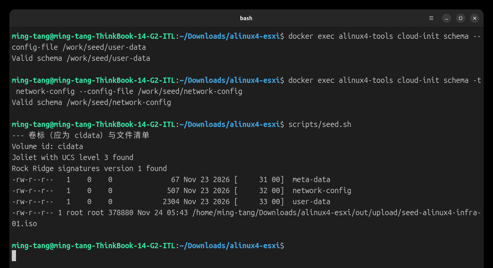

```bash
cd $WORK
docker exec alinux4-tools cloud-init schema --config-file /work/seed/user-data
docker exec alinux4-tools cloud-init schema -t network-config --config-file /work/seed/network-config
scripts/seed.sh
```

输出里确认三件事：两行 `Valid schema`；`Volume id: cidata`；文件名没有被截成 `USER_DAT.1;1` 这种 8.3 格式（Rock Ridge 已启用）——如果被截断，cloud-init 会读不到配置。

要注意 schema 校验管不到语义。`to: default` 就是通过了校验、却不能用的例子。

<details>
<summary>点开查看 <code>scripts/seed.sh</code></summary>

```bash
#!/usr/bin/env bash
# 用 cloud-localds 制作 NoCloud seed ISO。卷标必须是 cidata，cloud-init 靠它识别。
# seed 目录下三个文件：
#   user-data       用户、密钥、数据盘挂载等首启配置
#   meta-data       实例 ID 和主机名
#   network-config  静态 IP（cloud-init 在最早的 local 阶段就会应用它）
#
# 用法：seed.sh [输出.iso]（默认写到 out/upload/seed-<主机名>.iso）
set -euo pipefail

WORK=$(cd "$(dirname "$0")/.." && pwd)
OUT=${1:-seed-$(grep -oP '(?<=^local-hostname: ).*' "$WORK/seed/meta-data").iso}
TOOLS=${TOOLS:-alinux4-tools}

docker inspect "$TOOLS" >/dev/null 2>&1 || { echo "工具容器 $TOOLS 未启动，请先运行 tools-up.sh"; exit 1; }

mkdir -p "$WORK/out/upload"
docker exec "$TOOLS" cloud-localds "/work/out/upload/$OUT" \
    /work/seed/user-data /work/seed/meta-data \
    --network-config /work/seed/network-config

echo "--- 卷标（应为 cidata）与文件清单"
docker exec "$TOOLS" isoinfo -d -i "/work/out/upload/$OUT" | grep -E 'Volume id|Rock Ridge|Joliet'
docker exec "$TOOLS" isoinfo -l -R -i "/work/out/upload/$OUT" | grep -E 'data|config'
ls -la "$WORK/out/upload/$OUT"
```

</details>

### 步骤 6：确认两个文件就绪

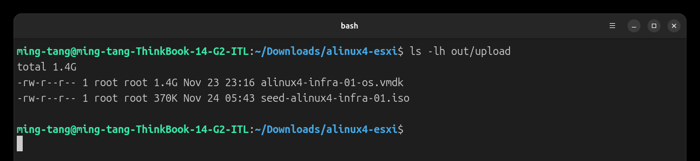

| 文件 | 作用 |
| --- | --- |
| `out/upload/alinux4-infra-01-os.vmdk` | 系统盘，1.33 GiB，虚拟容量 60 GiB |
| `out/upload/seed-alinux4-infra-01.iso` | cloud-init 配置盘，挂成光驱 |

## 三、在 ESXi 上创建虚拟机

### 步骤 7：登录，先看主机资源够不够

登录 ESXi Host Client，首页右侧就是资源概况。

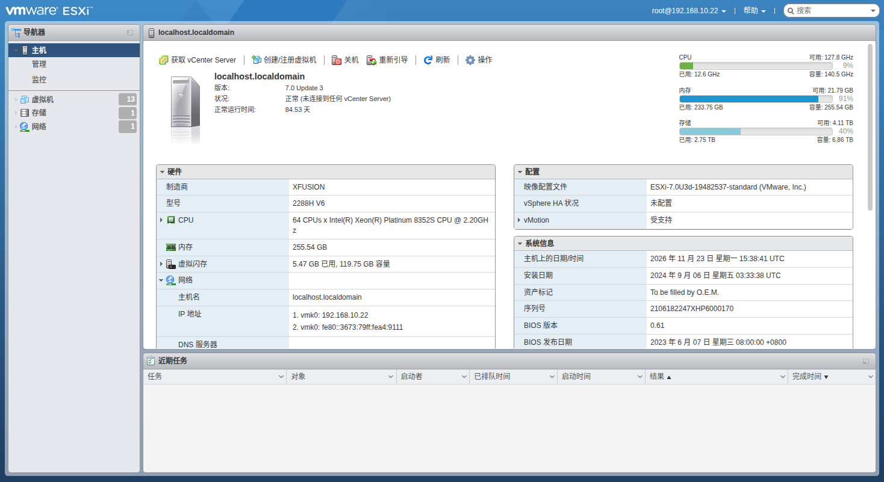

这次看到的是：内存容量 255.54 GB，可用 217.9 GB——所以 24 GB 没有问题。存储容量 6.86 TB，可用 4.11 TB，系统盘 60 GB 加数据盘 400 GB 没有压力。只有一个数据存储 `datastore1`，一个网络 `VM Network`。

### 步骤 8：向导第 1 步，选择创建类型

首页点"创建/注册虚拟机"。

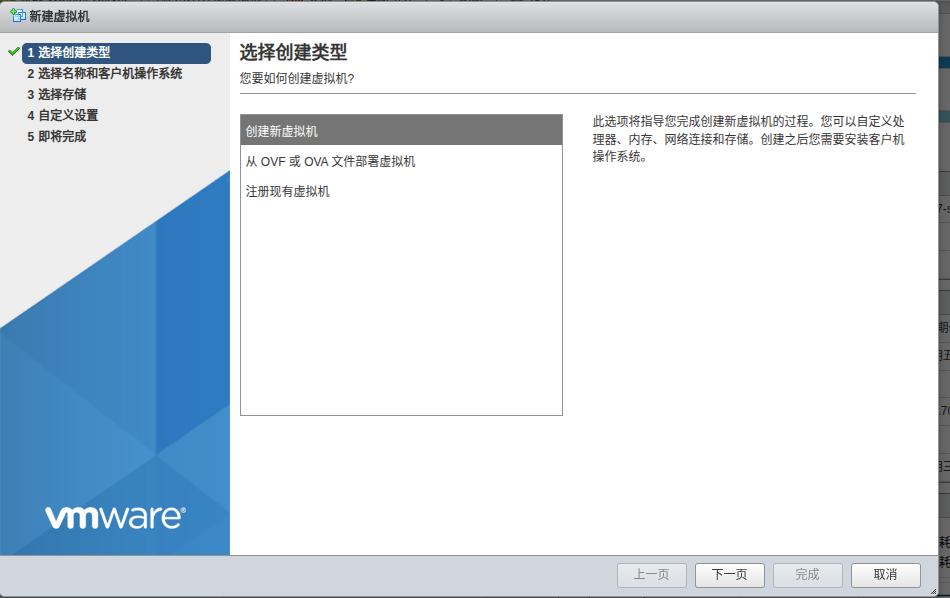

保持默认的"创建新虚拟机"，点"下一页"。

### 步骤 9：向导第 2 步，名称和客户机操作系统

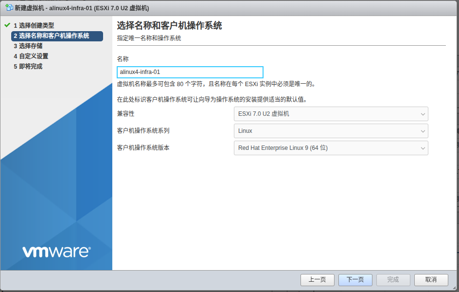

- **名称**：`alinux4-infra-01`。同时用作 ESXi 里的显示名和存储目录名。
- **兼容性**：默认的"ESXi 7.0 U2 虚拟机"即可。
- **客户机操作系统系列**：Linux。
- **客户机操作系统版本**：**Red Hat Enterprise Linux 9 (64 位)**。

为什么不是"Alibaba Cloud Linux"：这个下拉框里 82 个 Linux 选项中没有 Alibaba Cloud Linux，也没有 Anolis。AL4 是 OpenAnolis 版，属于 RHEL 9 兼容体系，选最接近的即可。这个选项只影响 ESXi 给的默认硬件，不影响系统能不能装。

### 步骤 10：向导第 3 步，选择存储

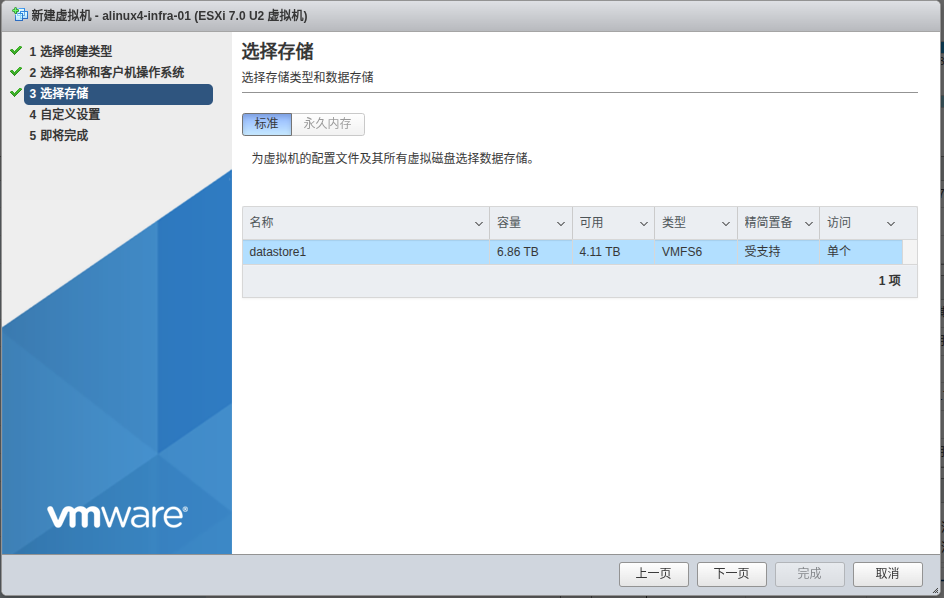

只有 `datastore1` 一个，选中它，点"下一页"。

### 步骤 11：向导第 4 步，自定义设置（虚拟硬件）

这一页默认给的是：CPU 1、内存 2048 MB、一块 16 GB 新硬盘、SCSI 控制器"VMware Paravirtual"、SATA 控制器、USB 2.0、一个网卡、一个光驱。逐项调整：

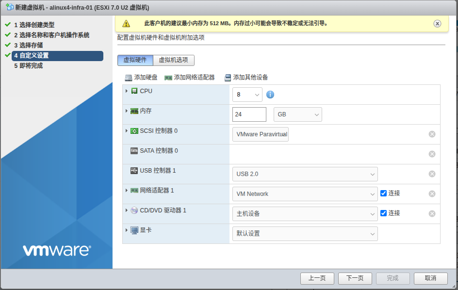

- **CPU**：改成 8。
- **内存**：24，单位选 GB。
- **硬盘**：点右侧的 × 删掉这块默认的 16 GB 硬盘。系统盘是现成的文件，步骤 19 再挂；数据盘等加了 NVMe 控制器再加（步骤 16）。
- **SCSI 控制器 0**：显示为"VMware Paravirtual"。这是选了 RHEL 9 之后的默认值，而它恰恰是这块镜像开不了机的那种控制器——第七节会说明原因。先留着，步骤 17 删掉。

网卡展开后可以看到适配器类型默认就是 **VMXNET 3**，"打开电源时连接"也已勾选，不用改：

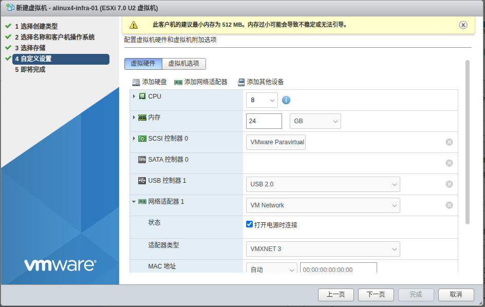

### 步骤 12：向导第 4 步，虚拟机选项（固件与安全引导）

切到"虚拟机选项"页签，展开"引导选项"。

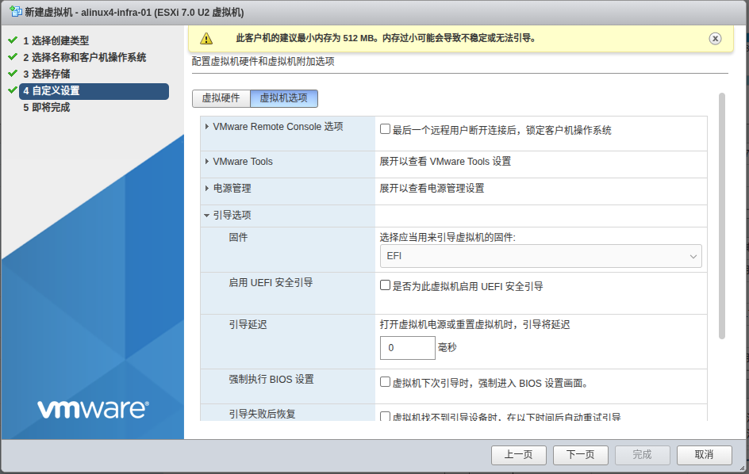

- **固件**：选了 RHEL 9 后默认就是 **EFI**，不用改。镜像带完整的 EFI 分区。
- **启用 UEFI 安全引导**：**取消勾选**。它默认是勾上的。安全引导要求引导程序被虚拟机固件信任的密钥签名，云镜像的引导程序不一定在 ESXi 的信任列表里。我没有实测勾着会怎样，只是没必要冒这个险。

### 步骤 13：向导第 5 步，完成

核对汇总页：


点"完成"。顶部出现成功提示，虚拟机数量从 13 变成 14：

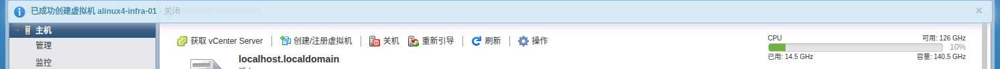

### 步骤 14：把两个文件上传到虚拟机目录

虚拟机建好后，存储上已经有了以它命名的目录。依次点：左侧"存储" → `datastore1` → 上方"数据存储浏览器" → 根目录下的 `alinux4-infra-01`。

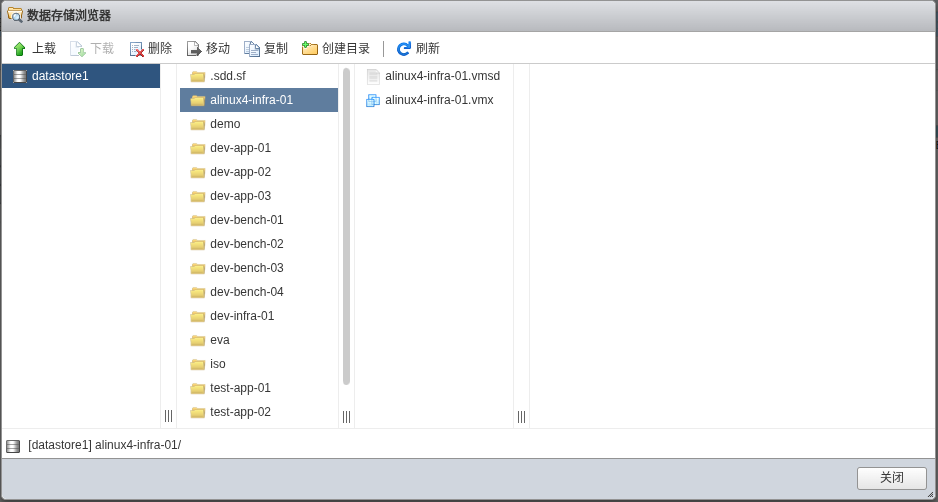

目录里是向导生成的配置文件（`.vmx`、`.vmsd`）。点左上角的"上载"，把步骤 6 的两个文件传进来。大文件约 1.3 GiB，实测用了 4 分钟，进度显示在浏览器上方：

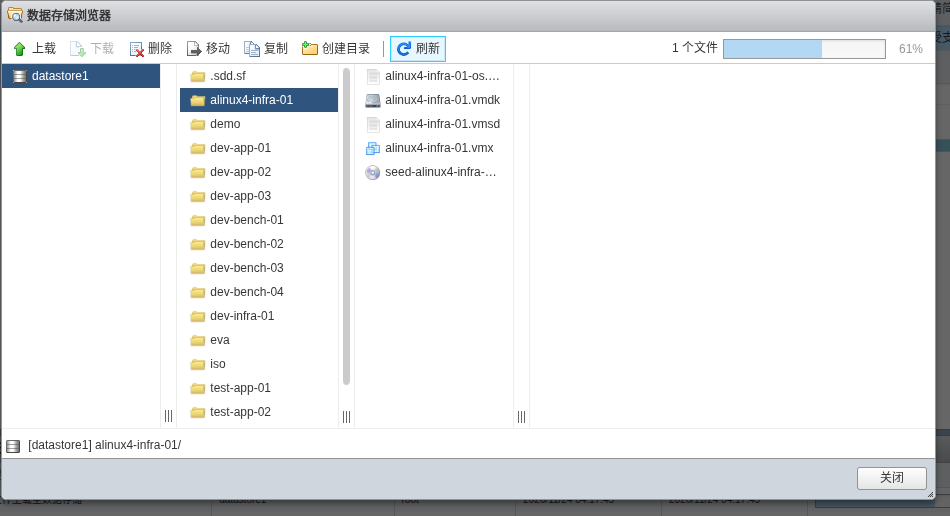

传完后点一下文件名，右侧显示大小：

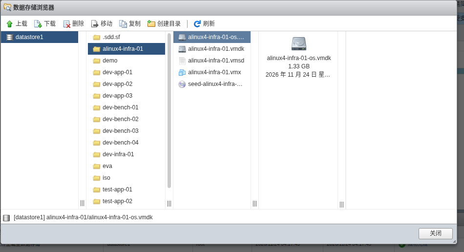

系统盘 1.33 GB、配置盘 368 KB，和本地一致。

### 步骤 15：编辑设置，添加 NVMe 控制器

在虚拟机列表里点 `alinux4-infra-01`，点上方"编辑"。点"添加其他设备"：

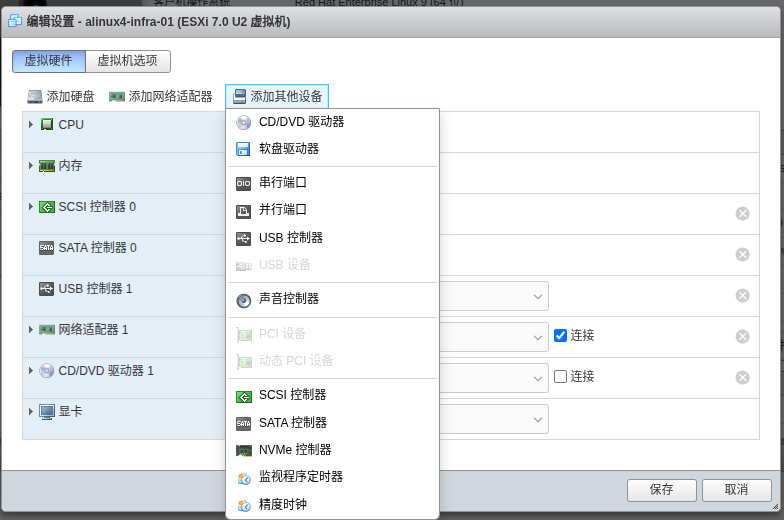

选"NVMe 控制器"。设备列表里多出"新建 NVMe 控制器"。

### 步骤 16：添加 400 GB 数据盘

点"添加硬盘" → "新标准硬盘"：

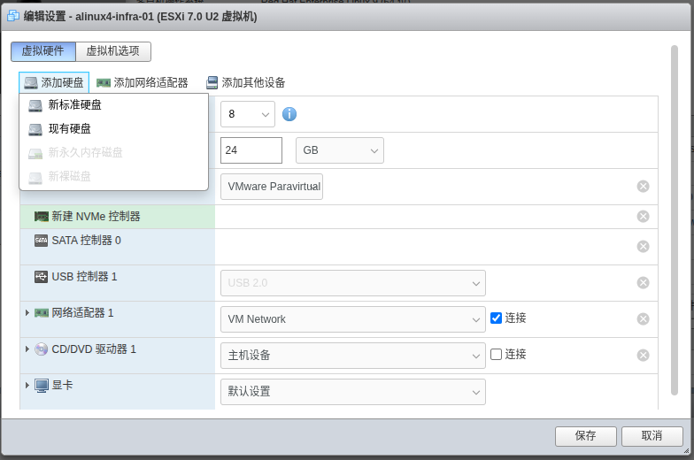

点这一行前方的箭头展开，改三处：

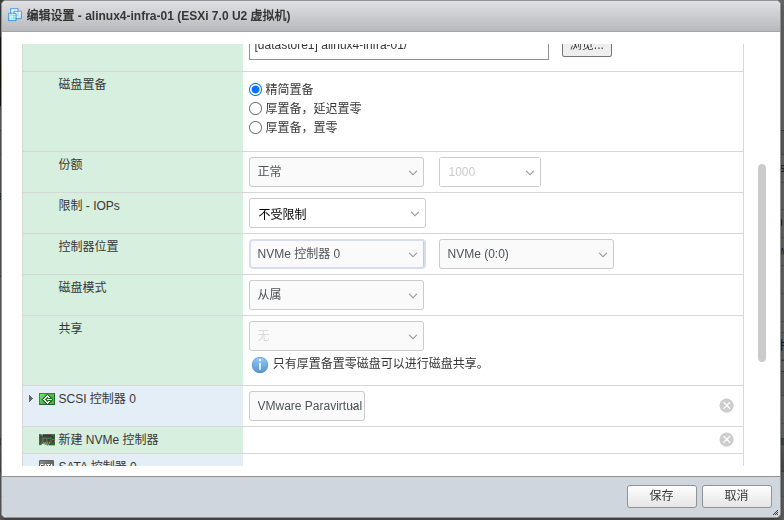

- **硬盘大小**：400，单位 GB。
- **磁盘置备**：选"精简置备"。默认是"厚置备，延迟置零"，那样 400 GB 会立刻从数据存储里划走。
- **控制器位置**：`NVMe 控制器 0`。默认是 SCSI 控制器 0。

### 步骤 17：CPU 改成 1 插槽 × 8 核，删掉 PVSCSI，保存

点"CPU"这一行前方的箭头展开，把"每个插槽内核数"从 1 改成 8，右边的"插槽数"随之变成 1：

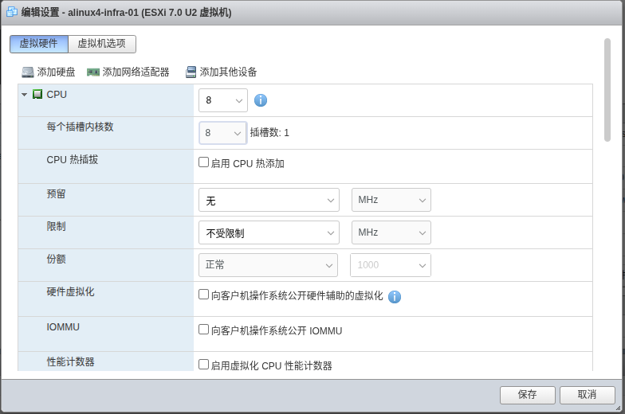

点"SCSI 控制器 0"右边的 × 把它删掉：系统盘和数据盘都走 NVMe，光驱走 SATA，这个控制器上不会有设备。

收拢后的设备列表应当是这样：

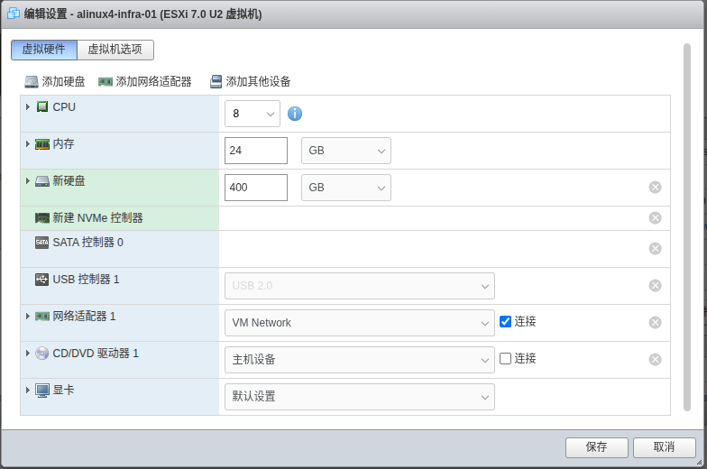

点"保存"：

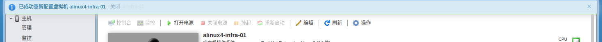

### 步骤 18：导入系统盘

先说结论：**步骤 3 转出来的磁盘不能直接拿来开机。** 我一开始没意识到这一点，把它挂上去就点了开机，被 ESXi 拒绝：

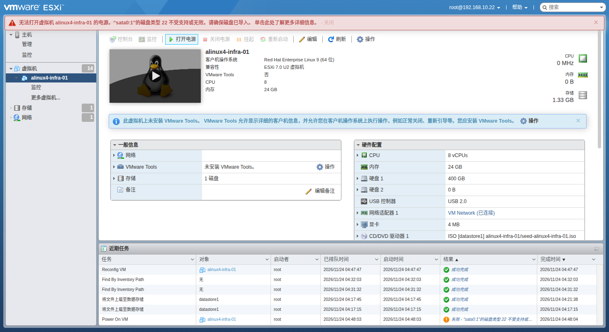

> 无法打开虚拟机 alinux4-infra-01 的电源。"sata0:1" 的磁盘类型 22 不受支持或无效。请确保磁盘已导入。

`streamOptimized` 是 VMware 的"托管格式"，ESXi 能读、能复制，但要先**导入**成它自己的原生格式才能开机。导入在数据存储内部完成，不需要重新上传。

标准做法是开 ESXi 的 SSH，用 `vmkfstools -i` 导入。这台主机没开 SSH，我用的是另一条路：让 ESXi 的接口替我做同样的导入。Host Client 页面本身就是登录状态，按 F12 打开浏览器控制台，粘贴附录里的脚本并回车即可（脚本和说明见附录末尾）：

```text
导入任务已提交，任务号 haTask--vim.VirtualDiskManager.copyVirtualDisk-xxxx。
```

大约 1 分钟后，"近期任务"里出现成功记录：

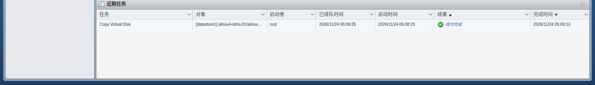

回到数据存储浏览器，目录里多了一个 `alinux4-infra-01-os-native.vmdk`。它是精简置备的原生磁盘，虚拟容量 60 GB，实际占用 3.86 GB：

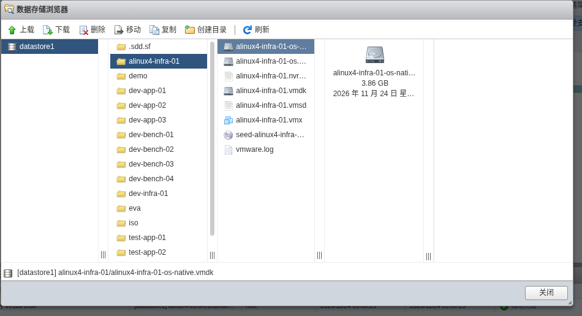

原来的 `alinux4-infra-01-os.vmdk` 不要删：它是干净的母盘，以后再建虚拟机可以直接从它再导入一份（第十节）。

> 如果像我当时那样已经把未导入的磁盘挂上了，有个迹象能提前看出来：界面读不出它的容量，"硬盘大小"显示 1 GB，"大小上限"是 0 B。导入以后再看就是 60 GB 了。
>
> 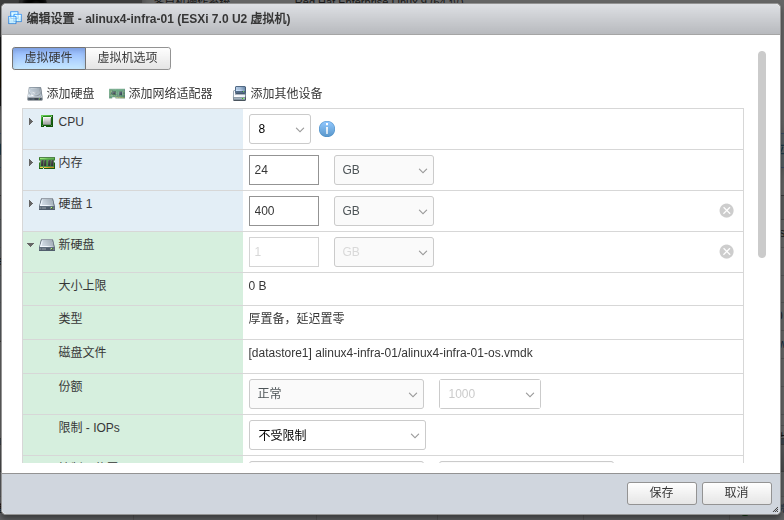
>
> 移除它的方法：在"编辑设置"里点那一行右侧的 ×。点完后行会变粉，旁边出现"从数据存储删除文件"的复选框——**不要勾**，只保存即可，文件会保留。
>
> 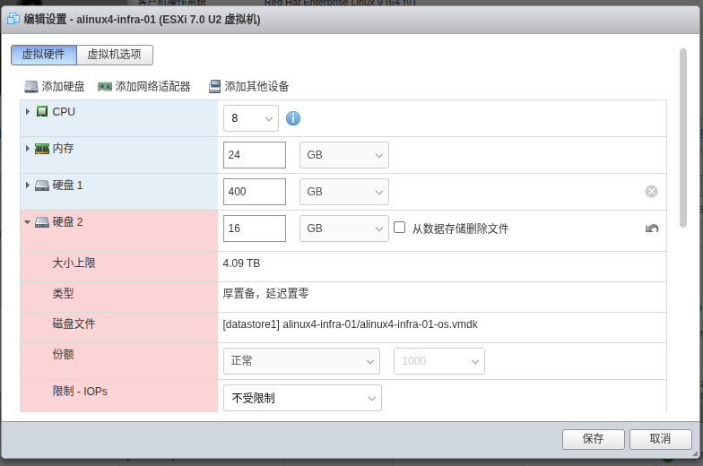

### 步骤 19：挂载系统盘和配置盘

**系统盘。** 编辑设置 → 添加硬盘 → 现有硬盘，在弹出的数据存储浏览器里进入 `alinux4-infra-01`，选 `alinux4-infra-01-os-native.vmdk`：

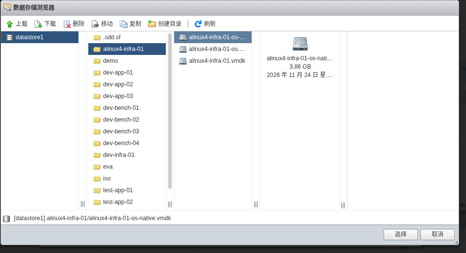

保存后，ESXi 就能读出它的容量了：虚拟机详情页的"硬件配置"里显示为 60 GB。

**数据盘的位置。** 展开数据盘那一行，把"虚拟设备节点单位"设为 **NVMe (0:1)**，把第一个节点空出来：

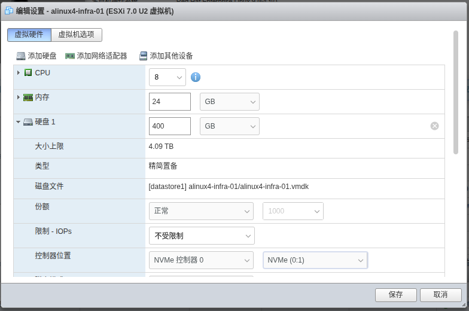

**配置盘。** 点"CD/DVD 驱动器 1"的下拉框，选"数据存储 ISO 文件"，在弹出的浏览器里选 `seed-alinux4-infra-01.iso`：

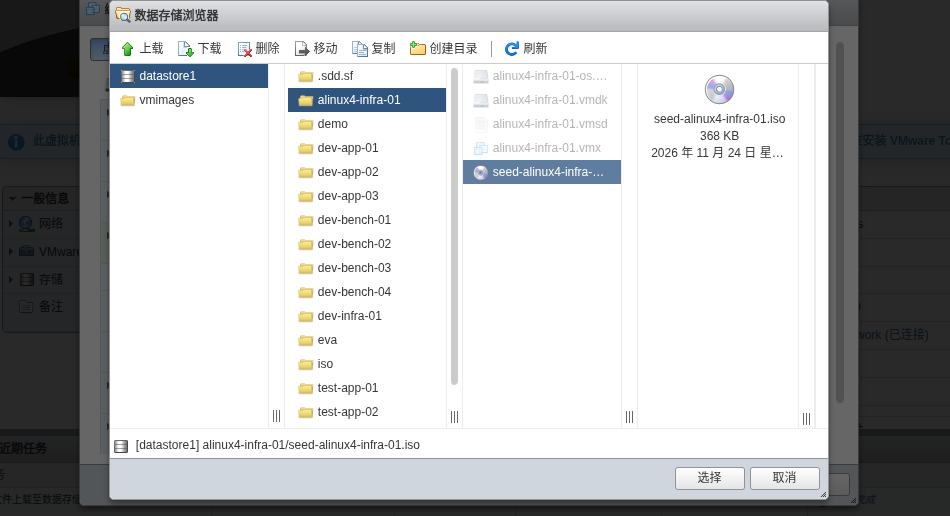

展开光驱那一行，确认"CD/DVD 介质"指向这个 ISO：

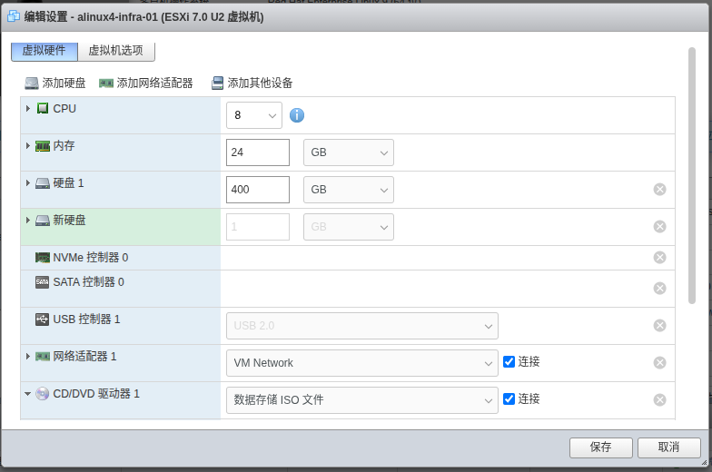

**展开同一个地方，往下看"打开电源时连接"。** 这个复选框要勾上，否则首次开机读不到配置盘。我当时以为选了 ISO 就够了，开机前特意回来检查，发现它是没勾的：

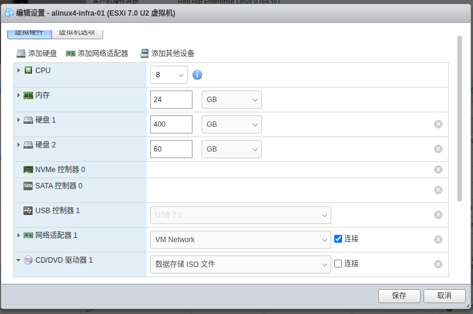

**系统盘接哪个控制器。** 这台虚拟机第一次开机时，我把系统盘接在了 **SATA 控制器**上（界面自动分到 SATA (0:2)）。这是有意为之：第一版配置盘里写死了"格式化 `/dev/nvme0n2`"，而我还不确定 ESXi 会把两块 NVMe 盘编成几号。系统盘放在 SATA 上，无论怎么编号都轮不到它被格式化。编号规则实测清楚以后，第五节再把系统盘改接到 NVMe。

点"保存"，顶部出现成功提示：


### 步骤 20：第一次开机

点"打开电源"。任务列表里"PowerOn VM"成功完成，右上角的内存占用开始变化：

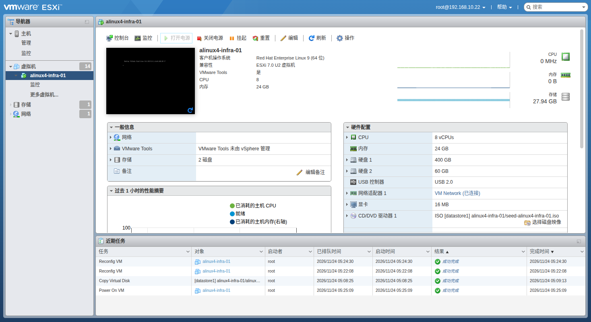

点左上角的屏幕缩略图打开控制台。系统输出走的是串口，屏幕上只看得到最后几行内核日志和登录提示：

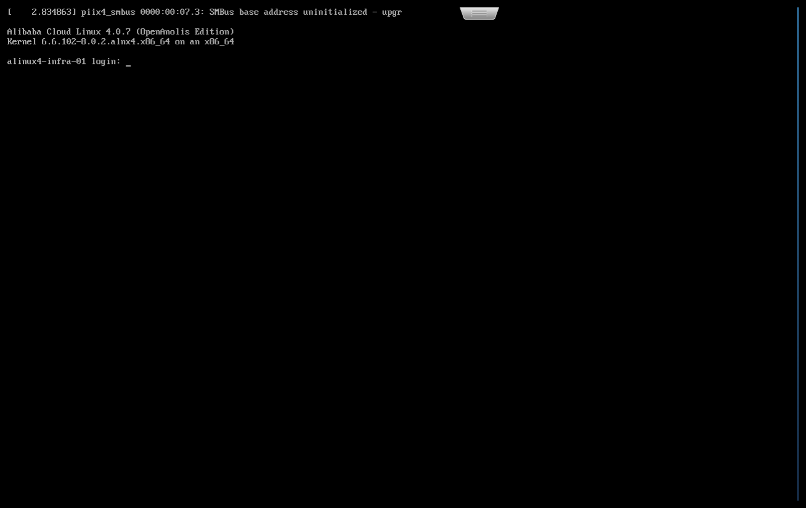

```text
Alibaba Cloud Linux 4.0.7 (OpenAnolis Edition)
Kernel 6.6.102-8.0.2.alnx4.x86_64 on an x86_64

alinux4-infra-01 login: _
```

主机名已经变成 `alinux4-infra-01`，说明配置盘被读到、cloud-init 跑过了。屏幕上没有可登录的账号是正常的（两个账号都是只认密钥），全部操作走 SSH。

## 四、首次开机后的排错与修复

这一节记录这次实测中开机后发现的三个问题，以及修复它们实际执行的命令。照着修正后的配置盘（步骤 4）做，前两个问题不会出现；第三个问题的隐患已经通过 `nofail` 消除。保留这一节，是因为排查思路比结论更值得参考。

### 问题一：静态 IP 没生效

**现象。** 按配置的地址 `192.168.10.50` 连不上。用密钥在网段里逐个试，在 `192.168.10.171` 上登了进去——这是 DHCP 分配的地址。

**排查。** 登进去先看 cloud-init：

```bash
cloud-init status --long
```

```text
status: error
detail:
Address default is not a valid ip address
```

`default` 就是我写的 `to: default`。这是 netplan 的写法，镜像自带的 cloud-init 23.2.2 不认，解析时直接抛错，整份网络配置作废，于是退回 DHCP。

用镜像里的解析器对比两种写法，结果很明确：

```text
cloud-init 23.2.2-8.alnx4
to: default      FAILED: ValueError: Address default is not a valid ip address
to: 0.0.0.0/0    parsed OK
```

补充一点：容器里的新版 cloud-init（26.2）两种写法都认。所以校验配置要针对目标系统里的版本，不能只在别的版本上试。

**修复。** 先在虚拟机里确认目标地址没人用（发 4 个探测，0 个响应；对网关发 2 个，2 个响应，说明探测本身有效）：

```bash
sudo arping -D -c 4 -w 5 -I eth0 192.168.10.50
sudo arping -c 2 -w 3 -I eth0 192.168.10.1
```

再用 NetworkManager 改成静态地址。第一条执行完当前连接就会断，所以两条放在同一个后台任务里执行，随后用新地址重新登录：

```bash
sudo nmcli con mod "Wired connection 1" ipv4.method manual \
    ipv4.addresses 192.168.10.50/24 ipv4.gateway 192.168.10.1 ipv4.dns "192.168.10.1 223.5.5.5"
sudo nmcli con up "Wired connection 1"
```

### 问题二：数据盘没有格式化

**现象。** `/data` 没有挂载。

**排查。** 看磁盘：

```bash
lsblk -o NAME,SIZE,TYPE,FSTYPE,LABEL,MOUNTPOINTS,MODEL
```

输出省略了 `MODEL` 列：

```text
sda        60G disk
|-sda1      1M part
|-sda2    200M part vfat          /boot/efi
`-sda3  59.8G part ext4   root   /
sr0       368K rom  iso9660 cidata
nvme0n1   400G disk
```

数据盘是 `/dev/nvme0n1`，不是配置盘里写的 `nvme0n2`。它接在 NVMe 的第二个节点上，但当时控制器上只有它一块盘，ESXi 从 1 开始编号，它就成了 n1。cloud-init 找不到 `nvme0n2`，格式化这一步什么也没做。

**修复。** 确认是空白盘后格式化并挂载（`wipefs` 无输出说明盘上没有任何签名）：

```bash
sudo wipefs /dev/nvme0n1
sudo mkfs.xfs -L data /dev/nvme0n1
sudo systemctl daemon-reload && sudo mount -a
```

挂载记录不用另外写：cloud-init 已经把 `LABEL=data /data` 写进了 `/etc/fstab`，文件系统一出现就能挂上。

### 问题三：一条会让下次开机卡住的 fstab 记录

排查问题二时注意到，`/etc/fstab` 里已经有这样一行：

```text
LABEL=data	/data	xfs	defaults,noatime,comment=cloudconfig	0	0
```

当时 `LABEL=data` 并不存在。fstab 里挂着一个不存在的设备，systemd 会等它超时后进入紧急模式，而这台机器的 root 没有密码，进了紧急模式也无法登录。也就是说，**问题二不处理，下次重启就起不来。**

修复是在这一行里加上 `nofail`：设备不在就跳过，不阻塞开机。下面是实际执行的命令：

```bash
sudo sed -i "s|^LABEL=data[[:space:]]*/data[[:space:]]*xfs[[:space:]]*defaults,noatime,|LABEL=data\t/data\txfs\tdefaults,noatime,nofail,x-systemd.device-timeout=10,|" /etc/fstab
grep data /etc/fstab
```

```text
LABEL=data	/data	xfs	defaults,noatime,nofail,x-systemd.device-timeout=10,comment=cloudconfig	0	0
```

修正后的配置盘（步骤 4）在 `mounts` 里直接写了 `nofail`，不会再有这个隐患。

### 一条可以忽略的告警

`sudo cloud-init schema --system` 会报 `users.0 ... is not valid under any of the given schemas`。实测在镜像自带的 cloud-init 23.2.2 上，任何 `users` 条目都会这样报，连最简写法也不例外，而 `ecs-user` 实际创建得完全正确。这是那个版本的校验缺陷，不影响使用。

## 五、定稿：系统盘改接 NVMe

前三节结束时虚拟机已经可用，但系统盘还在 SATA 上。把它改接到 NVMe 有两个目的：让硬件和规划一致；顺便实测"这块镜像能不能从 NVMe 启动"——这是选型里最关键的结论，之前只是从 initramfs 里有 `nvme.ko` 推出来的。

### 在虚拟机里正常关机

镜像里没有 VMware Tools，ESXi 上只有"关闭电源"（断电），没有"关闭客户机"。要正常关机，进系统执行：

```bash
sudo shutdown -h now
```

### 把系统盘改到 NVMe (0:0)

关机后打开"编辑设置"，展开系统盘那一行（60 GB 的那块），把"控制器位置"改成 `NVMe 控制器 0`。第一个节点空着，界面会自动选 `NVMe (0:0)`：

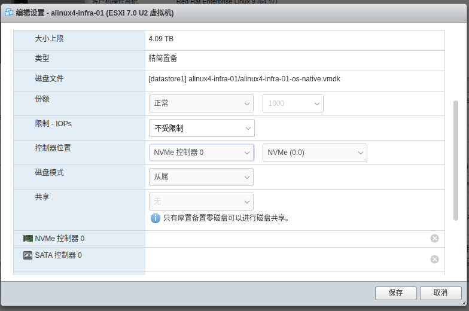

保存后的磁盘布局：

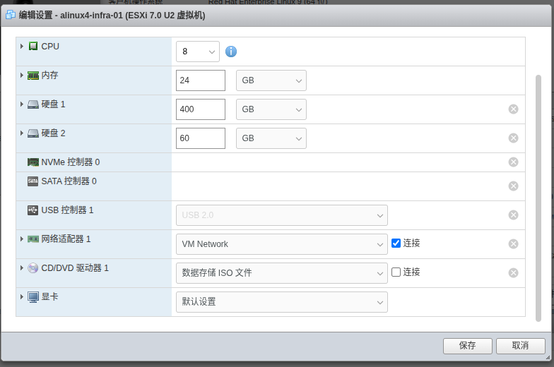

| 磁盘 | 容量 | 置备 | 位置 |
| --- | --- | --- | --- |
| 硬盘 1（数据盘） | 400 GB | 精简置备 | NVMe 控制器 0:1 |
| 硬盘 2（系统盘） | 60 GB | 精简置备 | NVMe 控制器 0:0 |

### 开机并确认

开机，登录后看根分区在哪块盘上：

```bash
findmnt -no SOURCE /
lsblk -o NAME,SIZE,TYPE,FSTYPE,LABEL,MOUNTPOINTS,MODEL
```

`lsblk` 的输出省略了 `MODEL` 列：

```text
/dev/nvme0n1p3
NAME         SIZE TYPE FSTYPE  LABEL  MOUNTPOINTS
sr0          368K rom  iso9660 cidata
nvme0n1       60G disk
|-nvme0n1p1    1M part
|-nvme0n1p2  200M part vfat           /boot/efi
`-nvme0n1p3 59.8G part ext4    root   /
nvme0n2      400G disk xfs     data   /data
```

从 NVMe 启动成功。数据盘的设备名从 `nvme0n1` 变成了 `nvme0n2`，因为 fstab 按卷标挂载，自动跟着换了过来。

这也顺带实测出了 ESXi 的编号规则：**同一控制器上的 NVMe 磁盘，按虚拟设备节点从低到高从 1 开始依次编号。** 数据盘先创建、系统盘后挂上，但系统盘在节点 (0:0) 所以是 `nvme0n1`，数据盘在 (0:1) 所以是 `nvme0n2`。

控制台照常停在登录提示符：


虚拟机运行中的详情页：

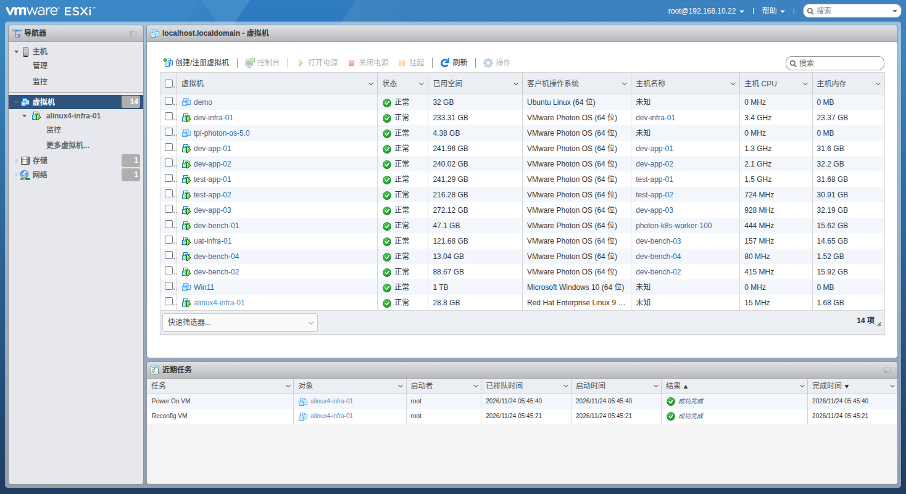

### 随主机自动开机

主机断电恢复后虚拟机要能自己开机，靠的是 ESXi 的"自动启动"，与 VMware Tools 无关——与它相关的只有"等待检测信号"这一项，这台主机本来就是"否"。这个功能按虚拟机单独启用，新建的虚拟机默认不参与。这台主机上原有的 10 台都配好了，唯独新建的这台是"取消设置"，主机通电后它不会开机。

配置入口：**主机 → 管理 → 系统 → 自动启动**。主机级的设置（已启用、启动延迟 120 秒、停止操作"关闭电源"）之前就是好的，不用动；只需要在列表里选中 `alinux4-infra-01`，点"启用"。启用前，它在列表最后，"自动启动顺序"是"取消设置"：

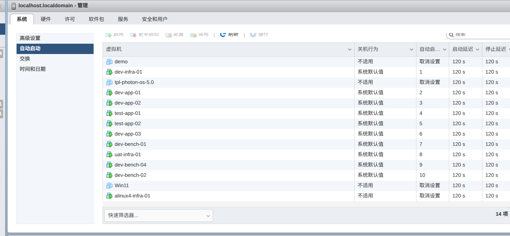

启用后变成"系统默认值 11"，接在你原有 10 台之后，不影响它们的顺序。刷新一次确认保存住了（"近期任务"里出现 `Reconfigure Autostart` 成功记录）：

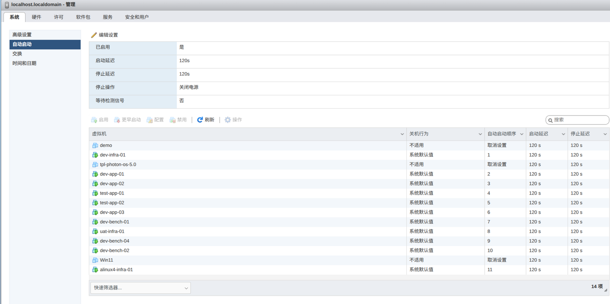

两点说明：

- **停止操作是"关闭电源"（断电）**：这台虚拟机没有 VMware Tools，主机关机时无法通知客户机正常关机。所以主机要关机维护前，最好先在虚拟机里执行 `sudo shutdown -h now`。
- **启动延迟 120 秒是上一台开机后等 120 秒再开下一台**。它排在第 11 位，主机开机后要等约 20 分钟才轮到它。如果希望这台基础组件机早点起来，可以在同一页点"配置"把它往前调，或者用"更早启动"提到最前；调整会整体重排其余虚拟机的序号，动之前想清楚。

### 给虚拟机设内存预留

**为什么设。** 2026-11-24 查这台主机：物理内存 255.5 GB，开机着的 11 台虚拟机一共配置了 270.3 GB，已经超过物理内存；宿主机已用 92.8%；**所有虚拟机的内存预留都是 0**。预留为 0 的意思是，宿主机内存一紧张，ESXi 就可以从任何一台虚拟机手里把内存收回去（气球回收），这台也不例外。这台机器要跑数据库和消息队列，系统里又没有 swap，被回收时会卡顿，严重的会被杀进程，所以要给它设预留。当时各虚拟机实际在用的内存加起来只有约 28 GB，所以并没有真的发生回收，这一步是提前上保险。

**界面里没有这一项。** ESXi 自带的 Host Client 里，"编辑设置"只有"虚拟硬件"和"虚拟机选项"两个页签；"虚拟机选项"里的"高级"只有调试统计、交换文件位置、配置参数、延迟敏感度四项。设内存预留是 vSphere Client 才有的功能（编辑设置 → 资源 → 内存 → 预留）。所以和导入磁盘一样走接口：在已登录的 Host Client 页面里执行附录里的 `set_reservation_snippet.js`。

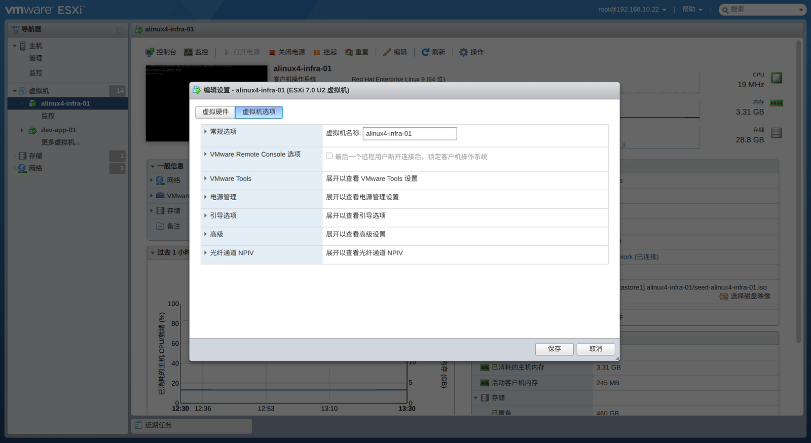

**做法。** 预留值取配置内存的 80%：24,576 MB × 0.8 = 19,660.8 MB，取 19,664 MB。

1. 在左侧点开 `alinux4-infra-01`，地址栏是 `…/ui/#/host/vms/38`。脚本按这个地址找虚拟机，所以要先点开。
2. 按 F12 打开控制台，粘贴附录里的脚本并回车。脚本会自己等几秒取登录令牌；提示"还没取到令牌"时，在页面上随便点一下再执行一次。
3. 虚拟机不用关机。执行完，控制台会打印任务结果和读回的预留值；"近期任务"里也多出一条 `Reconfig VM`，结果是"成功完成"：

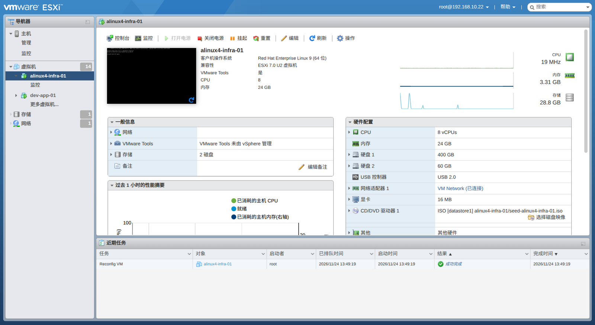

这次脚本返回的结果是：

```text
「alinux4-infra-01」配置内存 24576 MB，当前状态 poweredOn，预留现在是 0 MB。
任务 haTask-38-vim.VirtualMachine.reconfigure-26211（重新配置虚拟机）：成功
预留现在是 19664 MB；配置文件里：没有 sched.mem 开头的项。
```

脚本自带三道保护：先按名称核对虚拟机，对不上就停；开着机只允许调高预留，调低得先关机；提交后等任务结束再读回预留值，不凭"提交成功"就下结论。

**事后核对。** 用另一个查询脚本重新读了一遍：预留 19,664 MB，上限和份额没有变；宿主机资源池里"已被虚拟机预留的内存"从 2,884 MB 变成 22,547 MB，正好多出 19.6 GB；虚拟机没有中断，也没有被回收内存。

**两点说明。**

- **预留不等于占用。** 设完之后宿主机的已用内存没有变化（这台虚拟机当时只用 3.3 GB）。预留的含义是：宿主机内存紧张时，这部分不会从这台虚拟机身上拿，压力转到其他没有预留的虚拟机上。以后要调整，还是同一个脚本，换 `RESERVATION_MB`。
- 按 ESXi 的机制，虚拟机的交换文件会随预留变大而变小。这一点我没有去存储上核对。

## 六、验收

以下截图都是在最终配置下，从管理机通过 SSH 执行的只读检查。

**登录与身份。** 地址是 `192.168.10.50`，默认路由是静态的：

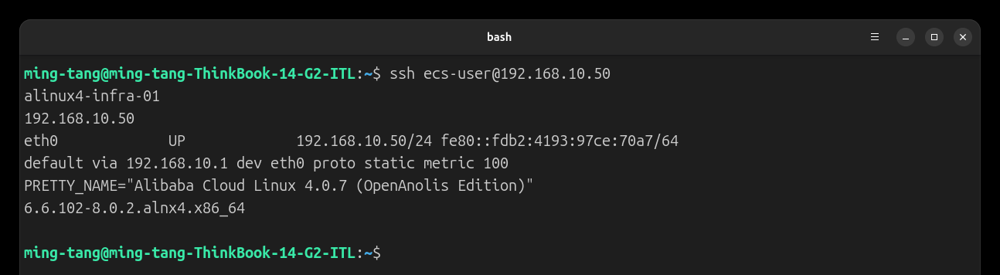

**网络、时间、规格。** DNS 生效；时区 Asia/Shanghai，时间已同步；1 插槽 × 8 核；系统里看到的内存是 23 GiB，比分配的 24 GB 少一点，差额是内核和固件保留的部分：

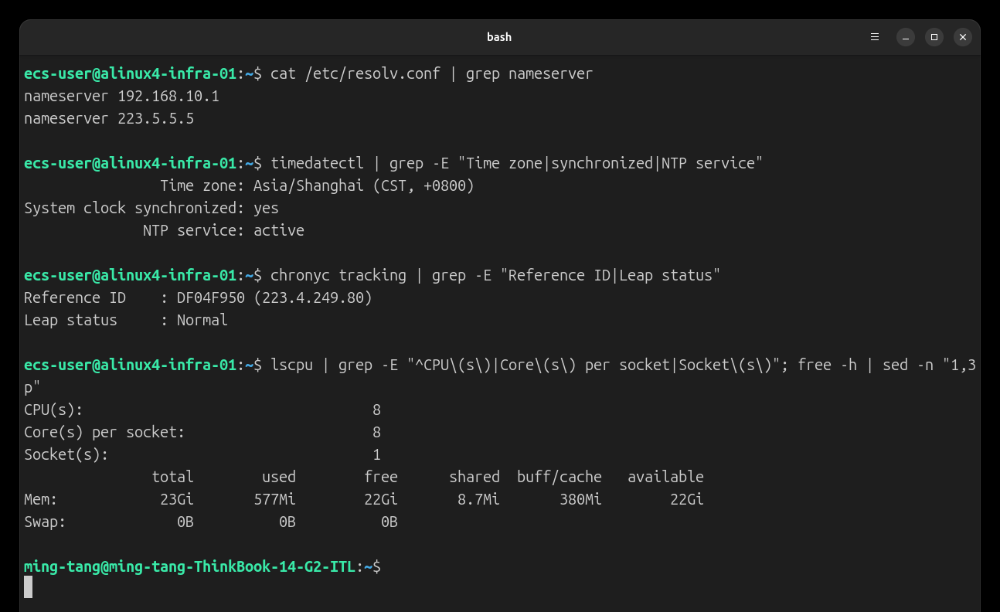

**磁盘。** 根分区在 `/dev/nvme0n1p3`，已扩到 59.8G；数据盘 `/dev/nvme0n2` 挂在 `/data`；fstab 里带着 `nofail`：

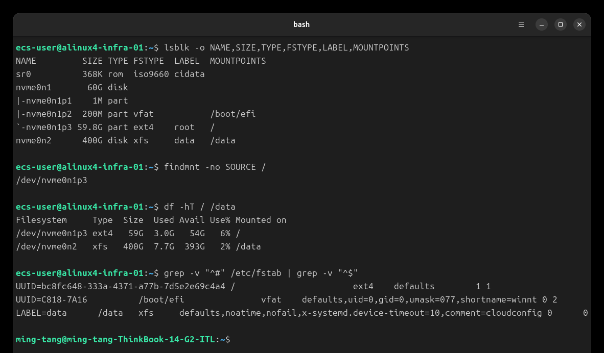

**登录策略。** `ecs-user` 免密 sudo；密码登录关闭；从管理机用 root 登录被拒：

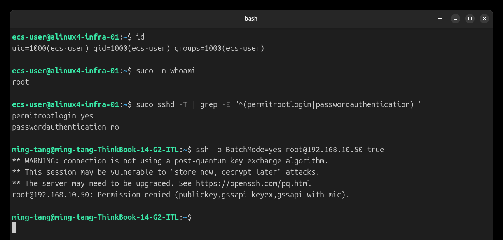

**初始化状态。** `cloud-init status` 为 `done`，数据源是 NoCloud，种子在 `/dev/sr0`。系统状态 `degraded` 只是因为 `systemd-vconsole-setup` 失败，那是虚拟机里常见的控制台字体问题，不影响使用：

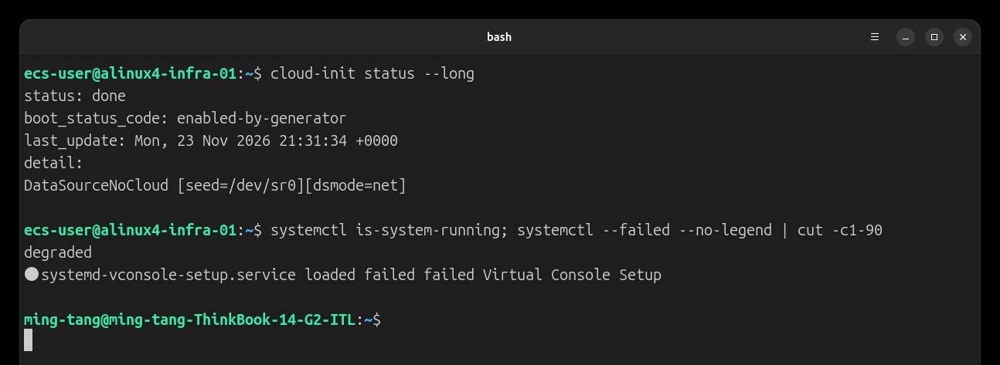

**软件源。** 镜像自带的源指向公网，直接可用：

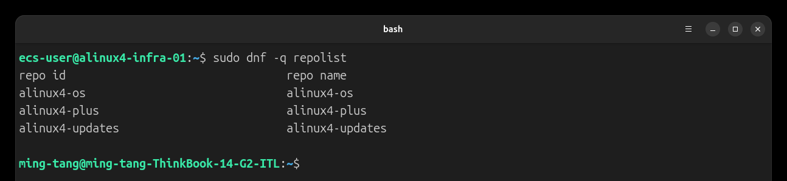

## 七、选型依据：镜像检查记录

云镜像不是为 VMware 做的。建虚拟机之前先只读地看一下里面的内容，硬件怎么选就有了依据，而不是试错。下面的命令在工具容器里执行，脚本源码见附录。

### 分区结构

先单独转一份 raw 用于检查（不扩容，保持原始的 20G 布局），再用 `gpt_dump.py` 解析分区表并把分区导出成单独文件，方便后面用 `debugfs` 读。

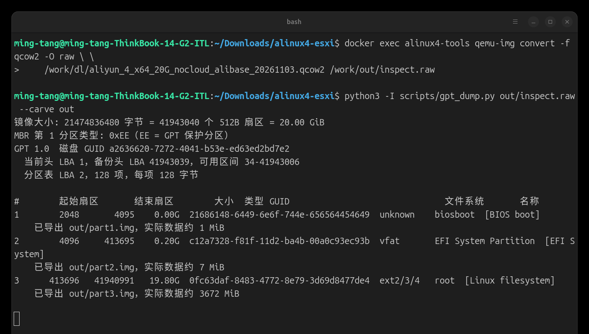

```text
LBA 0      1 MiB          200 MiB                      约 19.8 GiB
┌──────┬────────────┬──────────────┬───────────────────────────────────┐
│ 保护 │ BIOS boot   │ EFI 系统     │ 根分区 (ext4)                     │
│ MBR  │ (GRUB core) │ 分区 (FAT)   │ 排在最后 → 扩容时直接往后延伸即可  │
└──────┴────────────┴──────────────┴───────────────────────────────────┘
```

- **BIOS 和 EFI 两种固件都能启动**：EFI 分区里有 `EFI/BOOT/BOOTX64.EFI` 和 `EFI/alinux/grubx64.efi`。
- **根分区排在最后**，所以扩容只是"把最后一个分区往后延伸"，cloud-init 的 `growpart` 就能做。
- 根文件系统是 **ext4**，不用挂载也能用 `debugfs` 读。

### initramfs 里有哪些驱动

这是最关键的一项。系统盘的驱动必须在 initramfs 里——根分区挂载之前，系统只能用 initramfs 自带的模块。`/lib/modules` 里有不算数。

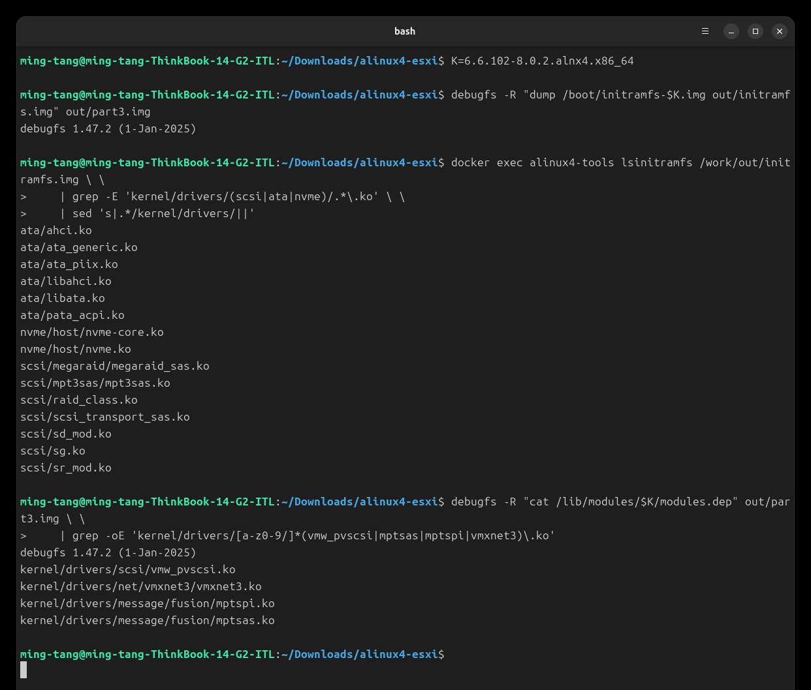

对照 ESXi 里能添加的控制器，以及这次的实测结果：

| ESXi 控制器 | 客户机需要的驱动 | 在 initramfs 里？ | 实测 |
| --- | --- | --- | --- |
| VMware Paravirtual（PVSCSI） | `vmw_pvscsi.ko` | 否 | 未试，按分析不能做系统盘 |
| LSI Logic SAS | `mptsas.ko` | 否 | 同上 |
| LSI Logic Parallel | `mptspi.ko` | 否 | 同上 |
| NVMe | `nvme.ko` | 是 | **可以启动**（第五节） |
| SATA（AHCI） | `ahci.ko` | 是 | **可以启动**（第一次开机） |

选 PVSCSI 或 LSI Logic 的话，开机会停在 `dracut-initqueue timeout`，后面跟着一行 `/dev/disk/by-uuid/… does not exist`。它们的驱动在 `/lib/modules` 里都有，所以**数据盘**接在 PVSCSI 上是没问题的——那时系统已经启动，可以正常加载模块。

`sr_mod.ko`、`cdrom.ko` 也在 initramfs 里，光驱挂配置盘没有问题。

### 数据盘判定逻辑的空跑结果

修正后的配置盘不再写死设备名，而是按"无签名、无分区、大于 100 GiB"挑盘。这段逻辑在虚拟机上以 root 身份空跑过一遍（只打印判定，不格式化），其中 `loop0` 是为了测试临时造出来的 101 GiB 空白盘：

```text
/dev/nvme0n1 size=  60 GiB partitions=3 signatures=4 -> skip
/dev/nvme0n2 size= 400 GiB partitions=0 signatures=2 -> skip
/dev/loop0   size= 101 GiB partitions=0 signatures=0 -> WOULD_FORMAT
```

系统盘被跳过；已经格式化过的数据盘也被跳过（不会重复格式化）；只有真正的空白盘才会被选中。

### cloud-init 的现状

| 检查项 | 镜像里的现状 | 对操作的影响 |
| --- | --- | --- |
| 数据源顺序 | `NoCloud` 排第一 | 挂 `cidata` 光驱就会被读取 |
| 默认用户 | `root` | 与 ECS 的 `ecs-user` 方式不一致，**由配置盘覆盖** |
| `sshd_config` | `PermitRootLogin yes`、`PasswordAuthentication no` | 只认密钥；root 的禁止靠 cloud-init 的 `disable_root` |
| `growpart` / `resizefs` | 已启用 | 根分区自动扩容，不用额外配置。实测根分区从 19.8G 扩到了 59.8G |
| YUM 源 | `mirrors.aliyun.com/alinux/...`（公网） | 不用改 |
| SELinux | `SELINUX=disabled`，内核参数 `selinux=0` | 默认关闭，与 ECS 一致 |
| 网卡命名 | 内核参数 `net.ifnames=0` | 网卡固定叫 `eth0` |
| 控制台 | `console=tty0 console=ttyS0,115200n8` | **系统输出走串口**，ESXi 屏幕上看不到 cloud-init 的过程，要靠 SSH 验证 |
| 时区 | `Asia/Shanghai` | 不用改 |

有一点值得单独记住：cloud-init 处理 `fs_setup` 时，只在设备上已经有同标签、同类型的文件系统时才跳过，**它不检查盘上有没有分区表**。所以往配置盘里写死一个设备名去格式化，一旦设备名对不上真实的盘，后果就是格式化错盘。这就是修正版改成按特征挑盘的原因。

## 八、与阿里云 ECS 的一致性和差异

| 项目 | 阿里云 ECS | 本虚拟机 | 备注 |
| --- | --- | --- | --- |
| 操作系统 | Alibaba Cloud Linux 4 | 同一发行版的 On-premise 云镜像（4.0.7） | 内核、软件包、`dnf` 源一致 |
| 登录用户 | 购买时可选 `ecs-user` | `ecs-user` | 官方推荐方式 |
| 提权 | `sudo su` | `sudo -i` 或 `sudo su`，免密 | |
| root 直接登录 | 不可用 | 不可用 | cloud-init `disable_root` |
| 密码登录 | 取决于购买时选的凭证 | 禁用，只认密钥 | |
| 软件源 | `mirrors.aliyun.com` | 同 | 镜像自带 |
| 安全组 | 有 | **没有** | ESXi 端口组只做二层接入；系统内也没有启用防火墙 |
| 云助手、云监控等 | 有 | 无 | 本地镜像不带这些组件 |
| VMware Tools | 不适用 | **没装**，见下 | |

**关于 VMware Tools**：AL4 默认启用的三个源（`os` 13415 个包、`updates`、`plus`）里都没有 `open-vm-tools`——ECS 上用不着它。影响有三点：

- ESXi 里对这台虚拟机只有"关闭电源"（断电），没有"关闭客户机"。要正常关机，进系统执行 `sudo shutdown -h now`。
- ESXi 不会自动显示它的 IP 和主机名。
- 不能做静默快照。

内核层面的半虚拟化驱动不依赖它，开机后已自动加载：`vmxnet3`（网卡）、`vmw_balloon`（内存气球）、`vmw_vmci`。缺的只是用户态的 `vmtoolsd`。

装不上，也不建议折腾：`open-vm-tools` 在 AL4 的三个源里都没有，EPEL 9 里也没有（实测在虚拟机里做了一次只解析、不安装的依赖查询，结果是 `No match for argument`）。这个包在 RHEL 9 自带的 AppStream 里，AL4 没有对应的源。硬要装只能从 Rocky、Alma 这类第三方源取 RPM，等于混用发行版，和"与 ECS 保持一致"的初衷相悖。

## 九、常见问题

| 现象 | 原因 | 处理 |
| --- | --- | --- |
| 开机停在 `dracut-initqueue timeout` | 系统盘接在了 PVSCSI / LSI Logic 上 | 关机，把系统盘改接 NVMe 或 SATA 控制器 |
| 开机报"磁盘类型不受支持或无效，请确保磁盘已导入" | 挂的是转换得到的 `streamOptimized` 磁盘 | 先导入成原生磁盘（步骤 18） |
| 开机后没有任何账号能登录 | 没挂配置盘，或光驱没勾"打开电源时连接" | 挂 `cidata` ISO，勾选后重新开机 |
| 配置的静态地址连不上 | cloud-init 的网络配置没生效 | 登进去（可能要用 DHCP 地址）看 `cloud-init status --long`；默认路由要写 `to: 0.0.0.0/0` |
| `/data` 没挂载 | 数据盘设备名和配置里写的不一致 | 看 `lsblk`；手工格式化并挂载（第四节问题二） |
| 改了配置盘却不生效 | `instance-id` 没变，cloud-init 认为还是同一个实例 | 改 `meta-data` 里的 `instance-id` 后重新开机 |
| 用 root 登录被拒 | 设计如此 | 用 `ecs-user` 登录后 `sudo -i` |
| 在 ESXi 控制台的 `login:` 下输什么密码都不行 | 建机时按 ECS 的方式锁定了 root 和 `ecs-user` 的密码，平时靠 SSH 密钥 | 给 root 设一个只在控制台用的密码，做法见《系统优化》第二节 |
| ESXi 屏幕上只看到内核日志和一个登录提示 | 系统输出走串口 `ttyS0` | 正常现象，用 SSH 操作 |
| 选了 EFI 后启动失败 | 安全引导拦截了云镜像的引导程序 | 关机，编辑设置里取消"启用 UEFI 安全引导" |
| ESXi 里没有"关闭客户机" | 没装 VMware Tools | 进系统执行 `sudo shutdown -h now` |
| 主机断电恢复后虚拟机没有自动开机 | 新建虚拟机默认不参与自动启动 | 主机 → 管理 → 系统 → 自动启动，选中虚拟机点"启用" |
| 界面里找不到"内存预留" | ESXi 自带的 Host Client 不提供这项，只有 vSphere Client 有 | 在已登录的页面里执行附录的 `set_reservation_snippet.js`（第五节） |
| 虚拟机变慢，系统里查不出原因 | 宿主机内存超配，这台虚拟机没有预留，被 ESXi 回收了内存 | ESXi 的"监控"里看该虚拟机的"气球"和"交换"；给它设预留 |

## 十、清理与再建一台

用完后删掉工具容器和中间产物（`out/*.raw` 是几十 GB 的稀疏文件，没必要留着）：

```bash
docker rm -f alinux4-tools
rm -f ~/Downloads/alinux4-esxi/out/*.raw ~/Downloads/alinux4-esxi/out/part*.img
```

**再建一台**（比如 `alinux4-infra-02`）：

1. 换一个确认空闲的 IP，改 `seed/` 下三个文件里的主机名和地址。选地址时 ping 和 ARP 都没有响应才算空闲——有的主机不回 ping 但地址是占着的。在已建好的虚拟机里用 `arping -D` 探测最可靠。
2. `meta-data` 里的 `instance-id` 必须换一个值，否则 cloud-init 会跳过"每实例一次"的步骤（建用户、格式化数据盘、扩容都不会做）。
3. 重新跑 `seed.sh` 生成新的配置盘并上传。系统盘不用重新上传：用附录的脚本从母盘 `alinux4-infra-01-os.vmdk` 再导入一份，把脚本里的 `DST` 改成新虚拟机目录下的路径。
4. 按第三节建机。有了实测出来的编号规则，可以直接把系统盘放在 NVMe (0:0)、数据盘放在 (0:1)，不需要再经过 SATA。
5. 别忘了启用随主机自动开机（第五节末尾）：新建虚拟机默认是"取消设置"，不启用的话主机断电恢复后它不会自己开机。
6. 内存预留也要重设（第五节）：新建虚拟机的预留默认是 0，用附录的同一个脚本改一下 `VM_NAME` 即可。
7. 建完之后给 root 设一个控制台专用的密码。不设的话，ESXi 控制台登不进去。做法见《系统优化》第二节。

要说明的是：修正后的配置盘在首次开机时全自动完成静态 IP 和数据盘格式化，这条路**没有从头再跑一遍**（需要再建一台才能验证）。它的两个关键部分是分开验证的：路由写法通过了镜像自带 cloud-init 的解析，数据盘判定逻辑在真实磁盘上空跑通过。

## 附录：脚本源码

<details>
<summary><code>scripts/gpt_dump.py</code>：只读解析 GPT 分区表，可把分区稀疏导出成单独文件</summary>

```python
#!/usr/bin/env python3
"""只读检查磁盘镜像：解析 GPT 分区表、识别分区上的文件系统，并按需把分区稀疏导出成单独文件。

用法：
  python3 -I gpt_dump.py <disk.img>                 # 只打印分区表
  python3 -I gpt_dump.py <disk.img> --carve <dir>   # 同时把每个分区导出到 <dir>/partN.img
"""
import struct
import sys
import uuid

MIB = 1024 * 1024

# 类型 GUID 的前三段是小端序存储，这里统一格式化成规范形式后比对
TYPES = {
    "c12a7328-f81f-11d2-ba4b-00a0c93ec93b": "EFI System",
    "21686148-6449-6e6f-744e-656564454649": "BIOS boot",
    "0fc63daf-8483-4772-8e79-3d69d8477de4": "Linux filesystem",
    "0657fd6d-a4ab-43c4-84e5-0933c84b4f4f": "Linux swap",
    "e6d6d379-f507-44c2-a23c-238f2a3df928": "Linux LVM",
    "ebd0a0a2-b9e5-4433-87c0-68b6b72699c7": "Microsoft basic data",
    "a19d880f-05fc-4d3b-a006-743f0f84911e": "Linux RAID",
}


def fmt_guid(raw: bytes) -> str:
    d1, d2, d3 = struct.unpack_from("<IHH", raw, 0)
    node = int.from_bytes(raw[10:16], "big")
    return str(uuid.UUID(fields=(d1, d2, d3, raw[8], raw[9], node)))


def fs_magic(f, offset: int) -> str:
    """按分区起始处的魔数猜文件系统类型，只读前 0x440 字节。"""
    f.seek(offset)
    head = f.read(0x440)
    if len(head) < 0x440:
        return "?"
    if head[0x438:0x43A] == b"\x53\xef":
        return "ext2/3/4"
    if head[0:4] == b"XFSB":
        return "xfs"
    if head[0:4] == b"LUKS":
        return "luks"
    if head[3:11] in (b"MSDOS5.0", b"MSWIN4.1", b"MKFS4.4 ") or (head[0x36:0x3E] == b"FAT16   " or head[0x52:0x5A] == b"FAT32   "):
        return "vfat"
    if head[0x438:0x43A] == b"\xef\x53":  # 不会走到这里，保留可读性
        return "ext"
    return "unknown"


def carve(f, start: int, size: int, path: str) -> None:
    """把分区内容稀疏导出：整块全零就跳过（打洞），否则写出。"""
    written = 0
    with open(path, "wb") as out:
        f.seek(start)
        left = size
        while left > 0:
            chunk = f.read(min(MIB, left))
            if not chunk:
                break
            if chunk.count(0) != len(chunk):
                out.write(chunk)
                written += len(chunk)
            else:
                out.seek(len(chunk), 1)
            left -= len(chunk)
        out.truncate(size)
    print(f"    已导出 {path}，实际数据约 {written / MIB:.0f} MiB")


def main() -> None:
    disk = sys.argv[1]
    carve_dir = None
    if "--carve" in sys.argv:
        carve_dir = sys.argv[sys.argv.index("--carve") + 1]

    with open(disk, "rb") as f:
        f.seek(0, 2)
        total = f.tell()
        sector = 512
        f.seek(0)
        mbr = f.read(512)
        mbr_type = mbr[0x1C2]
        print(f"镜像大小: {total} 字节 = {total / sector:.0f} 个 512B 扇区 = {total / 1024**3:.2f} GiB")
        print(f"MBR 第 1 分区类型: 0x{mbr_type:02X}{'（EE = GPT 保护分区）' if mbr_type == 0xEE else ''}")

        f.seek(sector)
        hdr = f.read(92)
        if hdr[:8] != b"EFI PART":
            print("未发现 GPT 头（EFI PART），可能是纯 MBR 分区表")
            return
        sig, rev, hdr_size, hdr_crc, _, cur, bak, first_usable, last_usable, disk_guid, pe_lba, n_entries, entry_size, _crc = struct.unpack(
            "<8sIIIIQQQQ16sQIII", hdr
        )
        print(f"GPT {rev >> 16}.{rev & 0xFFFF}  磁盘 GUID {fmt_guid(disk_guid)}")
        print(f"  当前头 LBA {cur}，备份头 LBA {bak}，可用区间 {first_usable}-{last_usable}")
        print(f"  分区表 LBA {pe_lba}，{n_entries} 项，每项 {entry_size} 字节")
        print()
        print(f"{'#':<3}{'起始扇区':>10}{'结束扇区':>11}{'大小':>10}  {'类型 GUID':<38}{'文件系统':<11}名称")
        f.seek(pe_lba * sector)
        table = f.read(n_entries * entry_size)
        n = 0
        for i in range(n_entries):
            e = table[i * entry_size:(i + 1) * entry_size]
            if e[:16] == b"\x00" * 16:
                continue
            n += 1
            tguid = fmt_guid(e[:16])
            first, last = struct.unpack_from("<QQ", e, 32)
            size = last - first + 1
            name = e[56:128].decode("utf-16le").rstrip("\x00")
            fs = fs_magic(f, first * sector)
            print(f"{n:<3}{first:>10}{last:>11}{size * sector / 1024**3:>8.2f}G  {tguid:<38}{fs:<11}{name}  [{TYPES.get(tguid, '?')}]")
            if carve_dir:
                carve(f, first * sector, size * sector, f"{carve_dir}/part{n}.img")


if __name__ == "__main__":
    main()
```

</details>

<details>
<summary><code>scripts/import_disk_snippet.js</code>：在 Host Client 页面的浏览器控制台里执行，把上传的磁盘导入成 ESXi 原生磁盘</summary>

用法：

1. 在已登录的 Host Client 页面按 F12，打开控制台（Console）。
2. 粘贴下面的脚本并回车。第一次会提示"还没取到令牌"——这是它在页面上装一个钩子，用来取 Host Client 自己调用接口时带的请求头。
3. 在页面上随便点一下（比如"刷新"），再粘贴执行一次。这次会提交导入任务并返回任务号。
4. 大约 1 分钟后，在控制台执行 `await __checkEsxiTask('任务号')` 查看结果，或者在"近期任务"里看 `Copy Virtual Disk`。

照做前改掉开头的 `SRC` 和 `DST` 两行。脚本调用的是 ESXi 的 `CopyVirtualDisk_Task` 接口，等同于 `vmkfstools -i <源> -d thin <目标>`，用的是页面自己的登录会话。这段脚本的提交部分用一个临时文件完整跑过，结果查询函数在一个成功任务和一个失败任务上各验证过一次。

```javascript
(async () => {
  // 在已登录的 ESXi Host Client 页面里，按 F12 打开浏览器控制台，粘贴本段脚本并回车。
  // 作用：把上传得到的 streamOptimized 磁盘导入成 ESXi 原生磁盘（精简置备），
  //       等同于在 ESXi Shell 里执行 vmkfstools -i <源> -d thin <目标>。
  // 用的是页面自己的登录会话，不需要另外输入账号密码。
  const SRC = '[datastore1] alinux4-infra-01/alinux4-infra-01-os.vmdk';        // 上传得到的磁盘
  const DST = '[datastore1] alinux4-infra-01/alinux4-infra-01-os-native.vmdk'; // 导入后的磁盘

  // 1) 取 Host Client 自己调用接口时带的请求头。ESXi 有 CSRF 防护，只带 Cookie 的请求会被当成未登录。
  //    这里挂一个钩子，等页面发出下一次请求时记下令牌；所以需要先在页面上随便点一下（比如"刷新"）。
  if (!window.__csrfHook) {
    const orig = XMLHttpRequest.prototype.setRequestHeader;
    window.__csrf = null;
    XMLHttpRequest.prototype.setRequestHeader = function (k, v) {
      if (/^vmware-csrf-token$/i.test(k)) { window.__csrf = v; }
      return orig.apply(this, arguments);
    };
    window.__csrfHook = true;
  }
  if (!window.__csrf) { return '还没取到令牌：请先在页面上点一次"刷新"，然后重新执行本段脚本。'; }

  const soap = (body) => fetch('/sdk/', {
    method: 'POST',
    credentials: 'same-origin',
    headers: {
      'Content-Type': 'text/xml; charset=UTF-8',
      SOAPAction: 'urn:vim25',
      'VMware-CSRF-Token': window.__csrf,
    },
    body: '<soapenv:Envelope xmlns:soapenv="http://schemas.xmlsoap.org/soap/envelope/"' +
      ' xmlns:xsd="http://www.w3.org/2001/XMLSchema" xmlns:xsi="http://www.w3.org/2001/XMLSchema-instance">' +
      '<soapenv:Body>' + body + '</soapenv:Body></soapenv:Envelope>',
  }).then((r) => r.text());

  // 2) 查源磁盘容量（磁道数 × 磁头数 × 扇区数 × 512 字节），目标磁盘必须显式写容量
  const g = await soap('<QueryVirtualDiskGeometry xmlns="urn:vim25"><_this type="VirtualDiskManager">ha-vdiskmanager</_this><name>' + SRC + '</name></QueryVirtualDiskGeometry>');
  const geo = /<cylinder>(\d+)<\/cylinder>[\s\S]*?<head>(\d+)<\/head>[\s\S]*?<sector>(\d+)<\/sector>/.exec(g);
  if (!geo) { return '读不到源磁盘的容量，请检查 SRC 路径：' + g.replace(/\s+/g, ' ').slice(0, 400); }
  const capacityKb = Math.floor(geo[1] * geo[2] * geo[3] * 512 / 1024);

  // 3) 提交导入任务。adapterType 的正确写法是 lsiLogic（Logic 的 L 大写，其它写法都会被拒绝）
  const r = await soap('<CopyVirtualDisk_Task xmlns="urn:vim25"><_this type="VirtualDiskManager">ha-vdiskmanager</_this>' +
    '<sourceName>' + SRC + '</sourceName><destName>' + DST + '</destName>' +
    '<destSpec xsi:type="FileBackedVirtualDiskSpec"><diskType>thin</diskType><adapterType>lsiLogic</adapterType>' +
    '<capacityKb>' + capacityKb + '</capacityKb></destSpec><force>false</force></CopyVirtualDisk_Task>');
  const task = /<returnval type="Task">([^<]+)<\/returnval>/.exec(r);
  if (!task) { return '提交失败：' + r.replace(/\s+/g, ' ').slice(0, 500); }

  // 4) 留一个查询任务结果的函数，稍后在控制台里执行： await __checkEsxiTask('<任务号>')
  window.__checkEsxiTask = async (id) => {
    const s = await soap('<RetrieveProperties xmlns="urn:vim25"><_this type="PropertyCollector">ha-property-collector</_this>' +
      '<specSet><propSet><type>Task</type><pathSet>info.state</pathSet><pathSet>info.error</pathSet></propSet>' +
      '<objectSet><obj type="Task">' + id + '</obj></objectSet></specSet></RetrieveProperties>');
    const state = /<name>info\.state<\/name><val[^>]*>(\w+)<\/val>/.exec(s);
    if (!state) { return '查不到这个任务（可能已经过期），请在"近期任务"里查看。'; }
    if (state[1] === 'success') { return '成功完成'; }
    const msg = /<localizedMessage>([^<]*)<\/localizedMessage>/.exec(s);
    return state[1] === 'error' ? ('失败：' + (msg ? msg[1] : '未知原因')) : ('进行中：' + state[1]);
  };
  return '导入任务已提交，任务号 ' + task[1] + '。大约 1 分钟后在控制台执行：await __checkEsxiTask(\'' + task[1] + '\')';
})()
```

</details>

<details>
<summary><code>scripts/set_reservation_snippet.js</code>：在 Host Client 页面的浏览器控制台里执行，给虚拟机设内存预留</summary>

用法：

1. 在左侧点开目标虚拟机，地址栏应形如 `…/ui/#/host/vms/38`。
2. 按 F12 打开控制台，粘贴下面的脚本并回车。脚本会等页面自己发出一次请求来取令牌，通常几秒；等不到会提示你在页面上点一下再执行。
3. 结束后控制台直接打印结果：任务是否成功，以及读回的预留值。也可以在"近期任务"里看 `Reconfig VM`。

照做前核对开头的 `VM_NAME` 和 `RESERVATION_MB`。脚本调用的是 ESXi 的 `ReconfigVM_Task` 接口，等同于 vSphere Client 里"编辑设置 → 资源 → 内存 → 预留"，用的是页面自己的登录会话。这段脚本在 2026-11-24 实际执行过：第一次被 ESXi 拒绝（有的字段这台虚拟机没有记录，读成了空值），补上默认值后成功；下面是修正后的版本。

```javascript
await (async () => {
  // 在已登录的 ESXi Host Client 页面里，先点开目标虚拟机（地址栏形如 …/ui/#/host/vms/38），
  // 按 F12 打开浏览器控制台，粘贴本段脚本并回车。
  // 作用：给这台虚拟机设内存预留。ESXi 自带的 Host Client 界面里没有这一项，所以走接口，
  //       等同于 vSphere Client 里"编辑设置 → 资源 → 内存 → 预留"。虚拟机开着机也能调高，不用关机。
  // 用的是页面自己的登录会话，不需要另外输入账号密码。
  // 开着机只能调高、不能调低；要调低得先关机。脚本会先核对虚拟机名称，对不上就什么都不做。
  const VM_NAME = 'alinux4-infra-01';   // 虚拟机名称，必须和地址栏里那台一致
  const RESERVATION_MB = 19664;         // 要预留的内存，单位 MB（这台虚拟机配置 24576 MB，这是 80%）

  // 1) 取 Host Client 自己调用接口时带的请求头。ESXi 有 CSRF 防护，只带 Cookie 的请求会被当成未登录。
  //    这里挂一个钩子，等页面发出下一次请求时记下令牌；页面每隔一会儿会自己刷新，所以通常等几秒就有。
  if (!window.__csrfHook) {
    const orig = XMLHttpRequest.prototype.setRequestHeader;
    window.__csrf = null;
    XMLHttpRequest.prototype.setRequestHeader = function (k, v) {
      if (/^vmware-csrf-token$/i.test(k)) { window.__csrf = v; }
      return orig.apply(this, arguments);
    };
    window.__csrfHook = true;
  }
  const sleep = (ms) => new Promise((r) => setTimeout(r, ms));
  for (let i = 0; i < 40 && !window.__csrf; i++) await sleep(500);
  if (!window.__csrf) { return '还没取到令牌：在页面上随便点一下（比如"刷新"），然后重新执行本段脚本。'; }

  const soap = (body) => fetch('/sdk/', {
    method: 'POST',
    credentials: 'same-origin',
    headers: {
      'Content-Type': 'text/xml; charset=UTF-8',
      SOAPAction: 'urn:vim25',
      'VMware-CSRF-Token': window.__csrf,
    },
    body: '<soapenv:Envelope xmlns:soapenv="http://schemas.xmlsoap.org/soap/envelope/"' +
      ' xmlns:xsd="http://www.w3.org/2001/XMLSchema" xmlns:xsi="http://www.w3.org/2001/XMLSchema-instance">' +
      '<soapenv:Body>' + body + '</soapenv:Body></soapenv:Envelope>',
  }).then((r) => r.text());

  // props(类型, 对象编号, [属性路径])：读若干属性，返回 { 属性路径: <val> 元素 }
  const props = async (type, objId, paths) => {
    const x = await soap('<RetrieveProperties xmlns="urn:vim25"><_this type="PropertyCollector">ha-property-collector</_this>' +
      '<specSet><propSet><type>' + type + '</type>' + paths.map((p) => '<pathSet>' + p + '</pathSet>').join('') + '</propSet>' +
      '<objectSet><obj type="' + type + '">' + objId + '</obj></objectSet></specSet></RetrieveProperties>');
    const d = new DOMParser().parseFromString(x, 'text/xml');
    const f = d.getElementsByTagNameNS('*', 'Fault')[0];
    if (f) { throw new Error(f.textContent.replace(/\s+/g, ' ').slice(0, 300)); }
    const o = {};
    for (const ps of Array.from(d.getElementsByTagName('propSet'))) { o[ps.querySelector('name').textContent] = ps.querySelector('val'); }
    return o;
  };
  // t(<val> 元素, 'a.b.c')：按属性路径取到文本
  const t = (el, path) => {
    let e = el;
    for (const k of path ? path.split('.') : []) { if (!e) { return null; } e = Array.from(e.children).find((c) => c.tagName === k) || null; }
    return e ? e.textContent.trim() : null;
  };

  // 2) 核对：地址栏里的那台就是目标虚拟机吗？现在的预留是多少？
  const id = (location.hash.match(/#\/host\/vms\/(\d+)/) || [])[1];
  if (!id) { return '地址栏不是某台虚拟机的页面（应形如 …/ui/#/host/vms/38）。请先在左侧点开目标虚拟机。'; }
  const p = await props('VirtualMachine', id, ['name', 'runtime.powerState', 'summary.config.memorySizeMB', 'resourceConfig.memoryAllocation']);
  const name = t(p.name, '');
  if (name !== VM_NAME) { return '地址栏里的虚拟机是「' + name + '」，不是「' + VM_NAME + '」。已停止，什么都没改。'; }
  const power = t(p['runtime.powerState'], '');
  const sizeMB = Number(t(p['summary.config.memorySizeMB'], ''));
  const a = p['resourceConfig.memoryAllocation'];
  const cur = {
    reservation: Number(t(a, 'reservation')), limit: Number(t(a, 'limit')),
    // 这几项有些虚拟机上没有记录（读到的是空），提交时要给出明确的值，否则 ESXi 解析不了
    expandable: t(a, 'expandableReservation') || 'false',
    shares: t(a, 'shares.shares') || String(sizeMB * 10), level: t(a, 'shares.level') || 'normal',
  };
  const head = '「' + name + '」配置内存 ' + sizeMB + ' MB，当前状态 ' + power + '，预留现在是 ' + cur.reservation + ' MB。';
  if (!(RESERVATION_MB > 0) || RESERVATION_MB > sizeMB) { return head + '\n预留值要在 1 到 ' + sizeMB + ' MB 之间，已停止。'; }
  if (RESERVATION_MB === cur.reservation) { return head + '\n已经是这个值，不需要改。'; }
  if (RESERVATION_MB < cur.reservation && power === 'poweredOn') { return head + '\n开着机只能调高预留。要调低得先关机。已停止。'; }

  // 3) 提交"重新配置虚拟机"任务。份额和上限按现有值原样带回，只改预留。
  const r = await soap('<ReconfigVM_Task xmlns="urn:vim25"><_this type="VirtualMachine">' + id + '</_this>' +
    '<spec xsi:type="VirtualMachineConfigSpec"><memoryAllocation xsi:type="ResourceAllocationInfo">' +
    '<reservation>' + RESERVATION_MB + '</reservation><expandableReservation>' + cur.expandable + '</expandableReservation>' +
    '<limit>' + cur.limit + '</limit>' +
    '<shares xsi:type="SharesInfo"><shares>' + cur.shares + '</shares><level>' + cur.level + '</level></shares>' +
    '</memoryAllocation></spec></ReconfigVM_Task>');
  const task = /<returnval type="Task">([^<]+)<\/returnval>/.exec(r);
  if (!task) { const fs = /<faultstring[^>]*>([^<]*)<\/faultstring>/.exec(r); return head + '\n提交失败：' + (fs ? fs[1].slice(0, 400) : r.replace(/\s+/g, ' ').slice(0, 400)); }

  // 4) 等任务结束（通常一两秒），再读回预留值核对
  let state = ''; let msg = '';
  for (let i = 0; i < 60; i++) {
    await sleep(1000);
    const tp = await props('Task', task[1], ['info.state', 'info.error']);
    state = t(tp['info.state'], ''); msg = t(tp['info.error'], 'localizedMessage');
    if (state === 'success' || state === 'error') { break; }
  }
  const how = state === 'success' ? '成功' : (state === 'error' ? '失败：' + msg : '超时未结束，请到"近期任务"里查看');
  const q = await props('VirtualMachine', id, ['resourceConfig.memoryAllocation', 'config.extraConfig']);
  const after = t(q['resourceConfig.memoryAllocation'], 'reservation');
  const mem = Array.from(q['config.extraConfig'] ? q['config.extraConfig'].children : [])
    .map((o) => t(o, 'key') + ' = ' + t(o, 'value')).filter((s) => /^sched\.mem/.test(s));
  return head + '\n任务 ' + task[1] + '（重新配置虚拟机）：' + how +
    '\n预留现在是 ' + after + ' MB；配置文件里：' + (mem.join('，') || '没有 sched.mem 开头的项') + '。';
})()
```

</details>

## 参考

- [Alibaba Cloud Linux 4 On-premise Image](https://mirrors.aliyun.com/alinux/4/image/) —— 镜像下载页
- [在本地虚拟机使用 Alibaba Cloud Linux 镜像](https://help.aliyun.com/zh/alinux/getting-started/use-alibaba-cloud-linux-3-images-in-an-on-premises-environment) —— 官方的本地使用说明（只讲 KVM，seed 的做法相同）
- [实例登录名、密码、密钥对管理](https://help.aliyun.com/zh/ecs/user-guide/instance-logon-credential-management)
- [避免使用 root 账号登录实例](https://help.aliyun.com/zh/ecs/user-guide/avoid-logging-in-to-the-instance-as-root)
- [自定义购买实例](https://help.aliyun.com/zh/ecs/user-guide/create-an-instance-by-using-the-wizard)
- [cloud-init NoCloud 数据源](https://cloudinit.readthedocs.io/en/latest/reference/datasources/nocloud.html)
