# Alibaba Cloud Linux 4 系统优化：SSH、自动安全更新、日志、Swap、基础工具、容器引擎

> 基线：2026-11-24 实测。对象是 `alinux4-infra-01`（`192.168.10.50`，Alibaba Cloud Linux 4.0.7，内核 6.6.102-8.0.4），已经做完建机和精简（见另外两份手册）。命令都在虚拟机里以 `ecs-user` 执行，只有下载 GitHub 上的文件是在管理机（写这份手册的 Ubuntu 电脑）上做的，会单独说明。截图是在真实终端里跑手册中的命令拍下来的，中途踩到的坑收在第九节。

## 一、开始之前

### 结果

| 项目 | 之前 | 现在 |
| --- | --- | --- |
| SSH | 配置里允许 root 登录，只是因为 root 没有密钥才登不进 | `PermitRootLogin no` |
| 控制台登录 | 两个账号都没有密码，ESXi 控制台登不进去 | root 有密码，只能在 ESXi 控制台使用；网络上 SSH 仍然拒绝 root 和一切密码 |
| 安全更新 | 没有自动更新 | 每天 6:00 到 7:00 之间自动装安全补丁，不自动重启 |
| 日志 | journald 没设上限（最多约 4G）；rsyslog 再往 `/var/log` 写一份 | journald 上限 500M，只留这一份 |
| Swap | 没有 | `/data/swapfile` 4G，`vm.swappiness = 10` |
| 基础工具 | 缺 11 个常用命令 | git、unzip、jq、yq、dig、lsof、rsync、htop、iotop、tmux、tree |
| 容器引擎 | 没有 | Docker Engine 29.5.1（包名 `moby-engine`）、Compose 2.26.1、buildx 0.39.1 |

### 动手前确认的两个决定

- **日志“不要多写”的意思是只留 journald 一份。** `/var/log/messages`、`secure` 这些文本文件不再更新，看日志统一用 `journalctl`。
- **容器引擎选 `moby-engine`。** 它就是 Docker Engine，由阿里云打包签名，现有手册里的 `docker compose` 等命令一条都不用改。Podman 在 Alibaba Cloud Linux 4 的官方源里没有。

### 两个贯穿全程的做法

- **能用独立的小文件，就不改系统自带的配置文件。** SSH、journald 的设置都放在专门的目录里（`sshd_config.d`、`journald.conf.d`），系统原来的文件一个字不动，回滚就是删掉小文件。
- **每次改动都先看“之前”，改完再看“之后”。** 所以下面的命令常常成对出现，截图里能看到前后对比。

## 二、SSH：禁止 root 登录

### 步骤 1：加一个配置片段

系统自带的 `/etc/ssh/sshd_config` 第 15 行有一句 `Include /etc/ssh/sshd_config.d/*.conf`，排在它自己的 `PermitRootLogin yes`（第 132 行）前面。sshd 的规则是同一项以先读到的为准，所以放在 `sshd_config.d` 里的设置会生效。

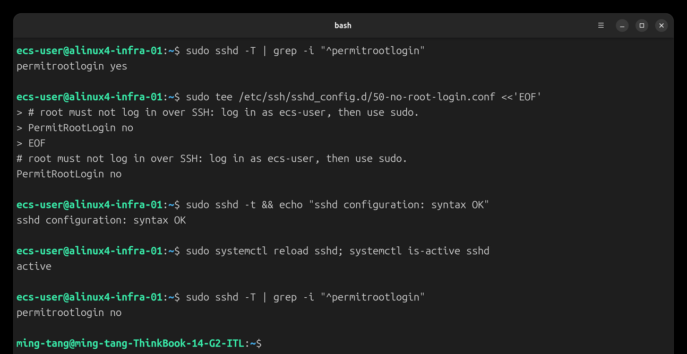

```bash
sudo sshd -T | grep -i "^permitrootlogin"       # 改之前：permitrootlogin yes

sudo tee /etc/ssh/sshd_config.d/50-no-root-login.conf <<'EOF'
# root must not log in over SSH: log in as ecs-user, then use sudo.
PermitRootLogin no
EOF

sudo sshd -t && echo "sshd configuration: syntax OK"
sudo systemctl reload sshd; systemctl is-active sshd

sudo sshd -T | grep -i "^permitrootlogin"       # 改之后：permitrootlogin no
```

- `sshd -T` 打印的是 sshd 最终生效的配置，改没改成功看它。
- **每次改 sshd 配置都先 `sshd -t` 再 `reload`。** 前者检查语法，配置写错会让 sshd 起不来，人就被锁在外面。`reload` 不会断开现有连接。
- 改完先别断开当前连接，另开一个窗口确认能登录。这次确认过：`ecs-user` 照常登录，用 root 登录被拒。

### 控制台专用的 root 密码

**为什么需要。** 禁止 root 登录、关闭密码登录之后，平时只靠一把 SSH 私钥进门。网络断了、sshd 出问题，或者私钥丢了的时候，ESXi 的控制台是唯一的入口。控制台登录要的是密码，而建机时两个账号都没有密码（`root` 和 `ecs-user` 都是锁定状态），所以那里其实进不去。

**为什么这个密码只会在控制台有效。** 密码能不能用，取决于是哪个服务在问它：

| 途径 | 谁在问密码 | 结果 |
| --- | --- | --- |
| SSH（网络） | `sshd` | 不收密码（`PasswordAuthentication no`）；root 更是完全拒绝（`PermitRootLogin no`） |
| ESXi 控制台 | Linux 本地登录 | 收密码 |

网络上在监听的只有 SSH，没有别的服务会问密码。所以给 root 设上密码，它就只能在控制台用。

**给 root 设，而不是给 `ecs-user` 设**，有两个原因。root 被 SSH 里单独一条规则挡死，和密码设置无关。系统启动失败进入紧急模式时，要的正是 root 的密码，而最需要控制台的场合就是起不来的时候。

在现有的 SSH 会话里执行，密码存进密码管理器：

```bash
sudo passwd root
```

这一步和下面在控制台登录的那一步，都是你自己操作的，密码不经过别人。事后核对状态：

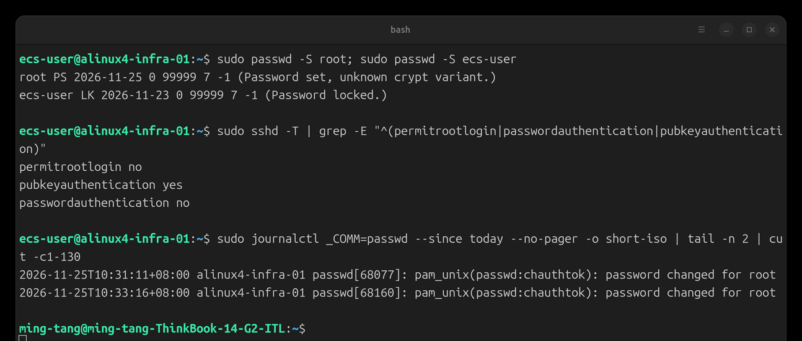

```bash
sudo passwd -S root; sudo passwd -S ecs-user
sudo sshd -T | grep -E "^(permitrootlogin|passwordauthentication|pubkeyauthentication)"
sudo journalctl _COMM=passwd --since today --no-pager -o short-iso | tail -n 2
```

- `PS` 表示已设密码，`LK` 表示锁定。root 是前者，`ecs-user` 仍是后者，只认密钥。
- 日志里的 `password changed for root` 是 `ecs-user` 通过 sudo 改的。谁、在哪个终端、什么时间、执行了什么，都记着。

再从别的机器确认“网络上用不了”。让 SSH 只用密码去连，不用密钥，它连输密码的机会都不给：

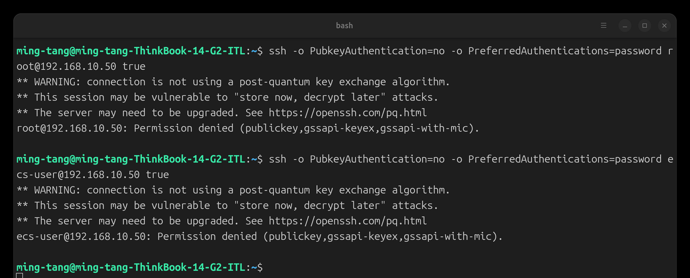

```bash
ssh -o PubkeyAuthentication=no -o PreferredAuthentications=password root@192.168.10.50 true
ssh -o PubkeyAuthentication=no -o PreferredAuthentications=password ecs-user@192.168.10.50 true
```

**在 ESXi 控制台登录。** 主机 → 虚拟机 → `alinux4-infra-01` → “控制台”，在新窗口打开。用鼠标点一下屏幕，让键盘输入进到虚拟机里，按回车，在 `login:` 处输入 `root` 和密码。输密码时屏幕上不显示任何字符。打字之前把输入法切到英文。屏幕的样子见建机手册里的控制台截图：

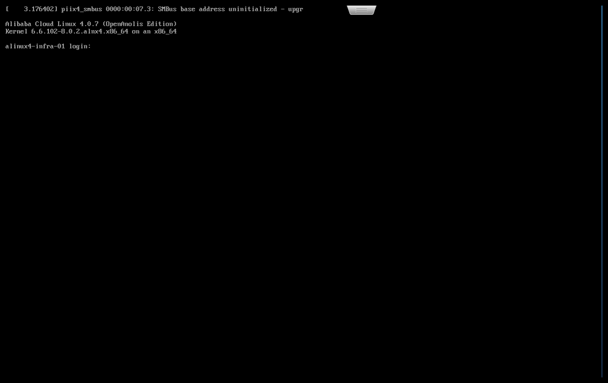

用 root 和密码登录成功的那一屏我没有截图，因为要输入密码，只能由你自己操作。这台机器上实际登录验证过。

**要守住的三条：**

1. 别改 `sshd_config` 里的那两个 `no`。“密码上不了网络”靠的就是它们。
2. 不要为了“本机也能用密码”去放开 `127.0.0.1`。用 host 网络的容器和宿主机共用 localhost，容器里的程序就能对着本机的 SSH 试密码。
3. 以后不要装靠系统密码登录 root 的网络服务，比如网页管理类的 Cockpit。

**`ecs-user` 能改 root 的密码，算不算风险。** 不算新增的风险。`ecs-user` 有免密的完整 sudo，又在 `docker` 组里，它本来就等于 root，设不设 root 密码都一样。所以 root 密码解决的是“钥匙丢了进不去”这种意外，解决不了“钥匙落在别人手里”：手里有 `ecs-user` 私钥的人本来就能做任何事。某把钥匙可能泄露时，要做的是尽快把它从公钥清单里删掉。

### 钥匙管理：其他机器怎么登录，钥匙丢了怎么办

服务器认的是一张**公钥清单**：`ecs-user` 的 `~/.ssh/authorized_keys`，一行一把公钥。手里有清单上任意一把公钥对应的私钥，就能登录。查看清单：

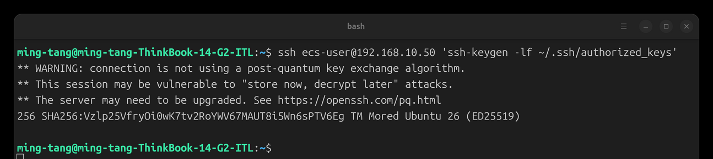

```bash
ssh ecs-user@192.168.10.50 'ssh-keygen -lf ~/.ssh/authorized_keys'
```

这台机器的清单里现在只有一把，是管理机的。

**其他机器要登录。** 在那台机器上生成一对钥匙，把公钥（`.pub` 文件，不是秘密）发给管理员：

```bash
ssh-keygen -t ed25519 -C "zhangsan@work-laptop"    # 已有的话跳过，一路回车
cat ~/.ssh/id_ed25519.pub                          # 把这一行发出去
```

管理员在任意一台已经能登录的机器上，把它加进清单，然后检查每把钥匙各占一行：

```bash
echo 'ssh-ed25519 AAAA…… zhangsan@work-laptop' | ssh ecs-user@192.168.10.50 'cat >> ~/.ssh/authorized_keys'
ssh ecs-user@192.168.10.50 'ssh-keygen -lf ~/.ssh/authorized_keys'
```

要收回某个人的权限，就删掉那一行。备注写的是谁、哪台机器，就按备注删：

```bash
ssh ecs-user@192.168.10.50 "sed -i '/zhangsan@work-laptop/d' ~/.ssh/authorized_keys"
```

两条规矩：私钥不出自己的机器；备注写清是谁、哪台机器。

**钥匙丢了怎么办。**

| 情况 | 怎么办 |
| --- | --- |
| 机器坏了或文件丢了，私钥有备份 | 把备份的私钥文件放回新机器的 `~/.ssh/id_ed25519`，权限设成 600 |
| 手里没有清单上的私钥，但清单上还有别人的钥匙 | 请那位同事登录，把你的新公钥加进去 |
| 私钥可能被别人拿到 | 用另一把已登记的钥匙登录，先删掉丢失的那一行，再加新公钥 |
| 一把能用的钥匙都没有 | 从 ESXi 控制台用 root 登录，把新公钥加给 `ecs-user` |

最后一种情况，在控制台上以 root 登录后执行：

```bash
echo 'ssh-ed25519 AAAA…… zhangsan@new-laptop' >> /home/ecs-user/.ssh/authorized_keys
chmod 600 /home/ecs-user/.ssh/authorized_keys
```

网页控制台里只能手敲，公钥有一百来个字符。敲完务必用新机器实际登录一次确认。

## 三、自动安全更新

### 为什么只装安全补丁，也不自动重启

这台机器给开发、测试、UAT 共用，上面会跑数据库和消息队列。把所有软件包都自动升级，版本变化不可控；自动重启会直接打断业务。所以只让系统自动装安全补丁，重启由人来做。内核更新装上后要重启才生效，隔一段时间执行 `needs-restarting -r` 看一眼。

### 步骤 2：安装 dnf-automatic

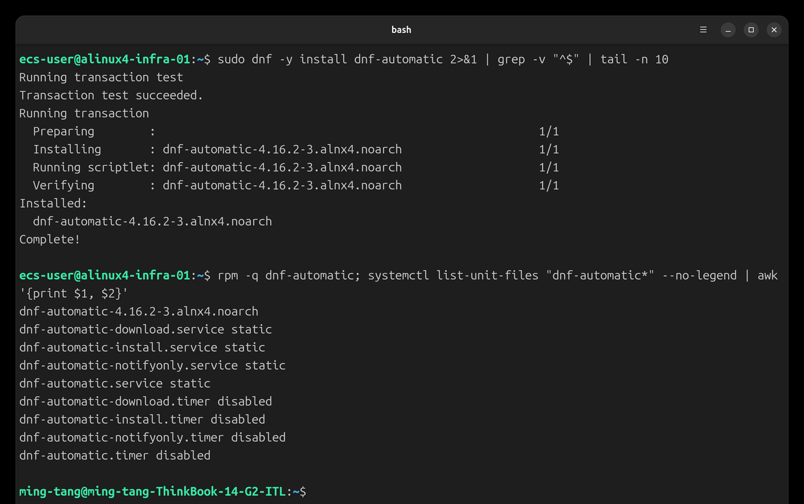

```bash
sudo dnf -y install dnf-automatic
rpm -q dnf-automatic; systemctl list-unit-files "dnf-automatic*" --no-legend
```

dnf 的输出里，行与行之间夹着空行，这是通过脚本执行时它特有的习惯，在终端里手动执行没有。为了让截图一屏放下，命令后面加了 `2>&1 | grep -v "^$" | tail -n 10`，去掉空行、只留最后十行。手册里的命令写的是原样。

### 步骤 3：把“更新所有包”改成“只更新安全补丁”

配置文件是 `/etc/dnf/automatic.conf`。改之前留一份原件在 `/root` 下，改完用 `diff` 确认只动了想动的两行：

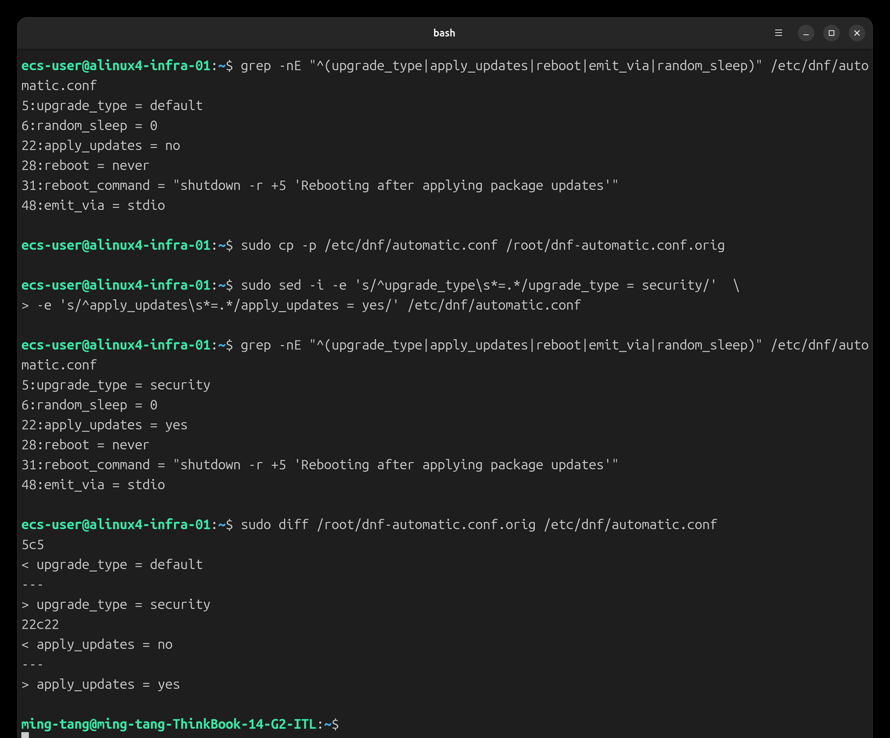

```bash
grep -nE "^(upgrade_type|apply_updates|reboot|emit_via|random_sleep)" /etc/dnf/automatic.conf

sudo cp -p /etc/dnf/automatic.conf /root/dnf-automatic.conf.orig

sudo sed -i -e 's/^upgrade_type\s*=.*/upgrade_type = security/' \
    -e 's/^apply_updates\s*=.*/apply_updates = yes/' /etc/dnf/automatic.conf

grep -nE "^(upgrade_type|apply_updates|reboot|emit_via|random_sleep)" /etc/dnf/automatic.conf
sudo diff /root/dnf-automatic.conf.orig /etc/dnf/automatic.conf
```

最后这五项的含义：

| 配置项 | 值 | 含义 |
| --- | --- | --- |
| `upgrade_type` | `security` | 只装带安全标记的更新。原来是 `default`，更新全部 |
| `apply_updates` | `yes` | 下载之后直接安装。原来是 `no`，只下载 |
| `reboot` | `never` | 永不自动重启。本来就是默认值 |
| `emit_via` | `stdio` | 结果写进日志，用 `journalctl` 看。本来就是默认值 |
| `random_sleep` | `0` | 不额外随机等待。本来就是默认值 |

### 步骤 4：启用定时器，并手动跑一次

dnf-automatic 自带四个定时器，只启用其中一个：

| 定时器 | 作用 |
| --- | --- |
| `dnf-automatic-install.timer` | 下载并安装更新。**用的是这个** |
| `dnf-automatic-download.timer` | 只下载 |
| `dnf-automatic-notifyonly.timer` | 只通知 |
| `dnf-automatic.timer` | 按配置文件里的 `apply_updates` 来 |

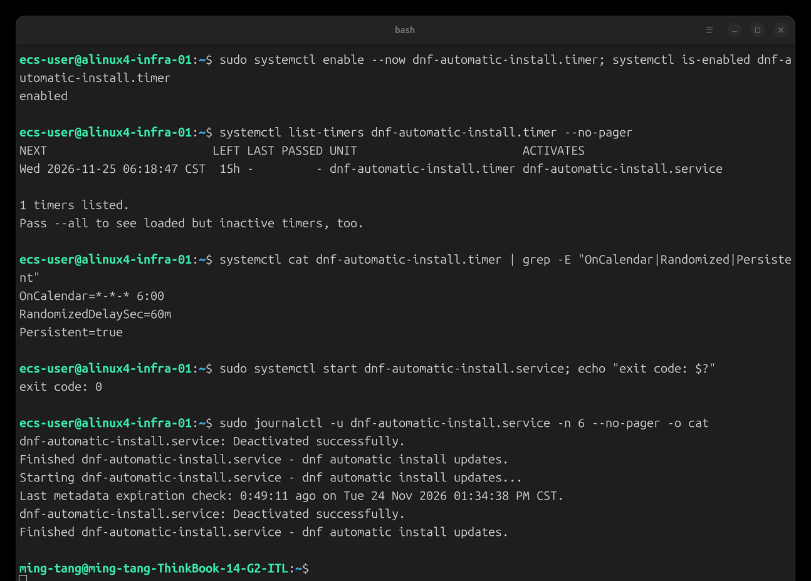

```bash
sudo systemctl enable --now dnf-automatic-install.timer; systemctl is-enabled dnf-automatic-install.timer
systemctl list-timers dnf-automatic-install.timer --no-pager
systemctl cat dnf-automatic-install.timer | grep -E "OnCalendar|Randomized|Persistent"

sudo systemctl start dnf-automatic-install.service; echo "exit code: $?"
sudo journalctl -u dnf-automatic-install.service -n 6 --no-pager -o cat
```

- 启用的那一条，第一次执行时会显示 `Created symlink …`。截图里显示的是 `enabled`，因为这是第二次执行。
- 定时器是每天 6:00，再加最多 60 分钟的随机延迟（`RandomizedDelaySec=60m`），免得所有机器同一时刻挤镜像站。`Persistent=true` 表示错过了（比如当时关机）开机后会补跑。
- 手动触发一次，是为了确认它真的能跑通。这次没有待打的补丁，服务正常结束，退出码 0，`dnf history` 里也没有多出事务。
- **看系统日志要加 `sudo`。** `ecs-user` 不在能读系统日志的组里，不加只能看到自己的，还会提示 `Hint: You are currently not seeing messages from other users and the system`。

## 四、日志：上限 500M，只留一份

### 之前的问题

日志被写了两遍：journald 存一份，同时转发给 rsyslog，rsyslog 再往 `/var/log/messages`、`secure` 这些文本文件写一份。journald 自己又没设上限，最多能占到约 4G。

### 步骤 5：给 journald 设上限并停止转发，停掉 rsyslog

先看改之前的样子（`sudo journalctl --disk-usage` 是 53.4M，`rsyslog` 是 `active`）。然后写配置。截图从第二条命令开始，第一条命令的输出被滚出了窗口：

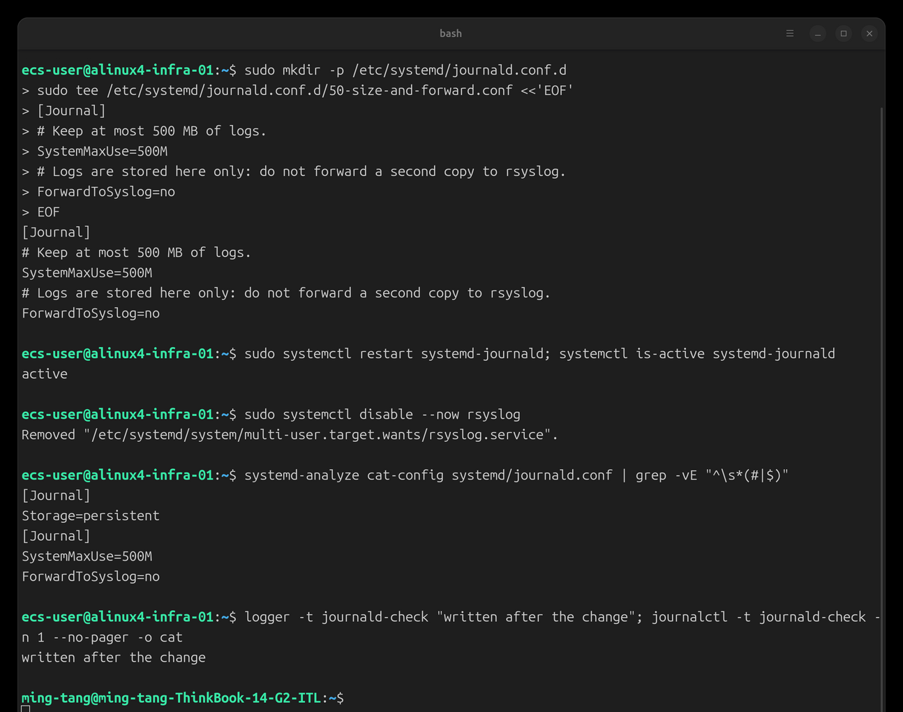

```bash
sudo journalctl --disk-usage; systemctl is-active rsyslog; ls /var/log/messages /var/log/secure

sudo mkdir -p /etc/systemd/journald.conf.d
sudo tee /etc/systemd/journald.conf.d/50-size-and-forward.conf <<'EOF'
[Journal]
# Keep at most 500 MB of logs.
SystemMaxUse=500M
# Logs are stored here only: do not forward a second copy to rsyslog.
ForwardToSyslog=no
EOF

sudo systemctl restart systemd-journald; systemctl is-active systemd-journald

sudo systemctl disable --now rsyslog

systemd-analyze cat-config systemd/journald.conf | grep -vE "^\s*(#|$)"
logger -t journald-check "written after the change"; journalctl -t journald-check -n 1 --no-pager -o cat
```

改完验证：

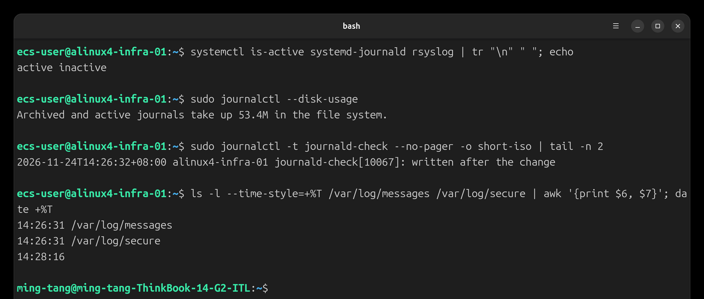

```bash
systemctl is-active systemd-journald rsyslog | tr "\n" " "; echo
sudo journalctl --disk-usage
sudo journalctl -t journald-check --no-pager -o short-iso | tail -n 2
ls -l --time-style=+%T /var/log/messages /var/log/secure | awk '{print $6, $7}'; date +%T
```

四点说明：

- **rsyslog 的软件包留着，只停了服务。** cloud-init 依赖这个软件包，卸掉会连带卸掉 cloud-init。
- **旧文件还在，只是不再更新。** 截图里 `/var/log/messages`、`secure` 的修改时间停在 14:26:31，而当前时间是 14:28:16，中间写的那条测试日志只进了 journald。这些旧文件由 logrotate 照常轮转、过期清理。
- **audit 的日志不受影响。** auditd 自己写 `/var/log/audit/audit.log`，不经过 rsyslog，不算重复。
- **上限是“到了才清”。** journald 的用量接近 500M 时才删最旧的归档，不是现在就占 500M。当前用量 53.4M。

以后看日志：

| 想看什么 | 命令 |
| --- | --- |
| 本次开机以来的全部日志 | `sudo journalctl -b` |
| 某个服务的日志 | `sudo journalctl -u sshd`、`sudo journalctl -u docker` |
| 实时跟踪 | `sudo journalctl -f` |
| 只看错误及更严重的 | `sudo journalctl -b -p err` |
| 按时间范围 | `sudo journalctl --since today`、`sudo journalctl --since "2026-11-24 14:00"` |
| 日志占了多少空间 | `sudo journalctl --disk-usage` |

## 五、Swap

### 为什么加

这台机器原来没有 swap。内存用尽时，内核会直接杀掉占内存最多的进程，很可能就是数据库。加一个 4G 的交换文件作缓冲，再把 `vm.swappiness` 设成 10，让系统平时尽量不用它，真吃紧时才用。

它和 ESXi 上的内存预留是两道不同的保险：预留防的是宿主机把内存收走，swap 防的是这台机器自己把内存用光。

### 步骤 6：创建并启用交换文件

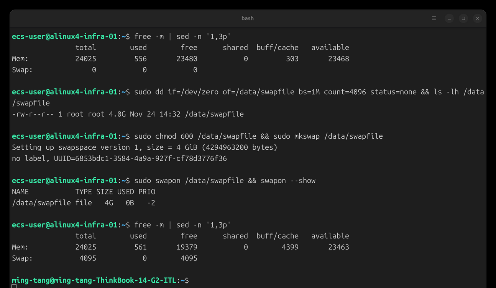

```bash
free -m | sed -n '1,3p'                                      # 改之前：Swap 0

sudo dd if=/dev/zero of=/data/swapfile bs=1M count=4096 status=none && ls -lh /data/swapfile
sudo chmod 600 /data/swapfile && sudo mkswap /data/swapfile
sudo swapon /data/swapfile && swapon --show

free -m | sed -n '1,3p'                                      # 改之后：Swap 4095
```

- 放在数据盘 `/data` 上，不占 60G 的系统盘。
- **用 `dd`，不用 `fallocate`。** `dd` 实实在在写入每一个字节，在各种文件系统上都能被 `swapon` 接受。`fallocate` 只是预先划出空间，有的文件系统上这样建出来的文件会被 `swapon` 拒绝。
- **权限必须是 `600`。** 交换文件如果人人可读，等于内存里的内容人人可读。
- 做完之后 `free` 里的 `buff/cache` 会涨约 4G。那是刚才写文件留下的缓存，需要时会自动让出来。

### 步骤 7：开机自动挂载，并设 swappiness

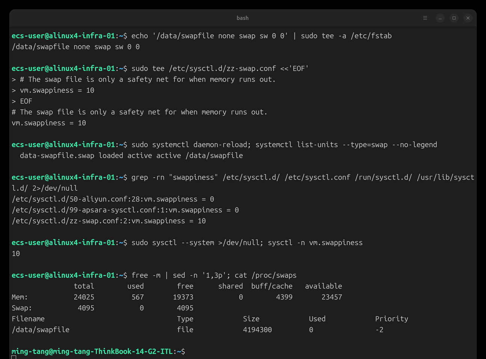

```bash
echo '/data/swapfile none swap sw 0 0' | sudo tee -a /etc/fstab

sudo tee /etc/sysctl.d/zz-swap.conf <<'EOF'
# The swap file is only a safety net for when memory runs out.
vm.swappiness = 10
EOF

sudo systemctl daemon-reload; systemctl list-units --type=swap --no-legend
grep -rn "swappiness" /etc/sysctl.d/ /etc/sysctl.conf /run/sysctl.d/ /usr/lib/sysctl.d/ 2>/dev/null
sudo sysctl --system >/dev/null; sysctl -n vm.swappiness
free -m | sed -n '1,3p'; cat /proc/swaps
```

- **fstab 里加了这一行，开机时才会自动启用。** systemd 会根据它生成 `data-swapfile.swap` 单元。`daemon-reload` 之后不用重启就能看到这个单元已加载、在运行。
- **文件名以 `zz` 开头是故意的。** 系统按文件名顺序加载 `/etc/sysctl.d/` 下的文件，后加载的覆盖先加载的。截图里能看到，阿里云自带的两个文件（`50-aliyun.conf`、`99-apsara-sysctl.conf`）把 swappiness 设成 0，`zz-` 排在它们之后，所以以 10 为准。
- `sudo sysctl --system` 会按开机的顺序把所有内核参数文件重新加载一遍。这是验证“重启以后也是这个值”的办法，不用真重启。

## 六、基础工具

### 步骤 8：用 dnf 安装十个

先试运行看会装多少，再真装：

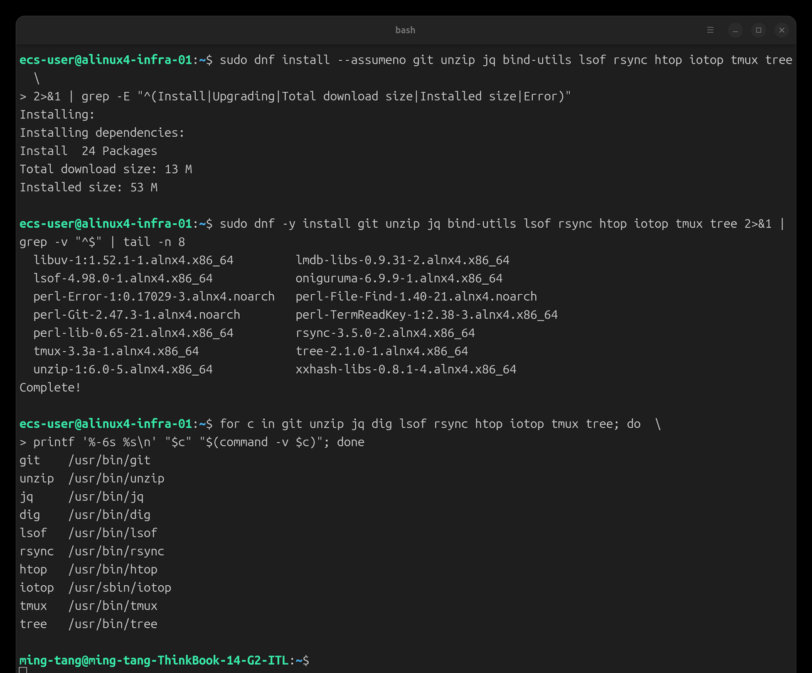

```bash
sudo dnf install --assumeno git unzip jq bind-utils lsof rsync htop iotop tmux tree \
    2>&1 | grep -E "^(Install|Upgrading|Total download size|Installed size|Error)"

sudo dnf -y install git unzip jq bind-utils lsof rsync htop iotop tmux tree
for c in git unzip jq dig lsof rsync htop iotop tmux tree; do printf '%-6s %s\n' "$c" "$(command -v $c)"; done
```

`dig` 命令来自名为 `bind-utils` 的软件包，所以要写包名。一共 24 个包（含依赖），下载 13 MB。

### 步骤 9：安装 yq

`yq` 不在官方源里。装的是 GitHub 上 `mikefarah/yq` 的 v4.54.3，也就是通常说的那个 yq。另有一个同名的 Python 版（用 pip 装），用法不同，没有选它。

**为什么不直接在虚拟机上下载：** 试过，虚拟机直连 GitHub 下载发布文件非常慢，15 MB 的文件 7 分钟只下了 0.7 MB。管理机访问 GitHub 快，所以在管理机上下载并校验，再传到虚拟机。

在管理机上：

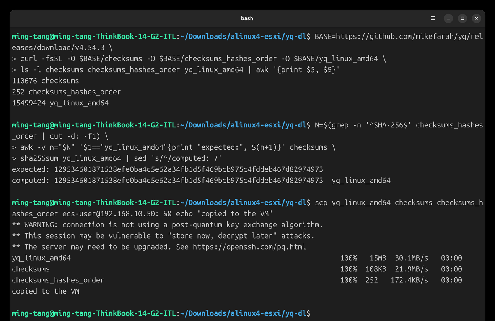

```bash
mkdir -p ~/Downloads/alinux4-esxi/yq-dl && cd ~/Downloads/alinux4-esxi/yq-dl
BASE=https://github.com/mikefarah/yq/releases/download/v4.54.3
curl -fsSL -O $BASE/checksums -O $BASE/checksums_hashes_order -O $BASE/yq_linux_amd64
ls -l checksums checksums_hashes_order yq_linux_amd64 | awk '{print $5, $9}'

N=$(grep -n '^SHA-256$' checksums_hashes_order | cut -d: -f1)
awk -v n="$N" '$1=="yq_linux_amd64"{print "expected:", $(n+1)}' checksums
sha256sum yq_linux_amd64 | sed 's/^/computed: /'

scp yq_linux_amd64 checksums checksums_hashes_order ecs-user@192.168.10.50:
```

这个项目的校验文件和常见的不一样：每个文件一行，并排写了 31 种哈希，哪一列是 SHA-256 要看 `checksums_hashes_order` 文件，它排第 18。上面两条命令就是按这个顺序把期望值取出来，和自己算的值并排显示，**两者必须一致**。这次还和 GitHub 接口公布的文件摘要核对过，三处相同。

在虚拟机上再校验一次，然后安装：

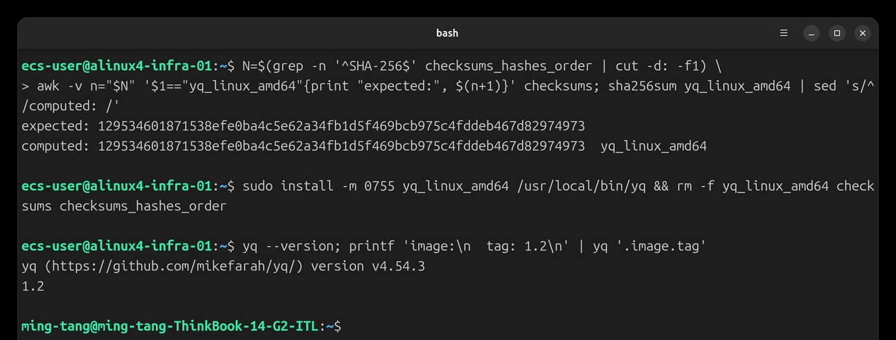

```bash
N=$(grep -n '^SHA-256$' checksums_hashes_order | cut -d: -f1)
awk -v n="$N" '$1=="yq_linux_amd64"{print "expected:", $(n+1)}' checksums; sha256sum yq_linux_amd64 | sed 's/^/computed: /'

sudo install -m 0755 yq_linux_amd64 /usr/local/bin/yq && rm -f yq_linux_amd64 checksums checksums_hashes_order
yq --version; printf 'image:\n  tag: 1.2\n' | yq '.image.tag'
```

- 前一个代码块最后的 `scp` 把三个文件传到了 `ecs-user` 的家目录，所以这里直接按文件名引用。装完随手删掉。
- `scp` 时出现的 `WARNING: connection is not using a post-quantum key exchange algorithm`，是管理机上较新的 OpenSSH 给的提醒，不影响使用。

## 七、容器引擎：Docker Engine + Compose + buildx

### 为什么是 moby-engine，为什么还要补 buildx

- `moby-engine` 就是 Docker Engine（29.5.1），只是包名不同。官方源里另有一套叫 `docker` 的包，是 2024 年的 24.0.9，不选它。
- Compose 插件（`docker-compose-plugin`）官方源里有。buildx 插件没有，而 RocketMQ 手册的 Dockerfile 用了 `COPY --chmod`，这个写法需要 BuildKit，所以从 GitHub 的官方发布补上。
- 引擎的数据（镜像、容器、卷、构建缓存）放到 `/data/docker`，不占系统盘。

### 步骤 10：安装

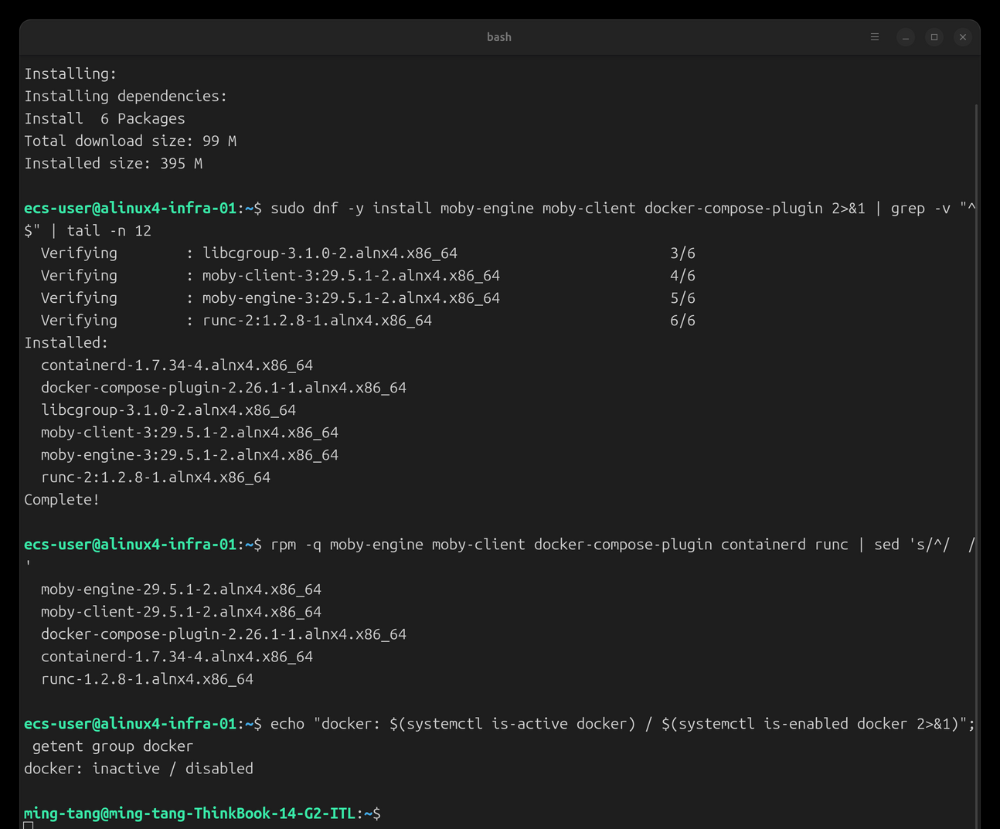

```bash
sudo dnf install --assumeno moby-engine moby-client docker-compose-plugin     # 试运行
sudo dnf -y install moby-engine moby-client docker-compose-plugin
rpm -q moby-engine moby-client docker-compose-plugin containerd runc
systemctl is-active docker; systemctl is-enabled docker
```

六个包：三个指定的，加上依赖 `containerd`、`runc`、`libcgroup`。下载 99 MB，占用 395 MB。装完之后服务没有自动启动，正好先写配置。

### 步骤 11：建用户组、写配置、启动

**顺序很重要：先建 `docker` 用户组，再启动。** 原因见这一节后面。

```bash
sudo groupadd --system docker && sudo usermod -aG docker ecs-user

sudo mkdir -p /data/docker /etc/docker
sudo tee /etc/docker/daemon.json <<'EOF'
{
  "data-root": "/data/docker",
  "log-driver": "json-file",
  "log-opts": { "max-size": "20m", "max-file": "5" },
  "live-restore": true
}
EOF

sudo systemctl enable --now docker
systemctl is-active docker.socket docker containerd
ls -l /run/docker.sock
```

`daemon.json` 里四项的含义：

| 配置 | 含义 |
| --- | --- |
| `data-root` | 引擎的数据放在 `/data/docker`。**必须在第一次启动之前设好**，否则会先在系统盘的 `/var/lib/docker` 建目录 |
| `log-driver`、`log-opts` | 容器日志默认单个文件 20MB、最多 5 个。没在 Compose 里单独配日志的容器，也不会把盘写满 |
| `live-restore` | 引擎重启或升级时，容器继续运行。这和刚装的自动安全更新正好配套：更新引擎的包会重启引擎，业务不断 |

**阿里云打的这个包不会自动建 `docker` 用户组**，所以第一条命令手动建，并把 `ecs-user` 加进去。`docker` 组的成员可以不带 `sudo` 使用 `docker`，你现有的手册都是这样写的。这个组等于 root 权限，而 `ecs-user` 本来就有免密 sudo，所以没有新增风险。已经登录着的会话要重新登录才生效。

下面是我第一次做这一步时的截图，其中启动失败了，因为当时把建组放在了启动之后：

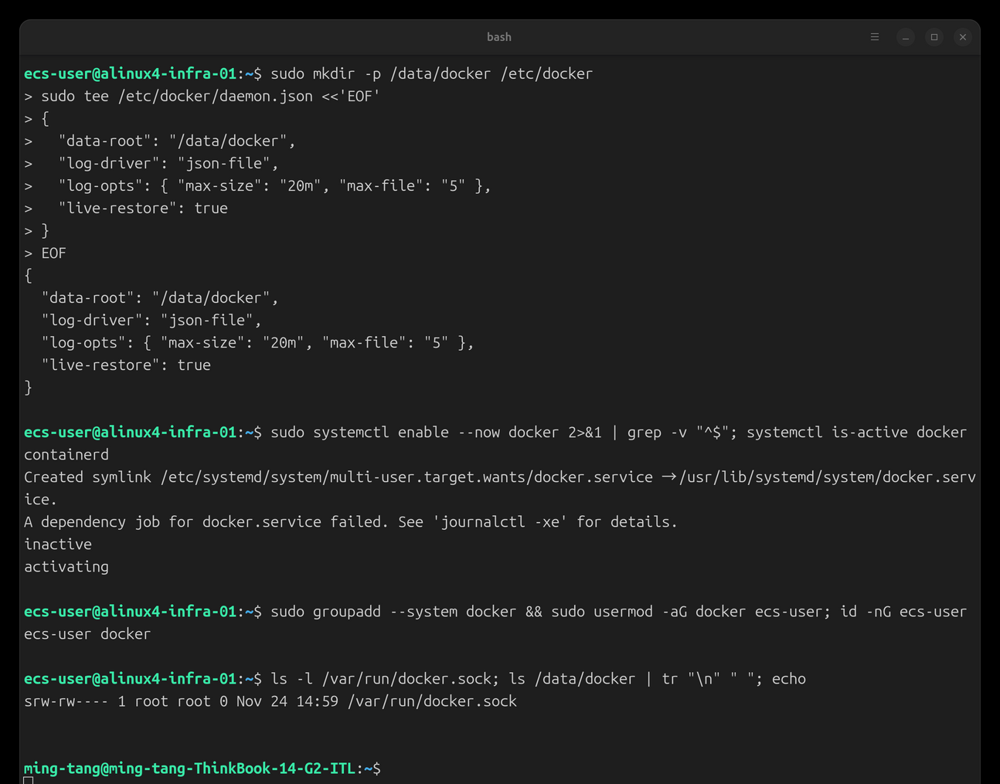

`docker.socket` 要把套接字交给 `docker` 组（它的配置里有 `SocketGroup=docker`），组还不存在，它就起不来；它又是 `docker.service` 的前置依赖，所以引擎也没起来，日志里是 `A dependency job for docker.service failed`。建好组之后重新启动：

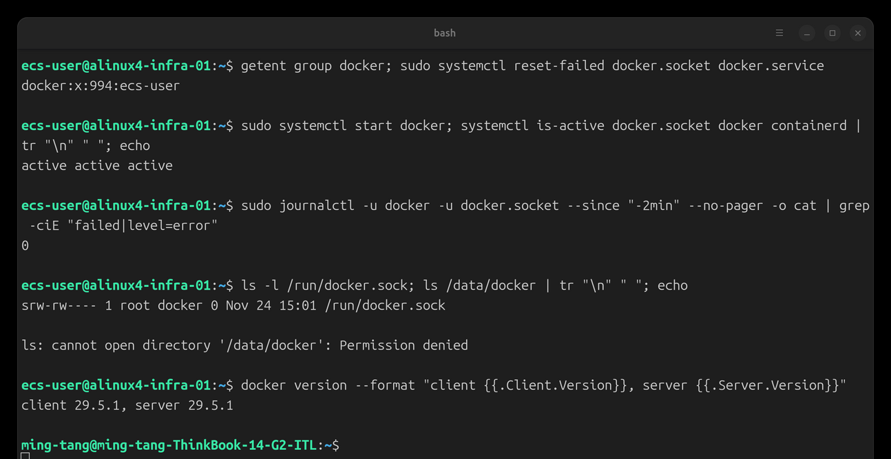

```bash
sudo systemctl reset-failed docker.socket docker.service
sudo systemctl start docker
systemctl is-active docker.socket docker containerd | tr "\n" " "; echo
docker version --format "client {{.Client.Version}}, server {{.Server.Version}}"
```

三个服务都是 `active`，最近两分钟的日志里没有错误，不带 `sudo` 运行 `docker version` 能看到服务端版本。截图里 `ls /data/docker` 报 `Permission denied` 是正常的，那是 root 的目录，用 `docker info` 可以看到它的位置。

### 步骤 12：在管理机上下载 buildx 并校验

和 yq 同样的做法。最新版是 v0.39.1：

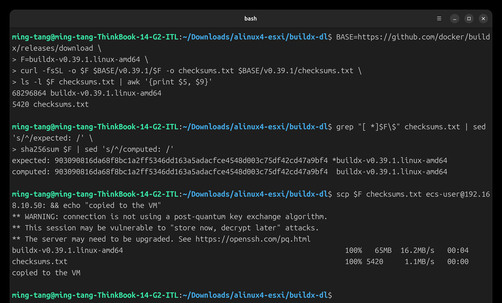

```bash
mkdir -p ~/Downloads/alinux4-esxi/buildx-dl && cd ~/Downloads/alinux4-esxi/buildx-dl
BASE=https://github.com/docker/buildx/releases/download
F=buildx-v0.39.1.linux-amd64
curl -fsSL -o $F $BASE/v0.39.1/$F -o checksums.txt $BASE/v0.39.1/checksums.txt
ls -l $F checksums.txt | awk '{print $5, $9}'

grep "[ *]$F\$" checksums.txt | sed 's/^/expected: /'
sha256sum $F | sed 's/^/computed: /'

scp $F checksums.txt ecs-user@192.168.10.50:
```

这个项目的校验文件是常见的“哈希 + 文件名”格式，但文件名前面有一个星号（`…a9bf4 *buildx-v0.39.1.linux-amd64`）。那是 `sha256sum` 的二进制模式标记，所以匹配时写成 `[*]`，空格和星号都认。

### 步骤 13：在虚拟机上校验并安装

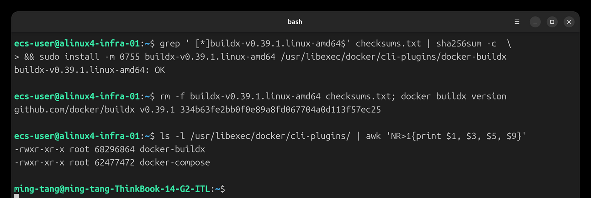

```bash
grep ' [*]buildx-v0.39.1.linux-amd64$' checksums.txt | sha256sum -c \
    && sudo install -m 0755 buildx-v0.39.1.linux-amd64 /usr/libexec/docker/cli-plugins/docker-buildx

rm -f buildx-v0.39.1.linux-amd64 checksums.txt
docker buildx version
ls -l /usr/libexec/docker/cli-plugins/
```

- **安装命令用 `&&` 接在校验后面，校验不通过就不会安装。**
- 插件放在 `/usr/libexec/docker/cli-plugins/`。这是 Compose 插件所在的位置，`docker` 命令会自动发现它。

### 步骤 14：验证引擎

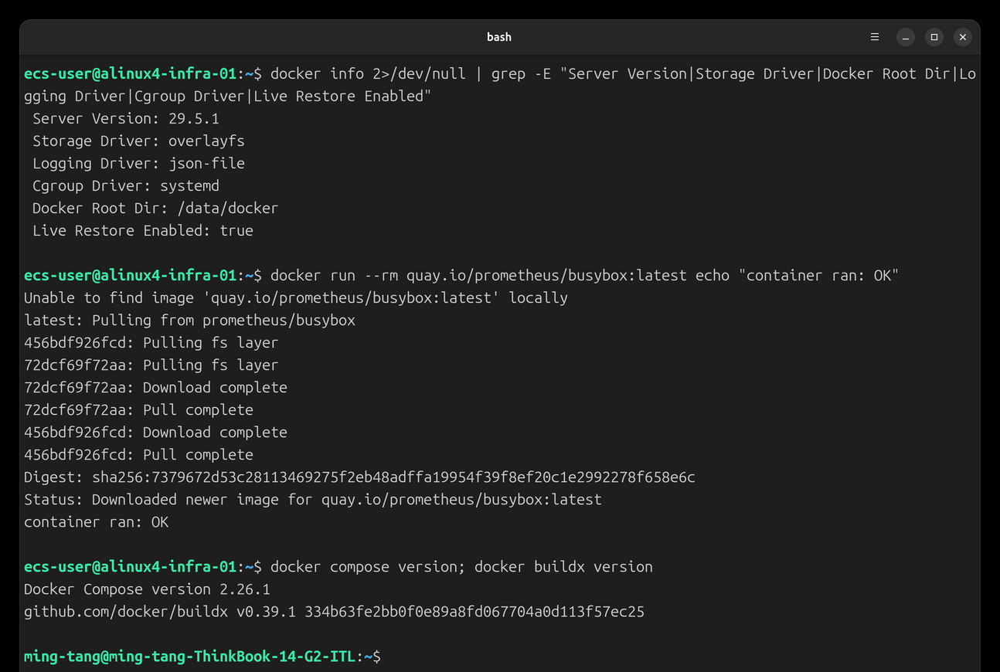

```bash
docker info 2>/dev/null | grep -E "Server Version|Storage Driver|Docker Root Dir|Logging Driver|Cgroup Driver|Live Restore Enabled"
docker run --rm quay.io/prometheus/busybox:latest echo "container ran: OK"
docker compose version; docker buildx version
```

`docker info` 的六项和配置一致；拉取镜像并运行容器成功；Compose 和 buildx 都可用。

**测试镜像为什么用 quay.io。** 从这台虚拟机出发，各个镜像仓库的连通情况是这样的：

| 仓库 | 结果 |
| --- | --- |
| Docker Hub（`docker.io`） | 不通，连接超时 |
| Google 的 `mirror.gcr.io`、AWS 的 `public.ecr.aws` | 不通 |
| `ghcr.io` | 能查到镜像清单，但下载镜像层超时 |
| `quay.io` | 正常 |
| 阿里云的 `registry.cn-hangzhou.aliyuncs.com` | 能连上 |
| 你自己的 kkRepo（`192.168.10.66:19090`） | 能连上 |

你现有五份手册里的镜像，大多在 Docker Hub 上。装组件之前要先定镜像从哪里来，这是还没做的事，见第十一节。

### 步骤 15：构建测试

用一个最小的 Dockerfile 验证 BuildKit，特意用上 `COPY --chmod`：

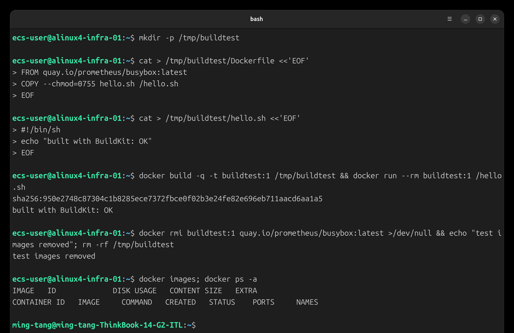

```bash
mkdir -p /tmp/buildtest
cat > /tmp/buildtest/Dockerfile <<'EOF'
FROM quay.io/prometheus/busybox:latest
COPY --chmod=0755 hello.sh /hello.sh
EOF
cat > /tmp/buildtest/hello.sh <<'EOF'
#!/bin/sh
echo "built with BuildKit: OK"
EOF

docker build -q -t buildtest:1 /tmp/buildtest && docker run --rm buildtest:1 /hello.sh
docker rmi buildtest:1 quay.io/prometheus/busybox:latest >/dev/null && echo "test images removed"; rm -rf /tmp/buildtest
docker images; docker ps -a
```

`COPY --chmod=0755` 给脚本加上了可执行位，构建出的镜像运行正常。测试用的镜像和目录随后删掉，引擎回到干净状态，所以最后两个列表都是空的。

## 八、验收

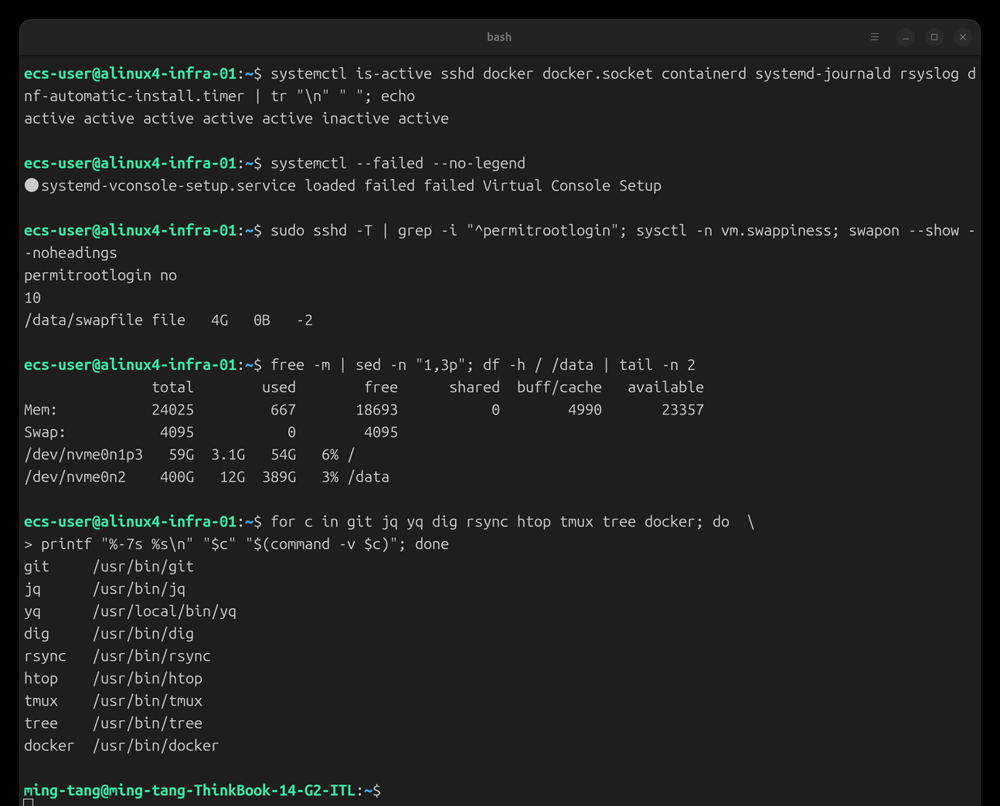

```bash
systemctl is-active sshd docker docker.socket containerd systemd-journald rsyslog dnf-automatic-install.timer | tr "\n" " "; echo
systemctl --failed --no-legend
sudo sshd -T | grep -i "^permitrootlogin"; sysctl -n vm.swappiness; swapon --show --noheadings
free -m | sed -n "1,3p"; df -h / /data | tail -n 2
for c in git jq yq dig rsync htop tmux tree docker; do printf "%-7s %s\n" "$c" "$(command -v $c)"; done
```

- 六个服务和定时器都是 `active`，rsyslog 是 `inactive`。
- 失败的服务仍然只有 `systemd-vconsole-setup`，这是建机时就有的。
- root 登录是 `no`，swappiness 是 10，交换文件 4G。
- 内存 24025 MB，已用约 670 MB，另有 4095 MB swap。
- 系统盘用了 3.1G，比精简完时的 2.6G 多，多出来的是这次新装的软件。数据盘显示 12G，其中交换文件 4G，其余是文件系统自身的预留和 Docker 的目录。

## 九、踩过的坑

| 现象 | 原因 | 处理 |
| --- | --- | --- |
| 启动引擎时报 `A dependency job for docker.service failed`，`docker.socket` 的日志里是 `Failed to resolve group docker` | 启动引擎之前没有建 `docker` 用户组 | 先建组，再执行 `sudo systemctl reset-failed docker.socket docker.service && sudo systemctl start docker` |
| 在虚拟机上用 `curl` 下载 GitHub 的发布文件极慢，或者报 `curl: (56)` | 虚拟机直连 GitHub 的下载通道很慢 | 在管理机上下载、校验，再 `scp` 上去 |
| `sha256sum -c` 报 `no properly formatted checksum lines found` | 没匹配到那一行。buildx 的校验行里文件名前有星号；yq 的校验文件是 31 种哈希并排的格式 | buildx 用 `[*]` 匹配；yq 按 `checksums_hashes_order` 取第 18 列 |
| 没校验通过，文件照样装上了 | 脚本里校验和安装是两条独立的命令 | 安装命令用 `&&` 接在校验后面。这次的事后核对过：已装文件的哈希和三处来源都一致 |
| `journalctl` 提示 `Hint: You are currently not seeing messages from other users and the system` | `ecs-user` 不在能读系统日志的组里 | 用 `sudo journalctl` |
| `journalctl: unrecognized option '--output-cat'` | 这个版本没有这个长选项 | 写 `-o cat` |
| `scp` 时 `WARNING: connection is not using a post-quantum key exchange algorithm` | 管理机的 OpenSSH 较新，虚拟机的 sshd 没有后量子密钥交换 | 提醒而已，不影响使用 |
| `ls /data/docker` 报 `Permission denied` | 目录属于 root | 正常，用 `docker info` 看 |
| 在 ESXi 控制台的 `login:` 下输什么密码都不行 | 建机时按 ECS 的方式锁定了两个账号的密码，平时靠 SSH 密钥 | 给 root 设密码，见第二节“控制台专用的 root 密码” |

## 十、回滚

| 项目 | 撤销办法 |
| --- | --- |
| SSH | `sudo rm /etc/ssh/sshd_config.d/50-no-root-login.conf && sudo sshd -t && sudo systemctl reload sshd` |
| 控制台密码 | `sudo passwd -l root`，重新锁定 root 的密码 |
| 自动更新 | `sudo systemctl disable --now dnf-automatic-install.timer`。配置用 `sudo cp -p /root/dnf-automatic.conf.orig /etc/dnf/automatic.conf` 恢复 |
| 日志 | `sudo rm /etc/systemd/journald.conf.d/50-size-and-forward.conf && sudo systemctl restart systemd-journald && sudo systemctl enable --now rsyslog` |
| Swap | `sudo swapoff /data/swapfile && sudo rm /data/swapfile`；删掉 `/etc/fstab` 里那一行；`sudo rm /etc/sysctl.d/zz-swap.conf && sudo sysctl --system` |
| 基础工具 | `sudo dnf remove git unzip jq bind-utils lsof rsync htop iotop tmux tree`；`sudo rm /usr/local/bin/yq` |
| 容器引擎 | `sudo systemctl disable --now docker docker.socket containerd`；`sudo dnf remove moby-engine moby-client docker-compose-plugin`；`sudo rm /usr/libexec/docker/cli-plugins/docker-buildx`；`sudo rm -rf /data/docker /etc/docker/daemon.json`；`sudo gpasswd -d ecs-user docker` |

## 十一、还没做的

- **镜像来源。** Docker Hub 从这台机器不通，见步骤 14 的表。装组件之前要先定：走 kkRepo 代理，还是配阿里云的加速器。
- **防火墙。** firewalld 还没启用。装了引擎之后，容器发布的端口由 Docker 自己的规则放行，启用 firewalld 时要一并定下做法。
- **透明大页。** 现在是全部开启，等装具体组件时按各组件的官方建议定。
- **第二把钥匙。** 公钥清单里现在只有管理机的一把，私钥也只在这一台机器上，没有备份。再登记一把（一位同事的，或者专门生成一对、离线保存的应急钥匙），或者至少把私钥文件备份到安全的地方。否则这台管理机一出问题，就只能走 ESXi 控制台。
- **多人使用时改成每人一个账号。** 现在所有人共用 `ecs-user`，日志里分不出是谁。人多了再做。
