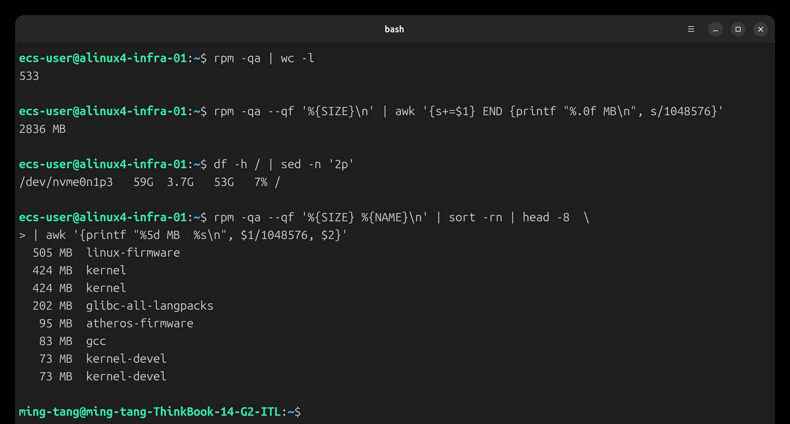
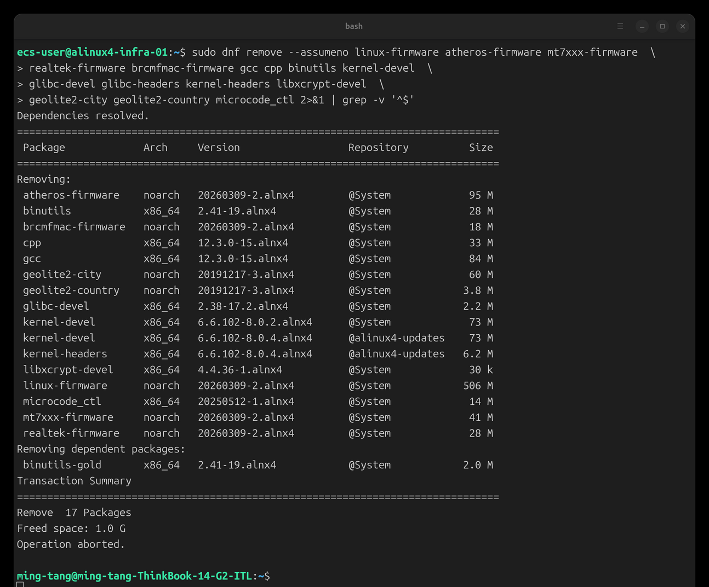
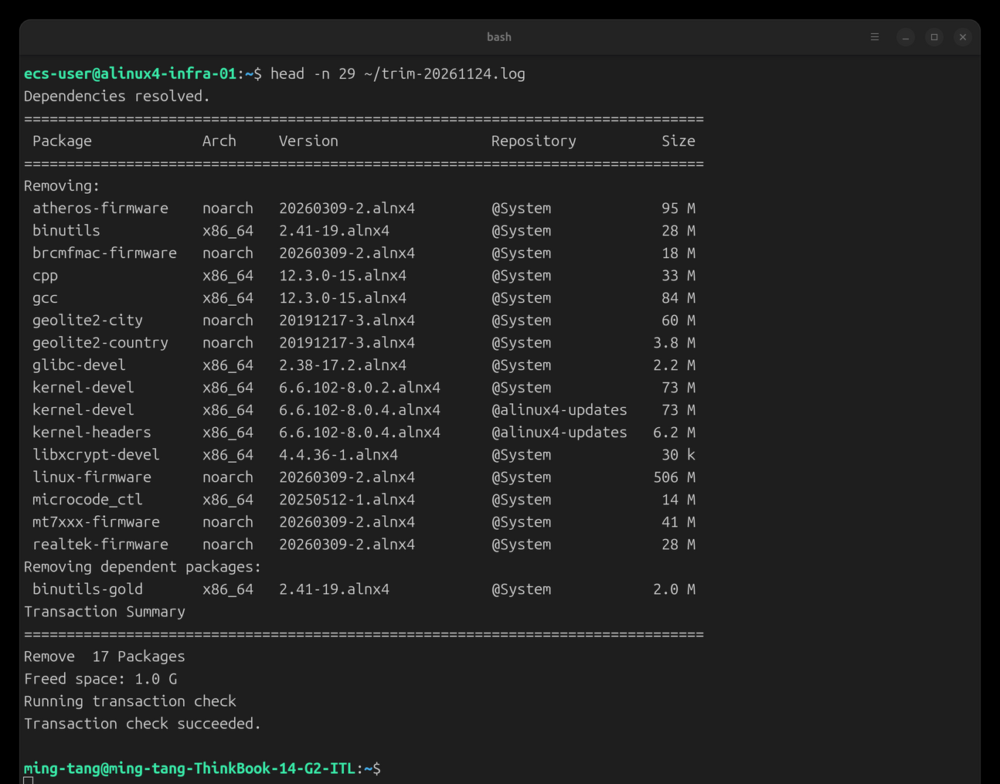
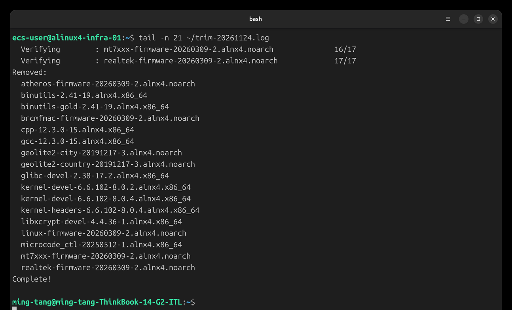
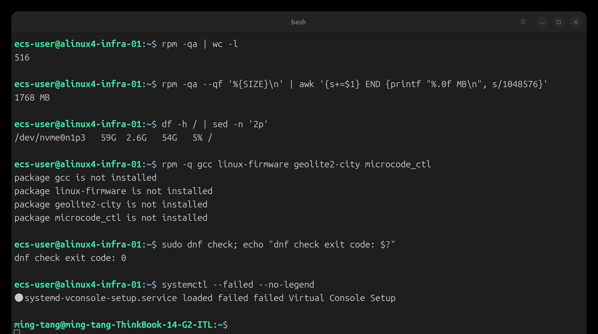
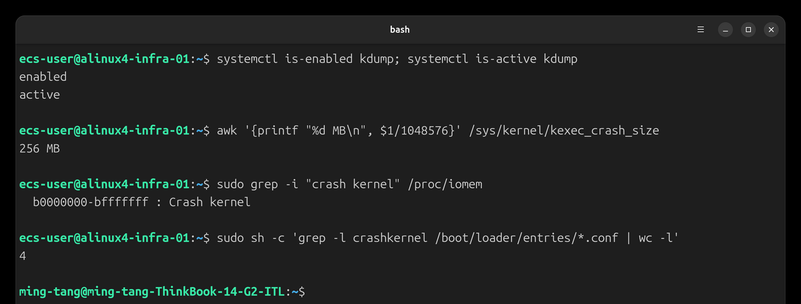
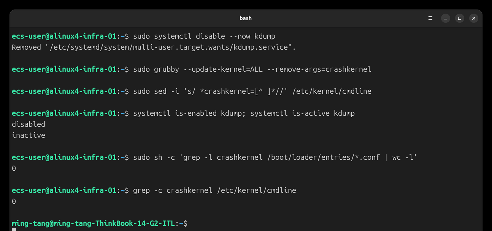
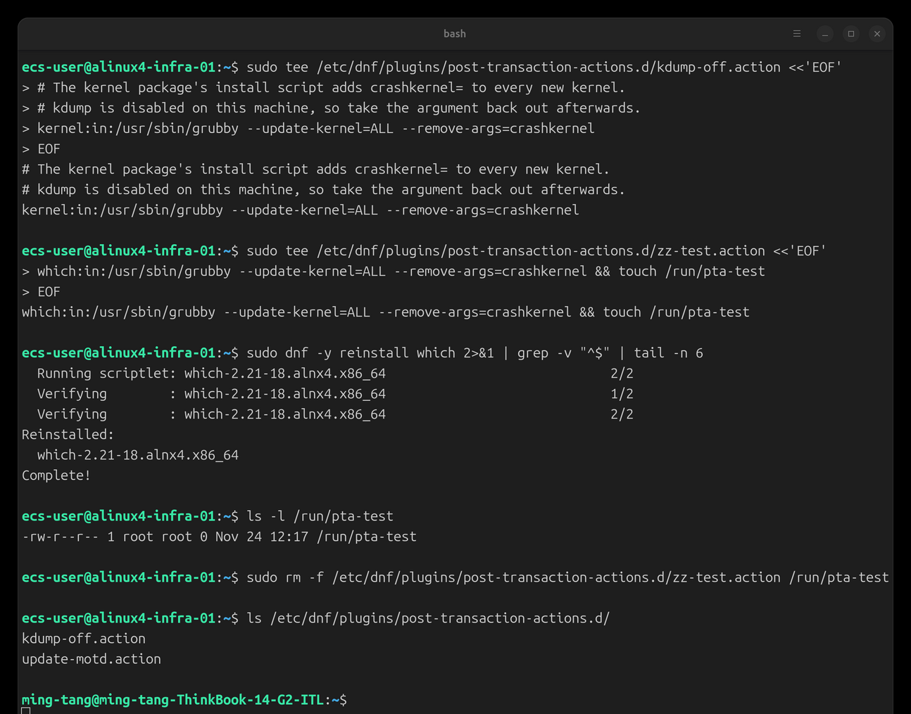
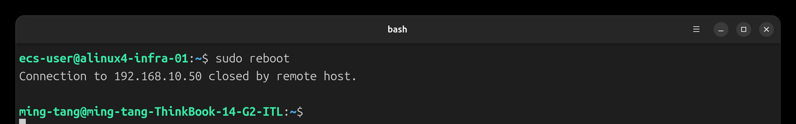
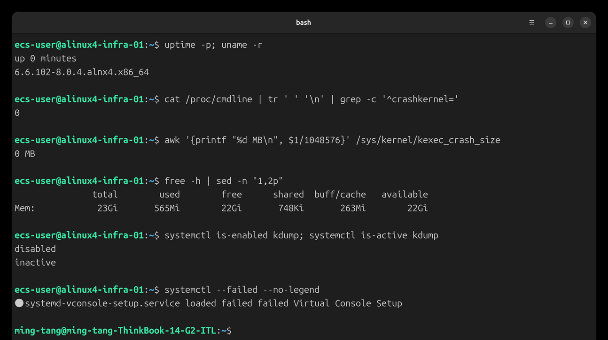

# Alibaba Cloud Linux 4 系统精简：删掉用不到的预装软件，停用 kdump

> 基线：2026-11-24 实测。对象是按《ESXi 7.0 上安装 Alibaba Cloud Linux 4》建好的 `alinux4-infra-01`（`192.168.10.50`，Alibaba Cloud Linux 4.0.7）。命令都在虚拟机里以 `ecs-user` 执行，截图是在真实终端里跑手册中的命令拍下来的。重启和重启后的验证见第四节。

## 一、开始之前

### 结果

| 项目 | 精简前 | 精简后 |
| --- | --- | --- |
| 已安装的软件包 | 533 个 | 516 个 |
| 安装体积（rpm 统计） | 2836 MB | 1768 MB |
| 系统盘占用 | 3.7 GB | 2.6 GB |
| 为 kdump 预留的内存 | 256 MB | 0（重启之后） |

动手前这台机器的状态：当天上午做过一次 `dnf upgrade`，新内核 `6.6.102-8.0.4` 已经装上但还没重启生效。

### 删掉了什么

| 类别 | 软件包 | 大小 | 为什么这台机器用不到 |
| --- | --- | --- | --- |
| 固件 | `linux-firmware`、`atheros-firmware`、`mt7xxx-firmware`、`realtek-firmware`、`brcmfmac-firmware` | 688 MB | 给实体的网卡、蓝牙适配器用的。虚拟机没有这些硬件，开机以来没有任何驱动请求过固件 |
| 编译工具链 | `gcc`、`cpp`、`binutils`（连带 `binutils-gold`）、两个版本的 `kernel-devel`、`glibc-devel`、`glibc-headers`、`kernel-headers`、`libxcrypt-devel` | 约 300 MB | 镜像带着它们，是为了能在实例上编译内核模块。这台机器只跑容器化的组件，不编译东西 |
| IP 归属地数据库 | `geolite2-city`、`geolite2-country` | 64 MB | 没有任何已安装的软件依赖它 |
| CPU 微码 | `microcode_ctl` | 14 MB | 虚拟机里 CPU 微码的更新由 ESXi 宿主机负责 |

### 为什么敢删

- **先试运行。** `dnf remove` 加 `--assumeno` 只做依赖计算，走到确认那一步就停。试运行的 Removing 清单里正好是这 17 个包，没有别的包被连带删除。
- **升级内核不会把固件装回来。** 普通的 `kernel` 包不依赖 `linux-firmware`，只有调试版的 `kernel-debug` 依赖。
- **删完检查依赖关系。** `dnf check` 的退出码是 0，说明剩下的软件包之间没有断链。

### 试过、但删不掉的

- `glibc-all-langpacks`（203 MB）：`grub2-tools-minimal` 依赖它，dnf 直接拒绝删除。
- `rsyslog`、`dhcp-client`、`net-tools`、`python3-devel`、`python3-setuptools`、`pkgconf-pkg-config`：删它们会连带删掉 cloud-init 或一批基础包。

### 动手前要知道的三件事

1. **只适用于虚拟机。** 在实体机上，固件和微码不能删。
2. **磁盘不会马上变小。** 系统盘是精简置备的，删掉文件后虚拟磁盘文件要等每周一次的 fstrim 之后才回收空间。
3. **需要时装回来是一条命令。** 见第五节。

## 二、删除预装软件

### 步骤 1：看精简前的状态

先记下几个数字，方便事后对比：装了多少个包、安装体积多大、系统盘用了多少、最占空间的是哪几个。



```bash
rpm -qa | wc -l
rpm -qa --qf '%{SIZE}\n' | awk '{s+=$1} END {printf "%.0f MB\n", s/1048576}'
df -h / | sed -n '2p'
rpm -qa --qf '%{SIZE} %{NAME}\n' | sort -rn | head -8 \
    | awk '{printf "%5d MB  %s\n", $1/1048576, $2}'
```

`%{SIZE}` 是 rpm 记录的安装体积，单位是字节。

### 步骤 2：试运行，确认只删这些

`--assumeno` 让 dnf 只做依赖计算，到确认那一步就停下，不改系统。**每次都先看这一步的 Removing 清单**：里面只能有打算删的包。多出别的包，说明有连带删除，要停下来查原因。



```bash
sudo dnf remove --assumeno linux-firmware atheros-firmware mt7xxx-firmware \
    realtek-firmware brcmfmac-firmware gcc cpp binutils kernel-devel \
    glibc-devel glibc-headers kernel-headers libxcrypt-devel \
    geolite2-city geolite2-country microcode_ctl 2>&1 | grep -v '^$'
```

结果是 16 个指定的包，加上连带删除的 `binutils-gold`，一共 17 个，腾出 1.0 G。末尾的 `Operation aborted.` 是正常的，表示试运行到此为止。

`2>&1 | grep -v '^$'` 把报错并入输出，并去掉空行。这样写是因为通过脚本执行 dnf 时，它会在每行后面多打一个空行，屏幕放不下。在终端里手动执行时可以不加。

### 步骤 3：执行删除

把 `--assumeno` 换成 `-y`。dnf 的输出有 90 行，一屏放不下，所以去掉空行的同时用 `tee` 把完整输出存进一个文件，事后再分段查看：

```bash
sudo dnf -y remove linux-firmware atheros-firmware mt7xxx-firmware \
    realtek-firmware brcmfmac-firmware gcc cpp binutils kernel-devel \
    glibc-devel glibc-headers kernel-headers libxcrypt-devel \
    geolite2-city geolite2-country microcode_ctl 2>&1 \
    | grep -v '^$' | tee ~/trim-20261124.log
```

日志的开头是 dnf 解析出的删除清单，和步骤 2 的试运行一致，并且已经进入 `Running transaction`：



```bash
head -n 29 ~/trim-20261124.log
```

日志的结尾是逐个包的 `Erasing`、`Verifying`，然后是实际删掉的清单和 `Complete!`：



```bash
tail -n 21 ~/trim-20261124.log
```

### 步骤 4：验证

重复步骤 1 的前三条命令，再确认三件事：指定的包已经是 `not installed`；`dnf check` 的退出码是 0；失败的服务没有变多。



```bash
rpm -qa | wc -l
rpm -qa --qf '%{SIZE}\n' | awk '{s+=$1} END {printf "%.0f MB\n", s/1048576}'
df -h / | sed -n '2p'
rpm -q gcc linux-firmware geolite2-city microcode_ctl
sudo dnf check; echo "dnf check exit code: $?"
systemctl --failed --no-legend
```

软件包从 533 个变成 516 个，安装体积从 2836 MB 变成 1768 MB，系统盘占用从 3.7G 降到 2.6G。失败的服务 `systemd-vconsole-setup` 在精简之前就有，是虚拟机里常见的控制台字体问题，和这次操作无关。

## 三、停用 kdump

### kdump 是什么，为什么在这台机器上停掉

kdump 的作用是在内核崩溃时把内存转储下来。为此它要在开机时从内存里划走一块专门留着，这台机器上是 256 MB，留给业务进程的就少了这部分。这台机器是开发、测试、UAT 用的虚拟机，用不上内核崩溃转储，所以停掉，把 256 MB 要回来。

停用要处理三层，少一层都不彻底：

| 层 | 要做的事 | 不做会怎样 |
| --- | --- | --- |
| 服务 | 停止，并取消开机自启 | 每次开机都会去准备转储内核 |
| 现有的启动项 | 把 `crashkernel` 参数从每个启动项里去掉 | 重启后内存照样被预留 |
| 以后新装的内核 | 加一条 dnf 规则 | 内核一升级，`crashkernel` 又被加回来 |

第三层的来由：内核软件包的安装脚本里写死了一句 `grubby --update-kernel … --args="… crashkernel=… …"`，每装一个新内核都会给它带上这个参数。只改现有的启动项，下次升级内核就前功尽弃。

### 步骤 5：看 kdump 现状



```bash
systemctl is-enabled kdump; systemctl is-active kdump
awk '{printf "%d MB\n", $1/1048576}' /sys/kernel/kexec_crash_size
sudo grep -i "crash kernel" /proc/iomem
sudo sh -c 'grep -l crashkernel /boot/loader/entries/*.conf | wc -l'
```

服务是 `enabled`、`active`；预留了 256 MB；4 个启动项（两个内核、两个救援项）的参数里都有 `crashkernel`。

`/proc/iomem` 和启动项目录，普通用户读不到真实内容，所以要加 `sudo`。最后一条命令里的通配符要在 root 身份下才会展开，所以写成 `sudo sh -c '…'`；写成 `sudo grep … /boot/loader/entries/*.conf` 会报找不到文件。

### 步骤 6：停服务，去掉现有启动项里的参数



```bash
sudo systemctl disable --now kdump
sudo grubby --update-kernel=ALL --remove-args=crashkernel
sudo sed -i 's/ *crashkernel=[^ ]*//' /etc/kernel/cmdline
systemctl is-enabled kdump; systemctl is-active kdump
sudo sh -c 'grep -l crashkernel /boot/loader/entries/*.conf | wc -l'
grep -c crashkernel /etc/kernel/cmdline
```

- `grubby` 是管理启动项的工具，`--update-kernel=ALL` 表示所有启动项，救援项也算在内。
- `/etc/kernel/cmdline` 是这台机器上生成新启动项时用的参数模板，以后生成救援启动项会从这里取参数，所以也去掉。
- 三个结果：服务变成 `disabled`、`inactive`；带 `crashkernel` 的启动项从 4 个变成 0 个；模板里也搜不到了。

**到这里内存还没释放。** 当前正在运行的内核是带着 `crashkernel` 启动的，这 256 MB 要到重启之后才还回来。

### 步骤 7：加一条 dnf 规则，防止新内核把参数加回来

dnf 自带一个叫“事务后动作”（post-transaction-actions）的插件，这台机器上已经启用。每次安装、删除、升级软件包的事务结束后，它按 `/etc/dnf/plugins/post-transaction-actions.d/` 目录下 `.action` 文件里的规则执行命令。规则一行一条，格式是 `包名:时机:命令`；时机写 `in`，表示这个包在本次事务里被安装或升级了。

下面写一个规则文件：凡是 `kernel` 这个包被安装或升级，事务结束后就把所有启动项里的 `crashkernel` 再去掉一次。



```bash
sudo tee /etc/dnf/plugins/post-transaction-actions.d/kdump-off.action <<'EOF'
# The kernel package's install script adds crashkernel= to every new kernel.
# kdump is disabled on this machine, so take the argument back out afterwards.
kernel:in:/usr/sbin/grubby --update-kernel=ALL --remove-args=crashkernel
EOF
```

这条规则要等下一次升级内核才会真正触发。为了不等那么久，用同一条命令、换一个马上能触发的条件来验证机制：临时加一条规则，“重装 `which` 这个小包时，执行同样的命令并留一个标记文件”；然后重装一次 `which`。它本来就在系统里，重装不改变任何东西。

```bash
sudo tee /etc/dnf/plugins/post-transaction-actions.d/zz-test.action <<'EOF'
which:in:/usr/sbin/grubby --update-kernel=ALL --remove-args=crashkernel && touch /run/pta-test
EOF

sudo dnf -y reinstall which 2>&1 | grep -v "^$" | tail -n 6
ls -l /run/pta-test
```

`/run/pta-test` 出现了，说明事务结束后，规则里的命令确实被执行。

验证完把临时规则和标记文件删掉。目录里只留下正式规则，和系统自带的 `update-motd.action`：

```bash
sudo rm -f /etc/dnf/plugins/post-transaction-actions.d/zz-test.action /run/pta-test
ls /etc/dnf/plugins/post-transaction-actions.d/
```

这一步在这台机器上做了两遍，所以 `dnf history list` 里有两条 `reinstall which`：第一遍时我的截图脚本出了错，规则文件没有建成；修好脚本后完整重做了一遍，手册里是第二遍的截图。

## 四、重启并验证

重启为两件事：进入上午升级装上的新内核 `6.6.102-8.0.4`；让 kdump 预留的 256 MB 真正释放。重启会断开连着这台虚拟机的 SSH 会话，所以先确认机器上没有别人在用，再执行。

### 步骤 8：重启



```bash
sudo reboot
```

`Connection to 192.168.10.50 closed by remote host.` 是虚拟机开始重启时主动断开的，属于正常现象。稍等片刻就能重新连上。

### 步骤 9：重启后的验证

重新登录后核对五件事：运行的是新内核；启动参数里没有 `crashkernel`；预留大小是 0 MB；kdump 没有随开机启动；失败的服务没有变多。



```bash
uptime -p; uname -r
cat /proc/cmdline | tr ' ' '\n' | grep -c '^crashkernel='
awk '{printf "%d MB\n", $1/1048576}' /sys/kernel/kexec_crash_size
free -h | sed -n "1,2p"
systemctl is-enabled kdump; systemctl is-active kdump
systemctl --failed --no-legend
```

- 内核是 `6.6.102-8.0.4.alnx4.x86_64`，`uptime -p` 显示刚开机。
- `grep -c` 的结果是 0，说明启动参数里已经没有 `crashkernel`。
- 预留大小从 256 MB 变成 0 MB，这部分内存已经还给系统。
- `free -h` 的总量重启前后都显示 23Gi。它的单位取整到 GiB，256 MB 的变化看不出来；要看精确值用 `grep MemTotal /proc/meminfo`。
- kdump 是 `disabled`、`inactive`。
- 失败的服务仍然只有 `systemd-vconsole-setup`，和重启前一样。

除了截图里的这几条，还核对过这些，都正常：IP 仍是 `192.168.10.50`，默认路由正常；数据盘挂在 `/data`；时钟已同步；软件包仍是 516 个；dnf 规则文件还在，启动项里没有 `crashkernel`。这次开机的日志里没有新的错误，只有和重启前相同的那条控制台字体报错，以及一条虚拟机里常见的 `piix4_smbus` 提示。

## 五、回滚

装回删掉的软件。只在确实需要时才做，比如要在这台机器上编译内核模块：

```bash
sudo dnf install gcc cpp binutils kernel-devel glibc-devel kernel-headers
# 固件、IP 归属地库、微码（实体机，或确实需要时）
sudo dnf install linux-firmware atheros-firmware mt7xxx-firmware realtek-firmware brcmfmac-firmware geolite2-city geolite2-country microcode_ctl
```

恢复 kdump。`crashkernel` 的原始取值来自内核软件包的安装脚本：

```bash
sudo rm /etc/dnf/plugins/post-transaction-actions.d/kdump-off.action
sudo systemctl enable kdump
sudo grubby --update-kernel=ALL --args="crashkernel=0M-2G:0M,2G-8G:192M,8G-128G:256M,128G-376G:384M,376G-:448M"
```

然后重启。`/etc/kernel/cmdline` 里被去掉的那一段，需要的话把同样的取值加回去。

## 六、常见问题

**下次升级内核后，怎么确认规则生效了？**

```bash
sudo sh -c 'grep -l crashkernel /boot/loader/entries/*.conf | wc -l'    # 预期 0
```

**旧内核还留着。** 上午升级后系统里有两个内核，旧的那个 `6.6.102-8.0.2` 约 500 MB，这次特意留作后备。重启进入新内核、运行几天确认稳定之后再删：

```bash
sudo dnf remove kernel-6.6.102-8.0.2.alnx4
```

**留下的文件。** 删除操作的完整输出在虚拟机的 `~/trim-20261124.log`，不需要了可以删。精简前的完整软件包清单存在管理机上：`~/Downloads/alinux4-esxi/trim/packages-before-20261124.txt`。

**数字对不上？** 软件包的数量和体积会随镜像版本、已做过的升级而变化。以自己机器上步骤 1、步骤 2 的输出为准。步骤 2 的 Removing 清单里出现本文没列到的包时，先查清楚再继续。
