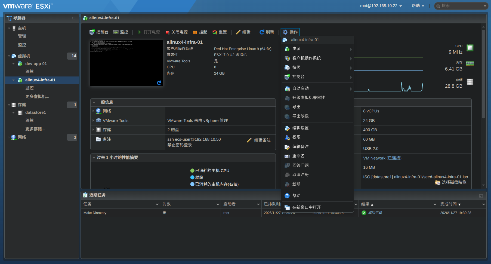
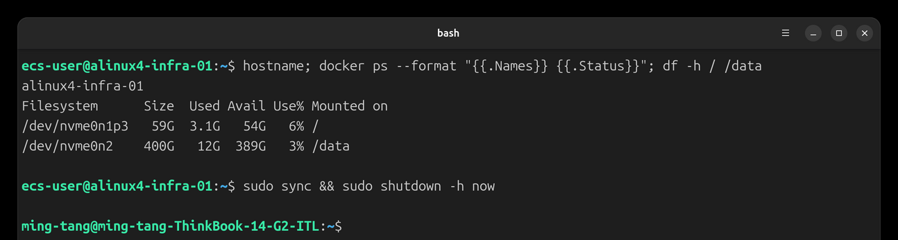
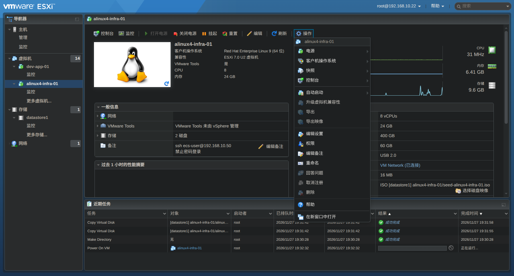
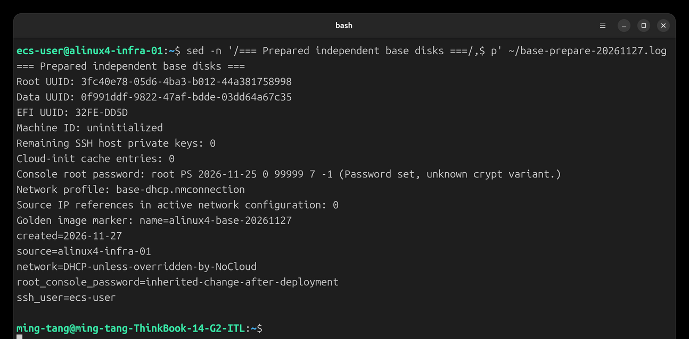
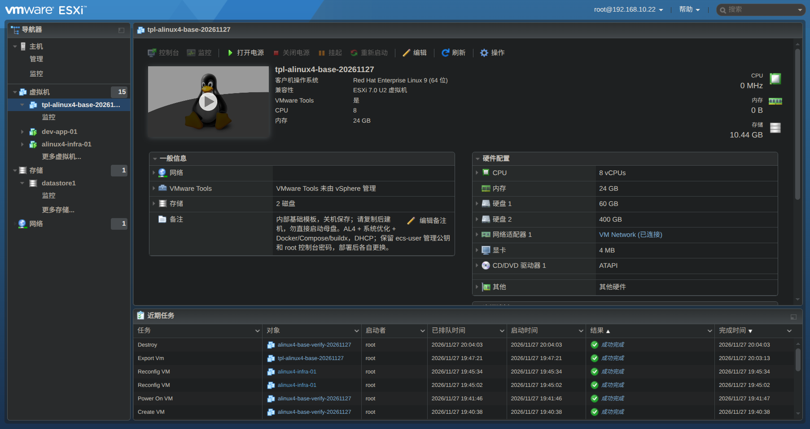
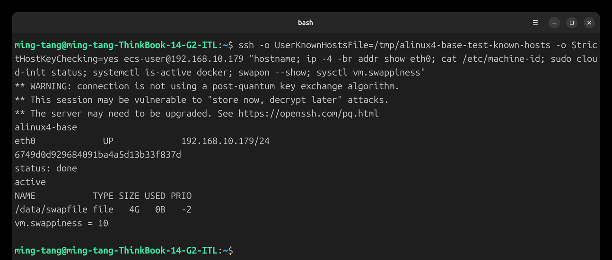
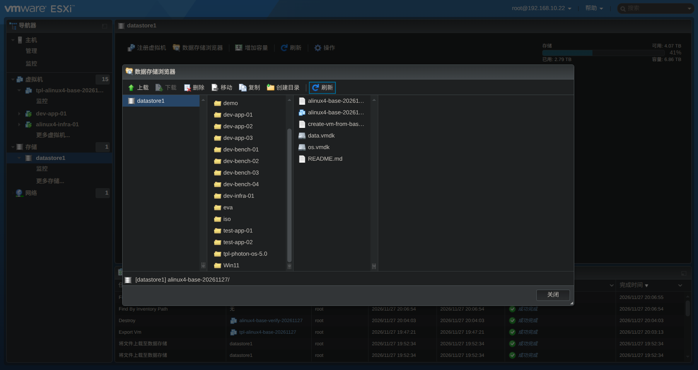

# ESXi 7.0：把 Alibaba Cloud Linux 4 做成基础模板，再快速创建虚拟机

> 2026-11-27 实测。来源是 `alinux4-infra-01`（`192.168.10.50`），ESXi 为 `192.168.10.22`。页面里数据存储的实际名称是 **datastore1**。本次保留原虚拟机，另外制作独立母盘。

## 保存在哪里

| 用途 | 位置 |
| --- | --- |
| 同一台 ESXi 快速建机用的母盘 | `[datastore1] alinux4-base-20261127/` |
| ESXi 列表里的模板名称 | `tpl-alinux4-base-20261127`，保持关机 |
| 模板详情 | <https://192.168.10.22/ui/#/host/vms/39> |
| 本机备份目录 | `~/Downloads/alinux4-base-20261127/`，目前只有说明与 OVF 描述文件，**完整备份未完成** |
| 快速建机脚本 | [scripts/create-vm-from-base.js](./scripts/create-vm-from-base.js)，datastore1 母盘目录里也有一份 |

**同一台 ESXi 新建虚拟机不需要本机文件。** 直接在 datastore1 上复制母盘即可。本机的 OVF/OVA 副本用于异地备份，或迁移到另一台 ESXi。只有 ESXi 上的一份不能应对数据存储损坏。

这台没有 vCenter，模板以一台**保持关机的普通虚拟机**呈现。名称中的 `tpl-` 是用途标记；实际建机靠独立复制磁盘。

## 母盘包含什么

| 项目 | 内容 |
| --- | --- |
| 系统 | Alibaba Cloud Linux 4.0.7，内核 6.6.102-8.0.4 |
| 默认规格 | 8 vCPU、24 GB、内存预留 19,664 MB（至少 80%） |
| 磁盘 | 60 GB 系统盘、400 GB 数据盘，均精简置备，接 NVMe |
| 数据目录 | XFS 挂在 `/data` |
| Swap | `/data/swapfile` 4G，`vm.swappiness=10` |
| SSH | `ecs-user` 公钥登录，root 和密码 SSH 登录均禁止 |
| 控制台 | 保留你设置的 root 控制台密码，部署后应各自更换 |
| 日志和更新 | journald 500M、停用 rsyslog 重复写、只自动安装安全更新、不自动重启 |
| 工具 | git、unzip、jq、yq、dig、lsof、rsync、htop、iotop、tmux、tree |
| 容器环境 | Docker Engine 29.5.1（moby）、Compose 2.26.1、buildx 0.39.1，数据在 `/data/docker` |

母盘没有部署业务组件，没有容器和业务镜像。没有额外配置镜像加速、防火墙或新监控服务。

## 一、制作过程

### 1. 检查来源，正常关机后复制

先核对原机名称、磁盘、容器列表和数据存储容量。确认没有容器在运行后，从客户机内正常关机。不要在 ESXi 上直接断电。





```bash
ssh ecs-user@192.168.10.50
hostname
docker ps
df -h / /data
sudo sync && sudo shutdown -h now
```

通过 ESXi 的虚拟磁盘复制功能，分别复制两块盘到新目录。复制的是独立的精简置备磁盘，不是把新虚拟机挂到原机的磁盘上。

```text
[datastore1] alinux4-base-20261127/
├── os.vmdk                  系统盘描述文件
├── os-flat.vmdk             系统盘数据
├── data.vmdk                数据盘描述文件
└── data-flat.vmdk           数据盘数据
```

两项复制任务成功后立即重新启动原机。原机仍然使用原来的磁盘、IP、主机名和 SSH 配置。



### 2. 只在副本中整理首次启动状态

直接复制运行多日的机器，会复制走旧的静态 IP、机器标识和 SSH 主机密钥。新旧两台同时启动时可能冲突，所以在未启动的副本里处理：

| 保留 | 重新初始化 |
| --- | --- |
| 已安装的软件与系统优化 | `/etc/machine-id` |
| `ecs-user` 的管理公钥 | SSH 主机密钥（与管理员公钥是两回事） |
| root 控制台密码 | cloud-init 的实例缓存 |
| 数据盘、Swap 和 Docker 配置 | 旧的网络配置和 DHCP 状态 |
| 时区、语言与开机服务 | 旧日志和随机种子 |

默认网络改成 DHCP，删除配置中的 `192.168.10.50`；新虚拟机不再继承这个静态 IP。系统盘、EFI 分区和数据盘换了新的文件系统 UUID，并同步修改副本里的 fstab 和引导配置。



实际操作时，临时把**副本磁盘**接到原机，按明确的块设备和 UUID 校验后离线挂载处理，再卸载并从原机移除。没有清理原机的 machine-id、SSH 密钥、网络或 cloud-init 缓存。

### 3. 登记母盘，保持关机

母盘名称是 `tpl-alinux4-base-20261127`。两块盘分别在 NVMe `0:0`、`0:1`，EFI 启动、安全引导关闭；不携带原机的 cloud-init ISO。

母盘保持关机，也不设置随 ESXi 自动开机。以后新建机器始终复制它，避免让“母盘”自己启动后消耗掉首次初始化状态。



### 4. 用独立副本验证首次启动

额外复制了两块盘，创建临时验证机，用较小的 2 vCPU / 4 GB 规格启动。路由器分配到的地址是 `192.168.10.179`，它只是本次测试的 DHCP 地址，不是新机器的固定地址。



验证结果：

- 公钥登录正常，SSH 主机密钥与原机不同。
- machine-id 自动重新生成。
- cloud-init 完成，默认数据源是 `DataSourceNone`；以后也可通过 NoCloud 配置盘指定网络和主机名。
- 系统盘、数据盘和 4G Swap 正常，swappiness 为 10。
- Docker、Compose、buildx、yq 正常；日志和自动更新设置保留。
- root 仍有控制台密码，SSH 仍拒绝 root 和密码认证。

测试发现了一个云镜像的首次启动问题：清理 machine-id 后，`systemd-firstboot` 会试图在控制台启动交互向导，却因输入设备报错。母盘里已将 `systemd-firstboot.service` 屏蔽，首次初始化交给 cloud-init；重新验证后，这个新报错消失。原镜像已有的 `systemd-vconsole-setup` 报错仍在，未借此改动其他系统设置。

## 二、以后在这台 ESXi 上快速建机

### 1. 执行快速复制脚本

在已经登录的 ESXi Host Client 页面按 F12，打开 Console，把 [create-vm-from-base.js](./scripts/create-vm-from-base.js) 全文粘贴进去。只改开头这几项：

```javascript
const NAME = 'alinux4-infra-02';
const CPUS = 8;
const MEMORY_MB = 24576;
const START_AFTER_CREATION = false;
```

脚本会：

1. 核对来源确实是关机的 `tpl-alinux4-base-20261127`。
2. 创建新目录；同名目录已存在时停止，避免覆盖。
3. 独立复制系统盘和数据盘，等复制完成后才创建新虚拟机。
4. 使用 NVMe、EFI 和 VMXNET 3，给新机生成新的 MAC，并把内存预留设为至少 80%。
5. 返回新机的页面地址；默认创建后不开机，便于先核对配置。

脚本使用 Host Client 本身的已登录接口，不读取或导出浏览器里的密码、Cookie 或令牌。本次测试机使用了相同的磁盘复制和建机接口；整合脚本已通过语法检查，未另外创建第二台机器重复执行整段脚本。`BASE_VM_ID='39'` 只适用于当前这台 ESXi；母盘将来重新注册、编号变了，要修改这个值。

### 2. 开机，查看 DHCP 地址，再登录

新虚拟机默认使用 DHCP，初始主机名为 `alinux4-base`。从路由器的 DHCP 列表找新 MAC，或者从 ESXi 控制台登录后执行：

```bash
ip -4 -br addr show eth0
```

然后用现有管理密钥登录新地址：

```bash
ssh ecs-user@新地址
```

新机器重新生成 SSH 主机密钥，所以它与原机的主机密钥不同，这是预期行为。如果重复使用一个旧地址，SSH 提示主机密钥变化时，先核对虚拟机和地址，确认是自己新建的机器再更新对应的 known_hosts 记录。

### 3. 新机器上的收尾

登录后给它自己的身份：

```bash
sudo hostnamectl set-hostname alinux4-infra-02
sudo passwd root
```

如果要改静态 IP，先用 `nmcli connection show` 找实际连接名，再按新机器的地址配置。**不要照抄原机的 `192.168.10.50`。** 网络一改，现有 SSH 会话可能断开，重新连新地址。

另外按需要调整：

- 管理公钥：母盘里保留的是这台管理机的公钥，新机器应登记自己的管理员。
- 数据盘容量、CPU、内存及至少 80% 内存预留。
- 随 ESXi 自动开机：新建虚拟机默认不参与，需单独启用。
- 业务组件、镜像来源、监控与备份。

## 三、本机备份与另一台 ESXi 上恢复

本机目录是 `~/Downloads/alinux4-base-20261127/`。**这次只保存了 OVF 描述文件，磁盘下载被浏览器取消（工具返回 `USER_CANCELED`），没有继续重试。因此本机没有完整 OVF/VMDK 备份，也没有生成 OVA，不能用现有本机文件部署。**

以后需要跨主机迁移或离线备份时，在关机母盘的“操作 → 导出”里重新导出，保存 OVF 和两块 VMDK，三者齐全后才是可用备份。OVF 本身只描述虚拟机配置，不包含系统或数据。

原生母盘完整保留在 datastore1；同主机快速建机不依赖这次未完成的本机备份。



下面是将来拿到完整备份后，在另一台 ESXi 上恢复的方法：

在目标 ESXi 选择“创建/注册虚拟机 → 从 OVF 或 OVA 文件部署虚拟机”，上传 OVA，或同时选择 OVF 和它引用的两块 VMDK。选择精简置备，将网络映射到目标主机自己的端口组。

导入后检查：EFI、安全引导关闭、系统盘在 NVMe `0:0`、数据盘在 `0:1`、网卡“打开电源时连接”已勾选，再开机。首次登录和身份修改同上。

**不要把导出用的 streamOptimized VMDK 直接当成 ESXi 运行磁盘挂上去。** 必须经 OVF/OVA 部署过程导入，或者使用虚拟磁盘复制工具转成原生格式；建机手册里记录过直接挂载报“磁盘类型不受支持”的问题。

本机备份与数据存储母盘都包含 root 密码散列，因此按公司内部服务器备份保管；本次没有把镜像发布到任何外部镜像仓库。
